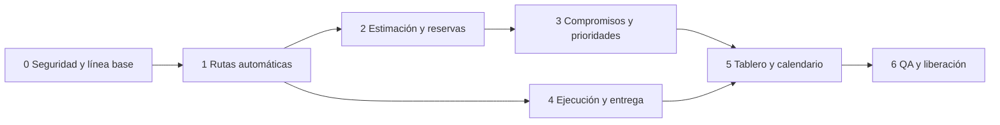

# PrintFlow — historias de usuario y fases de desarrollo de producción

**Versión:** 1.0 · **Fecha:** 10 de octubre de 2026 · **Fuente funcional:** [FSD de producción y trazabilidad](FSD-Produccion-y-Trazabilidad-2026-10-10.md).

Este backlog implementa las reglas acordadas sin reconstruir cotizaciones, descuentos u órdenes en otra arquitectura. Cada historia se cierra con evidencia de prueba; la fase anterior es dependencia de la siguiente cuando comparte datos o permisos. Las estimaciones de esfuerzo se asignarán tras verificar esquema, datos y despliegue reales.

## Principios de entrega

- Extender `ServiceOrderManager::createFromAcceptedQuotation`, `ServiceOrderItem` y `ServiceOrderOperationPlan` actuales.
- Vincular rutas al Producto del cotizador (`CommercialItem`). Investigar la tabla `products` existente antes de crear una relación adicional.
- Mantener importes comerciales en la orden y crear salidas operativas explícitamente libres de dinero.
- Usar nuevas migraciones; no modificar migraciones ya ejecutadas ni sobrescribir cambios locales de otra persona.
- Mantener el cálculo de capacidad, promesa y permisos en Symfony; DayPilot Lite solo muestra datos y solicita cambios.
- No crear movimientos, existencias, reservas o alertas de inventario ni correo automático al cliente en este alcance.

## Fase 0 — seguridad y línea base

**Objetivo:** eliminar la exposición monetaria actual y obtener una base verificable antes de abrir Producción a empleados.

**Estado de ejecución (10 de octubre de 2026):** la separación de importes está implementada en el código local mediante `service_orders.view_commercial`, una migración aditiva y vistas operativas sin campos comerciales. La prueba funcional `ServiceOrderCommercialAccessTest` pasó en la consola local de Uriel con SQLite habilitado: **4 pruebas y 195 aserciones**. Cubre Producción, Operador y Ventas, HTML operativo, denegación de cotización/PDF/precios y el endpoint JSON de reordenamiento. También pasaron `lint:container` y el lint de las cuatro plantillas Twig indicadas en el runbook. Falta verificar migraciones/permisos y el esquema en Hostinger, ejecutar la regresión comercial completa y confirmar las fichas de capacidad con el taller; por ello la Fase 0 sigue abierta.

**Comandos pendientes y despliegue:** seguir [Runbook de validación y deploy en Hostinger](Runbook-Validacion-y-Deploy-Hostinger.md). Sus consultas de base son de solo lectura; la secuencia de despliegue requiere un commit revisado, confirmar la raíz `public/` y revisar el dry run de migraciones. Por instrucción de Uriel, el proceso no crea respaldos.

| ID | Historia | Criterio de terminado |
| --- | --- | --- |
| PF-P0-01 | Como responsable técnico, quiero conocer migraciones aplicadas, tablas, permisos efectivos y datos de equipos por entorno para migrar sin perder historia. | Se documentan estado local/Hostinger, `role_permissions`, versión de esquema, registros existentes y diferencias; ninguna migración histórica se reescribe. |
| PF-P0-02 | Como empleado, quiero consultar órdenes/trabajos sin recibir importes comerciales. | **Validación local aprobada:** `ServiceOrderCommercialAccessTest` pasa con 4 pruebas y 195 aserciones. `service_orders.view` no basta para ver importes; la plantilla los condiciona a `service_orders.view_commercial`, que se asigna a Ventas/Administración. `ROLE_OPERATOR` recibe lectura operativa. Al habilitar nuevas exportaciones, adjuntos o bitácoras para empleados, sus proyecciones y permisos también deberán probarse. |
| PF-P0-03 | Como responsable técnico, quiero una regresión de cotización aceptada → orden única y del cálculo comercial vigente. | Pruebas verifican aceptación, POST con CSRF, doble solicitud, partidas/snapshots, PDF comercial bajo permiso y ausencia de cambios en descuentos. La suite de PHP vuelve a ejecutar en entorno de prueba. |
| PF-P0-04 | Como jefe, quiero confirmar las capacidades de las cinco máquinas antes de prometer fechas. | Ficha validada con unidad, ancho útil, tecnología, rendimiento real inicial y preparación; cualquier dato no confirmado permanece no estimable. |

**Puerta de salida:** ningún rol operativo puede obtener importes mediante `service_orders.view` u otra ruta accesible; esquema y permisos aplicados están documentados; la regresión comercial pasa. No cerrar hasta verificar el entorno real y ejecutar las pruebas funcionales.

## Fase 1 — rutas automáticas por Producto y partida

**Objetivo:** crear una orden con trabajo y ruta técnica ya definidos, sin pedir que el jefe capture cada paso.

| ID | Historia | Criterio de terminado |
| --- | --- | --- |
| PF-P1-01 | Como jefe/Administrador, quiero definir rutas base reutilizables y asignarlas a varios Productos. | Se configuran secuencia, operación activa, condición, obligatoriedad y variantes sencillas; cada Producto publica una versión inequívoca. Un Producto puede ajustar su configuración sin alterar otros. |
| PF-P1-02 | Como jefe/Administrador, quiero tratar por separado Diseño y revisión de archivo del cliente. | Con archivo aportado, la variante omite Diseño pero incluye preprensa; sin archivo requerido, preprensa queda bloqueada con causa y no se reservan pasos posteriores. |
| PF-P1-03 | Como sistema, quiero generar un trabajo y sus pasos por cada `ServiceOrderItem` al crear la orden. | El caso de uso existente genera ruta y snapshot en su transacción; doble clic/concurrencia no duplican orden, trabajo ni planes. Folio y vínculos históricos permanecen. |
| PF-P1-04 | Como jefe, quiero identificar partidas sin ruta o datos completos sin inventar un plan. | La orden se crea y el trabajo muestra causa de «requiere planificación/estimación»; no hay reserva ni pronóstico ficticio. |
| PF-P1-05 | Como jefe, quiero corregir medidas técnicas y dividir una partida cuando producción lo requiera. | Corrección/división solo durante planificación, con permiso, CSRF y motivo; la cotización queda intacta; las hijas sustituyen la fila para Ventas, conservan cantidad/subtotal total y FK original única; revisión de ruta requerida tras corregir medidas. |

**Puerta de salida:** prueba de extremo a extremo desde una cotización aceptada hasta los pasos generados; versiones nuevas no modifican trabajos existentes; la ruta manual actual permanece como excepción autorizada durante la transición.

**Estado local de Fase 1 (10 de octubre de 2026):** PF-P1-01 tiene pantallas y servicios para rutas base y versiones por Producto; falta probar guardar/publicar desde el flujo web. PF-P1-02 está implementada y sus tres pruebas unitarias anteriores pasaron (16 aserciones), incluidos archivo presente/ausente. PF-P1-03 tiene el hook en `ServiceOrderManager::createFromAcceptedQuotation`, pero falta una prueba integrada que cree una orden real desde cotización aceptada; la prueba funcional de permisos crea la orden manualmente. PF-P1-04 registra una causa cuando falta ruta y lo cubre una prueba unitaria. PF-P1-05 ya tiene código local: snapshot técnico independiente, corrección de medidas con motivo y confirmación obligatoria de revisión de ruta; división transaccional de 2–20 filas, cantidad exacta, reparto de centavos, réplica de ruta activa y precios solo en la proyección autorizada de Ventas. Se añadieron pruebas funcionales para división, corrección y denegación de empleados, pero esta sesión no pudo ejecutarlas porque PHP no logró abrir `tests/bootstrap.php` y el comando de Twig lint no pudo leer `.env`; deben repetirse en PowerShell normal. Fase 1 sigue abierta hasta validar migraciones sobre esquema real, probar la interfaz de rutas y cerrar el caso aceptada → orden → ruta. No desplegar aún.

## Fase 2 — estimación, máquinas y calendario laboral

**Objetivo:** convertir cargas físicas en tiempo de máquina y reservar huecos sin solapes.

| ID | Historia | Criterio de terminado |
| --- | --- | --- |
| PF-P2-01 | Como jefe/Administrador, quiero registrar capacidad numérica por equipo/operación y máquinas alternativas. | Unidad, valor, ancho, preparación, eficiencia y vigencia son estructurados; la ficha textual histórica se conserva; equipos inactivos o de operación/área inactiva no se proponen. |
| PF-P2-02 | Como sistema, quiero estimar impresión, laminado y corte con su unidad física correcta. | Pruebas de m²/h, metros lineales/h y cm/s incluyen conversiones, preparación y ancho; piezas o área sin longitud de trayectoria no producen tiempo de corte. |
| PF-P2-03 | Como jefe, quiero dar una estimación manual justificada al corte sin vector medible u otra excepción. | Se guardan actor, motivo, datos disponibles, minutos y versión; el valor manual se distingue del calculado y se puede comparar con tiempo real. |
| PF-P2-04 | Como jefe/Administrador, quiero configurar lunes a viernes 08:00–18:00, feriados, mantenimiento, averías y horas extraordinarias autorizadas. | Agenda excluye fuera de jornada por defecto; excepciones por máquina/fecha muestran actor/motivo y recalculan reservas futuras afectadas. |
| PF-P2-05 | Como sistema, quiero elegir una máquina compatible y reservar tramos diarios respetando la secuencia. | Trabajo de varios días se divide en segmentos; no inicia antes del predecesor; prueba concurrente demuestra cero solapes de máquina. |
| PF-P2-06 | Como jefe, quiero asignar operador después de reservar máquina. | Plan inicial puede tener máquina y no responsable; solo jefe/Administrador asignan o reasignan con historia. |

**Puerta de salida:** casos medidos reales validan el estimador; hay prueba de trabajo de 24 horas distribuido en jornadas de diez horas y de colisión concurrente de reservas.

## Fase 3 — compromisos, prioridades y reprogramación

**Objetivo:** mostrar cuándo se terminará, añadir margen comercial y gestionar urgencias sin interrumpir máquina activa.

| ID | Historia | Criterio de terminado |
| --- | --- | --- |
| PF-P3-01 | Como Ventas, quiero una fecha sugerida de entrega con tres días laborales de margen después del fin previsto. | El cálculo usa calendario del negocio; distingue fin de producción, sugerencia y fecha pactada. Ventas, jefe y Administrador pueden ajustar la fecha con motivo y riesgo visible. |
| PF-P3-02 | Como jefe/Administrador, quiero prioridades Normal, Alta y Urgente. | Normal es predeterminada; Urgente o cambio posterior exigen motivo; el orden de cola tiene desempate estable. |
| PF-P3-03 | Como jefe/Administrador, quiero previsualizar el efecto de una urgencia y confirmarlo. | Se ven máquina, tramos desplazados, nuevas fechas y riesgos; solo reservas futuras no iniciadas se mueven. Activas, mantenimiento y fijadas permanecen. Confirmación audita la versión del plan. |
| PF-P3-04 | Como jefe, quiero detectar riesgo por partida y orden. | Pronóstico, compromiso, holgura y causa generan alerta en tablero/calendario; prioridad y riesgo tienen indicadores distintos. No hay correo automático de alerta. |

**Puerta de salida:** simulación con trabajo activo, reserva futura Normal y nueva Urgente muestra que la Urgente toma el próximo hueco válido, la Normal se reubica sin solapes y ambas fechas/alertas se recalculan; cancelar la vista previa no modifica datos.

## Fase 4 — ejecución, calidad y entrega

**Objetivo:** saber qué se hace, quién lo atiende, qué sigue y por qué se detuvo.

| ID | Historia | Criterio de terminado |
| --- | --- | --- |
| PF-P4-01 | Como operador, quiero ver todos los trabajos y ejecutar solo mis pasos asignados. | GET operativo muestra todos sin importes; POST de paso ajeno se deniega. Estado base: Pendiente, Listo, En curso, Pausado, Bloqueado, Completado. |
| PF-P4-02 | Como jefe/Administrador, quiero registrar y resolver bloqueos, pausas e incidencias. | Cada transición valida estado y pertenencia, exige motivo cuando aplica, conserva actor/UTC e historial y actualiza pronóstico y agenda. |
| PF-P4-03 | Como jefe/Administrador, quiero enviar a retrabajo una operación rechazada en calidad. | Se crea nuevo intento ligado al anterior, sin borrar paso/evento ejecutado; causa, autor y resultado son visibles. |
| PF-P4-04 | Como empleado, quiero consultar material previsto y usado. | Se registra nombre, cantidad y unidad manualmente; no consulta ni modifica stock. |
| PF-P4-05 | Como responsable de producción, quiero cerrar la fabricación y que Ventas confirme la entrega aparte. | «Producción terminada» exige pasos requeridos completos y bloqueos resueltos; solo Ventas con permiso confirma «Entregado». Ningún hito envía correo automático. |
| PF-P4-06 | Como empleado, quiero acceder a archivos de producción autorizados. | Previsualización/descarga requiere permiso en servidor; no se expone ruta física ni PDF comercial, y reemplazos relevantes conservan historia. |

**Puerta de salida:** recorrido completo con dos roles desde orden hasta producción terminada y entrega; transiciones inválidas, acceso a pasos ajenos y descargas no autorizadas se rechazan.

## Fase 5 — tablero y calendario DayPilot Lite

**Objetivo:** dar una vista diaria útil al empleado y herramientas de filtrado/reprogramación al jefe.

| ID | Historia | Criterio de terminado |
| --- | --- | --- |
| PF-P5-01 | Como empleado, quiero ver el día seleccionado con todas las máquinas en columnas. | DayPilot Lite Calendar muestra horas 08:00–18:00 y reservas por máquina, navegación por fecha, estado, tarea activa y alerta; funciona en escritorio y ofrece lectura usable en móvil. |
| PF-P5-02 | Como jefe, quiero filtrar por día, máquina, área, operación, estado, prioridad, responsable, orden, Producto y riesgo. | Filtros se aplican en consulta servidor y resumen; no alteran reservas ni exponen datos comerciales. |
| PF-P5-03 | Como jefe, quiero un resumen semanal por máquina. | DayPilot Lite Scheduler muestra máquinas como filas y lunes a viernes en línea temporal horizontal, con carga libre/reservada/ejecutada y alertas. |
| PF-P5-04 | Como usuario autorizado, quiero abrir una reserva y entender trabajo, paso y próximo destino. | Cada segmento enlaza a detalle operativo y lleva folio, operación, horas, prioridad y riesgo sin importes. |
| PF-P5-05 | Como jefe/Administrador, quiero mover una reserva futura desde calendario con seguridad. | La UI pide vista previa y confirmación; el servidor valida permiso, CSRF, jornada, dependencia, compatibilidad, plan vigente y solapes. Ante conflicto revierte la acción visual. |

**Puerta de salida:** integración local con AssetMapper/Stimulus sin CDN de producción; calendario, JSON y DOM se verifican con cuentas de Operador y jefe. No se incorpora ningún plugin Premium de FullCalendar.

## Fase 6 — QA, datos existentes y liberación

| ID | Historia | Criterio de terminado |
| --- | --- | --- |
| PF-P6-01 | Como responsable técnico, quiero migraciones seguras y reversibilidad documentada. | Se prueban sobre copia de datos, índices/FK y restricciones, permisos semilla, ruta faltante y órdenes históricas sin ruta; no hay cambio destructivo de snapshots. |
| PF-P6-02 | Como responsable de seguridad, quiero demostrar aislamiento comercial. | Matriz de roles comprueba HTML, `data-*`, JSON/AJAX, calendario, PDF, exportación, adjuntos, bitácora y URLs directas; no hay importes ni valores que permitan deducirlos. |
| PF-P6-03 | Como responsable de operaciones, quiero confiar en fechas y trazabilidad. | Pruebas cubren zona UTC/México, feriados, extraordinarios, varios días, máquina en mantenimiento, concurrencia, urgencia, retrabajo, creación única, snapshots y auditoría. |
| PF-P6-04 | Como responsable de despliegue, quiero liberar sin interrumpir el ciclo comercial. | Estado de migraciones, ejecución revisada, compilación AssetMapper, caché y smoke test en Hostinger; se confirma cotización → aceptación → orden y acceso por roles. |

## Orden de implementación y dependencias

La primera entrega utilizable puede cerrar Fases 0–2: orden con ruta, estimación y reservas. La vista operativa y ejecución completa requieren Fases 4–5 antes de exponerlas a empleados. No declarar terminada una fase solo porque su pantalla exista: sus permisos, transacciones, migraciones y pruebas son parte del criterio de terminado.

## Riesgos concretos que gobiernan la planificación

1. **Exposición de precios detectada:** las vistas locales ya condicionan importes con `service_orders.view_commercial`; aún no se confirma si la nueva migración está aplicada en ningún entorno.
2. **Dos modelos de Producto:** el cotizador usa `CommercialItem`; `Product` existe pero no se encontró en la ruta de cotización/orden. Evitar rutas duplicadas y documentar el vínculo futuro si se necesita.
3. **Capacidad textual:** las cinco velocidades sembradas requieren validación y factores reales; no importarlas automáticamente como rendimiento efectivo.
4. **Restricción única de operación por partida:** ruta inicial v1 no repite operación. Retrabajo se modela como intento, preservando historia. Revisar índice si se acuerdan repeticiones de ruta en el futuro.
5. **Estado de entorno no comprobado:** migraciones aplicadas, `role_permissions` y Hostinger deben verificarse antes de modificar datos. PHP 8.2.31 tiene `pdo_mysql`; `pdo_sqlite` no está cargado por defecto. El comando PHPUnit actual no puede abrir `tests/bootstrap.php` dentro de esta sesión, aunque PowerShell sí lo lee. Los comandos exactos para repetir pruebas, lint, inspección de permisos y despliegue están en el runbook; faltan esos resultados desde consola normal y SSH real.
6. **Licencias y legibilidad:** DayPilot Lite cumple día por máquina y semana horizontal por máquina bajo Apache 2.0. Una semana con día × máquina en columnas necesitaría otra composición y no forma parte de esta entrega; FullCalendar Scheduler v3 o actual no constituye una alternativa gratuita para el uso comercial cerrado.
