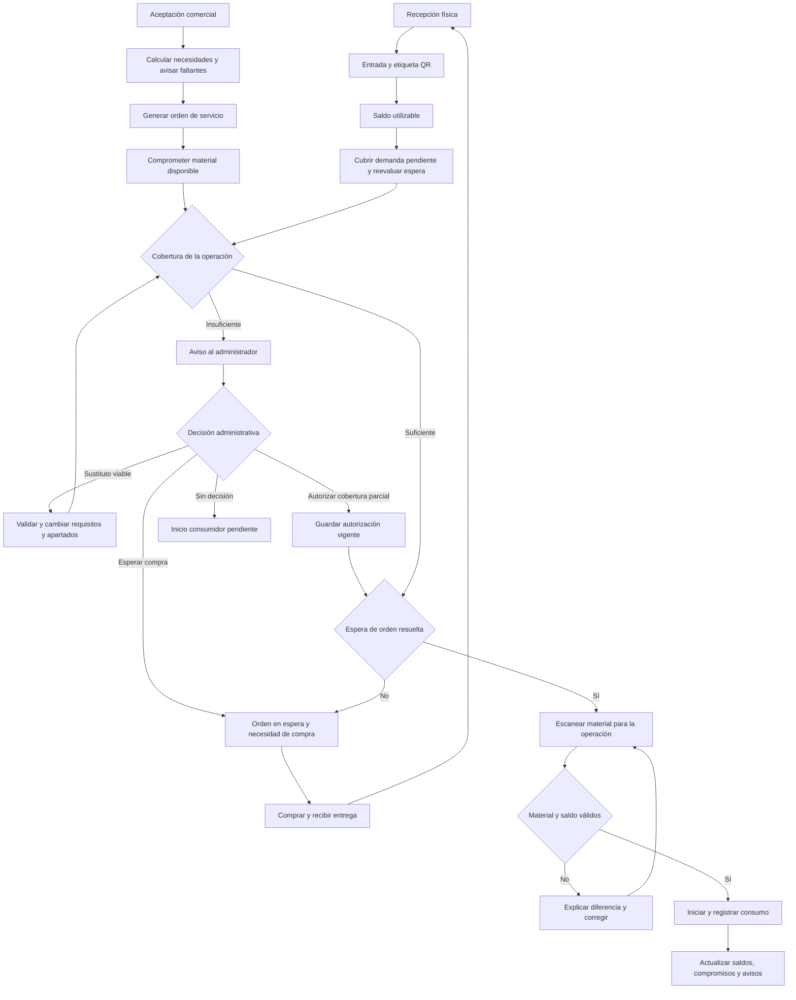

# PrintFlow — estrategia de implementación del módulo de inventario

**Fecha:** 12 de octubre de 2026.
**Estado:** Implementados en código: diagnóstico de catálogo, unidades físicas y recepciones, conteo inicial, mínimos y avisos, compromisos de órdenes, decisiones ante faltantes, sustituciones autorizadas, etiquetas QR, validación de la unidad física por QR y consumo físico en Impresión. El cierre descuenta una vez el QR escaneado, registra consumo y merma, libera la parte aplicada del apartado y permite separar un sobrante con procedencia y etiqueta propia. Al terminar todas las operaciones de una orden, se libera de forma trazable el apartado restante que no se utilizó. También están disponibles el conteo cíclico por unidad QR y su priorización, las operaciones de bloqueo, liberación y retiro en bodega, el recálculo de compromisos al cambiar necesidades y la cancelación trazable de órdenes. La bandeja de reposición agrupa faltantes de órdenes y mínimos, propone proveedor configurado y exporta una solicitud. Las compras en seguimiento y sus recepciones físicas parciales quedan enlazadas sin sumar disponibilidad antes de recibir. Cada solicitud conserva las órdenes en espera que motivaron su preparación, permite dar seguimiento a una fecha estimada o cancelarla antes de recibir, y avisa cuando su cobertura o decisión cambió. El panel de indicadores muestra diferencias de conteo, merma por material, esperas de compra y compras en seguimiento. También se pueden configurar nuevas presentaciones desde el catálogo y el mínimo operativo queda solo en Inventario. Antes del piloto se debe confirmar el SHA, las migraciones y el diagnóstico actuales en `dev`; la salida de PuTTY del 13 de octubre es histórica. Aún no existe producción ni se ha ejecutado el piloto físico.
**Objetivo:** saber cuánto material existe, cuánto está comprometido, cuánto queda disponible y qué hace falta comprar; verificar mediante QR que Impresión utiliza el material correcto para cada orden.

**Corrección de unidad para rollos:** se aplicó la [guía de control lineal de rollos](guia-control-lineal-rollos-inventario.md). La presentación conserva saldo en ML y consumo previsto en m²; Impresión ahora solicita ML previstos para apartar y ML reales para descontar el QR, sin inferirlos del área neta. Las operaciones históricas no se convierten automáticamente y requieren conciliación física si hubo diferencia.

**Lectura QR del piloto:** la cámara integrada ya permite consultar una unidad desde Inventario sin modificar existencias, así como capturar el código en Conteo cíclico, Operaciones de bodega e Impresión. El conteo cíclico solo se usa tras medir físicamente el saldo y queda sujeto a revisión administrativa. La lectura con el dispositivo real y una etiqueta impresa sigue pendiente de validar en `dev`.

**Avance de integración de Impresión:** la previsión de material se captura con la variante en m² (o la unidad de consumo configurada) y se convierte al saldo de inventario al apartar. Si la orden ya está planificada, el apartado se concilia al guardar; si la previsión se captura antes, se aparta al planificar. Cambios posteriores antes de iniciar actualizan el mismo registro previsto y sus reservas. El escaneo y el inicio de Impresión requieren una previsión y un compromiso existentes. La aceptación comercial por sí sola todavía no aporta necesariamente el metraje físico; por eso no se infiere una reserva de la cantidad comercial de la partida.

**Alcance general:** esta estrategia cubre todos los materiales existentes en la base y los que se den de alta posteriormente. Existencias, compromisos, mínimos, avisos, resolución de faltantes con sustitutos o espera de compra, autorización de producción parcial, QR y sobrantes se aplican a cada material controlado, según su variante y configuración. La lona identificada en las consultas es un caso de diagnóstico del estado actual; no define una lista exclusiva de materiales para el módulo.

## 1. Resultado esperado y alcance

El módulo debe ofrecer un ciclo completo: **recibir → identificar → comprometer → validar → consumir → conciliar → reponer**. La prioridad es que las existencias sean confiables y que las tareas diarias requieran pocos pasos.

| Necesidad del negocio | Comportamiento esperado |
| --- | --- |
| Saber cuánto material hay | Consultar existencia física, comprometido pendiente de uso y disponible, siempre con unidad de medida. |
| Apartar material de una orden nueva | Generar compromisos al crear la orden de servicio, sin descontar todavía la existencia física. |
| Avisar cuando se alcanza el mínimo | El administrador configura el mínimo por variante; el sistema avisa cuando el disponible es menor o igual al límite. |
| Avisar inmediatamente por faltantes | Guardar un aviso persistente para el administrador durante la aceptación y actualizarlo al generar la orden. |
| Registrar material | Administrador y personal autorizado de Impresión pueden registrar materiales y entradas físicas. |
| Incorporar materiales nuevos | Tomar unidades y reglas del catálogo de la base; admitir altas nuevas mediante configuración, sin modificar código por cada material. |
| Manejar sobrantes | Conservar saldos de unidades abiertas e identificar sobrantes separados recuperables con cantidad y medidas propias. |
| Producir con faltantes | Aceptar la orden y permitir el inicio de la operación con autorización explícita del administrador. |
| Usar materiales sustitutos | Ofrecer al administrador sustitutos configurados, técnicamente compatibles y con saldo apto; actualizar requisitos y apartados únicamente después de su elección. |
| Esperar la compra del material | El administrador puede poner la orden en **En espera de compra de material**, con necesidad de abastecimiento y seguimiento visibles. |
| Identificar material con QR | Cada unidad física tiene etiqueta, identificador y saldo propios. |
| Evitar usar material equivocado | Comparar el material escaneado con los requisitos vigentes de la operación; explicar cualquier diferencia. |
| Mantener el control | Conservar quién hizo cada movimiento, cuándo, por qué y con qué orden, recepción o conteo se relaciona. |

El primer alcance incluye los materiales existentes en la base, configuración para materiales nuevos, una bodega lógica, entradas, saldos por unidad física, compromisos, avisos, sustitutos configurables, decisiones administrativas ante faltantes, espera de compra, etiquetas, validación en Impresión, consumos, sobrantes y correcciones auditadas. La necesidad de compra ligada a una orden en espera debe estar disponible desde este alcance. Después se incorporan conteos cíclicos y agrupación de reposiciones; compras completas, cuentas por pagar y múltiples almacenes tienen su propia evolución.

## 2. Decisiones de negocio confirmadas

### 2.1 Requisitos expresados por el usuario

- El compromiso empieza al generar una nueva orden de servicio.
- El material comprometido se muestra como **pendiente de uso**.
- El administrador configura el límite mínimo.
- Los faltantes al aceptar una orden deben avisarse inmediatamente en un panel del dashboard administrativo.
- Al registrar o aumentar un faltante, los administradores activos reciben un correo con enlace directo a la decisión de esa orden; requiere transporte de correo configurado.
- Impresión muestra el estado de la cobertura en la cola y en el trabajo: autorización pendiente, espera de compra, producción parcial o sustituto aprobado. La sustitución autorizada también se identifica en la tabla de cobertura de la orden.
- Administrador e Impresión pueden registrar material.
- El QR permite comprobar que el material corresponde a la orden de trabajo.
- El alcance cubre los materiales que ya existen en la base de datos y utiliza las unidades que tienen configuradas.
- El módulo debe admitir materiales nuevos y sus reglas de unidades mediante configuración.
- Los sobrantes forman parte del alcance inicial.
- Una orden con faltantes se acepta y puede producirse con autorización del administrador.
- Algunos materiales pueden sustituirse entre sí; ante un faltante, el administrador puede elegir un sustituto viable cuando exista.
- El administrador también puede poner esa orden en espera de la compra del material faltante.
- Cada rollo, envase, paquete u otra unidad física tiene identificación QR y saldo individuales.

### 2.2 Aplicación de las respuestas recibidas

Las decisiones anteriores sustituyen las propuestas iniciales del documento. Las siguientes reglas indican cómo implementarlas; los equipos concretos de lectura y la ubicación única siguen siendo propuestas técnicas.

| Tema | Decisión y aplicación | Verificación necesaria |
| --- | --- | --- |
| Materiales y unidades | Partir de todos los materiales de la base, distinguir activos/inactivos y aplicar a cada variante sus unidades de compra, inventario y consumo. El piloto escalona la activación, no limita el catálogo a una lista fija. | Consultar la base real, conciliar campos legados y detectar conversiones faltantes. |
| Materiales nuevos | Habilitar altas configurables con unidad, presentación, precisión, conversiones, control físico y mínimo. | Comprobar un material nuevo que no existía al desarrollar el módulo. |
| Órdenes con faltantes | Aceptar, comprometer lo disponible y avisar. La operación consumidora puede iniciar después de autorización administrativa vigente para esa necesidad e intento. | Probar solicitud, autorización, rechazo, revocación y cambios del requerimiento. |
| Sustitutos | Configurar compatibilidad por variante y contexto; presentar alternativas viables y recalcular cantidades antes de que el administrador confirme una. | Comprobar aptitud técnica, disponibilidad real, reserva atómica y QR del sustituto aprobado. |
| Espera de compra | Mantener la aceptación comercial y poner la orden en espera explícita; registrar qué comprar y reevaluar cobertura al recibir físicamente. | Impedir nuevos inicios/reanudaciones durante la espera; una compra solicitada no aumenta stock ni retira la espera. |
| QR por unidad física | Identificar individualmente rollos, envases, paquetes y sobrantes separados; saldo consultado en servidor. Proponer celular y lector USB hasta confirmar los equipos disponibles. | Probar que dos unidades de la misma variante conservan saldos distintos. |
| Sobrantes | Conservar remanente de una unidad abierta y crear unidad hija con QR para un sobrante separado reutilizable. | Cantidad, dimensiones, procedencia y conservación física sin duplicar inventario. |
| Ubicación | Una bodega lógica de Producción, siguiendo el alcance del modelo existente. Un texto opcional de estante facilita encontrar material. | Varias bodegas requieren saldos, mínimos y transferencias por almacén. |

**Regla confirmada:** un faltante permite aceptar la orden; producir con esa cobertura insuficiente exige autorización del administrador. La autorización conserva el faltante visible y permite continuar el trabajo con cobertura parcial. Las cantidades físicas se registran a partir de recepciones, mediciones y consumos reales.

**Decisión administrativa ampliada:** al atender el faltante, ofrecer **Usar sustituto viable**, **Poner orden en espera de compra** y la opción ya confirmada **Autorizar producción con faltante**. La primera exige compatibilidad comprobada; la segunda detiene nuevos inicios de la orden; la tercera permite avance parcial dentro de su alcance. Ninguna elección sustituye el registro de existencias reales.

## 3. Punto de partida del repositorio al elaborar la estrategia

Esta sección conserva el diagnóstico inicial del 12 de octubre; las brechas descritas aquí pueden estar resueltas en el código actual. El estado actualizado está al inicio del documento y la validación del servidor figura en la [guía del piloto](operacion-inventario-piloto-y-salida.md). La estrategia se basó en el código local revisado y en las consultas compartidas por el usuario desde PuTTY. La base reportada fue `u692972268_printflow_dev`, con motor `11.8.9-MariaDB-log`. La sección 3.2 recoge los materiales, unidades y conteos observados; esa evidencia corresponde a la base identificada y no certifica otro ambiente. El [diagnóstico de solo lectura](consulta-inventario-materiales-unidades.sql) queda disponible para repetir o completar la revisión.

| Base existente | Uso en la implementación |
| --- | --- |
| PHP 8.2, Symfony 7.4, Doctrine ORM, Twig, Stimulus/AssetMapper y `brick/math` | Mantener el monolito y los patrones actuales; calcular cantidades con decimales exactos. |
| `Material`, `MaterialVariant`, unidades y conversiones | Reutilizar el catálogo; operar saldos y mínimos sobre variantes concretas. |
| `InventoryLot`, `InventoryMovement`, `MaterialVariantCost` y `MovementType` | Completar el dominio y los servicios; no recrear tablas que ya aparecen en migraciones. |
| `MaterialVariant.minimumStock`, `reorderPoint` y `reorderQuantity` | Usar el mínimo de variante como política operativa y preparar la reposición. |
| `ServiceOrderManager::createFromAcceptedQuotation()` | Punto de integración para requisitos y compromisos de material de la orden. Ya utiliza transacción y bloqueo de la cotización. |
| `QuotationManager::accept()` y controlador de cotizaciones | Punto de comprobación y aviso inmediato durante la aceptación comercial. |
| `PrintingManager::validateScans()` | Ya compara máquina y variante leídas contra lo previsto; extenderlo a unidad física, lote, condición y saldo. |
| `PrintingManager::start()` y `ProductionExecutionManager` | Revalidar disponibilidad dentro de la transacción que inicia la operación. |
| `PrintingManager::configureRequirements()` | Permite cambiar material antes de iniciar, pero rechaza planes bloqueados y planes con ejecución abierta/completada. Integrar resolución administrativa de espera y tratamiento del pendiente sin reescribir ejecuciones previas ni saltarse otros bloqueos. |
| `ProductionIncidentManager`, pausas y agenda | Coordinar esperas y replanificación. Una ejecución en curso necesita pausa previa; un bloqueo de material debe conservar los motivos ajenos a inventario. |
| `PrintingManager::complete()` y `ProductionMaterialUsageManager` | Impresión ya contabiliza el QR físico en una única transacción; extender el mismo servicio a capturas parciales y flujos manuales autorizados sin duplicar movimientos. |
| `ProductionMaterialUsage` | Puede guardar variante, lote y movimiento. Los registros manuales actuales también admiten material/unidad como texto y referencias nulas; necesitan conciliación. |
| `DashboardController` y `templates/dashboard/index.html.twig` | Añadir consulta de avisos y panel administrativo; actualmente no existe el panel de inventario. |
| Permisos, `PermissionVoter`, auditoría y trazabilidad de órdenes | Reutilizar control de acceso y evidencia de cambios. |

Hay tres diferencias que deben resolverse desde el inicio:

1. **Aceptación y creación de orden son acciones separadas en el código.** Aunque la documentación de Producción resume el flujo como aceptación → orden, el controlador de aceptación no invoca al creador de órdenes. Se necesitan dos puntos de comprobación para cumplir el aviso inmediato y el compromiso posterior.
2. **El formulario actual de materiales sigue escribiendo el mínimo legado de `Material`.** Existe también el mínimo de `MaterialVariant`. La nueva interfaz debe tener una sola fuente operativa por variante y un tratamiento explícito del valor legado.
3. **La BOM existente pertenece a `Product`, mientras las órdenes operan con `CommercialItem`.** No hay que asumir que esa receta ya calcula el material de la orden. Se necesita una relación explícita o una configuración de necesidades sobre el producto comercial utilizado.

El renderizador de etiquetas y los QR de inventario usan `endroid/qr-code`, declarado en `composer.json` y fijado en `composer.lock`. En cada servidor debe comprobarse que Composer haya instalado el paquete antes de imprimir o escanear etiquetas.

Consultar el [modelo previo de inventario](inventory-model/README.md) y el [estado de Producción](produccion-trazabilidad/estado-actual.md). El primero aporta conceptos; este documento fija el orden de trabajo y las integraciones que todavía faltan. Su recomendación antigua de contabilizar automáticamente consumos estimados debe revisarse según las reglas de medición de esta propuesta.

### 3.1 Catálogo de la base y adaptación a materiales nuevos

La fuente es `materials` y sus `material_variants`, junto con `measurement_units` y conversiones específicas. Obtener una matriz de material, variante, estado, presentación, unidades de compra/inventario/consumo, factores, dimensión, precisión, permiso de fracciones y requisitos de lote/caducidad. Marcar atributos desconocidos como pendientes de configurar; no deducirlos del nombre.

Cuando exista una variante válida, sus unidades gobiernan el inventario. Si un material solo conserva la unidad legada, crear/configurar su variante de forma explícita con esa información, sin asumir que compra y consumo tienen la misma unidad o inventar un factor.

El alta de material nuevo debe usar el mismo flujo que los existentes: seleccionar unidades del catálogo o dar de alta una unidad con permiso administrativo, definir presentación/conversiones, indicar precisión y atributos físicos, configurar mínimo y empezar a recibir unidades identificadas. Antes de habilitar reservas automáticas, validar las conversiones que realmente necesita su orden. Administrador e Impresión pueden registrar el material; las reglas de unidades y mínimos mantienen permisos propios.

Los formularios se adaptan a configuración de variante y dimensión: cantidad para unidades contables, ancho/largo cuando se necesita superficie, volumen para líquidos, peso cuando corresponda. No mantener listas de nombres como “si es vinil” o “si es tinta” en el código. Un requisito técnico de impresión sigue usando sus atributos concretos y compatibilidad, no solo la dimensión.

Conservar materiales inactivos para historial. Marcar explícitamente los materiales que no mantienen stock y las operaciones sin consumo; no generar reservas ficticias para ellos. La conciliación de la etapa 0 cubre todo el catálogo existente y deja identificadas las configuraciones que necesitan revisión.

### 3.2 Diagnóstico con los resultados recibidos de la base

**Fuente:** salidas pegadas por el usuario de las consultas 1–6 del diagnóstico. No se realizó una nueva conexión directa ni se modificó la base.

Este diagnóstico recoge únicamente los registros visibles en los resultados recibidos. La configuración específica de la lona sirve para verificar el tratamiento de datos legados. Los servicios, pantallas y etapas descritos en el resto del documento deben funcionar también para otras presentaciones, dimensiones y materiales nuevos mediante configuración, sin depender del código o nombre de esa lona.

| Dato observado | Resultado | Implicación para el módulo |
| --- | --- | --- |
| Base | `u692972268_printflow_dev` | Identificar este destino en el ensayo y comprobar por separado el ambiente de despliegue. |
| Motor | `11.8.9-MariaDB-log` | Validar migraciones y concurrencia en MariaDB 11.8, con tablas transaccionales; no dar por comprobado el comportamiento mediante SQLite. |
| Material mostrado | `LONA-FRONT-13OZ` — Lona frontal de 13 onzas | Reutilizar su identidad; no crear otra lona solo para duplicar el catálogo. |
| Variante mostrada | ID `1`, `LONA-FRONT-13OZ-DEFAULT`, activa | Es la presentación existente que debe revisarse antes del primer saldo. No se recibió un listado que pruebe variantes adicionales. |
| Compra / inventario / consumo | `PZA` / `PZA` / `PZA` | Hoy el sistema expresa las tres cantidades en piezas. No interpretarlas automáticamente como rollos, metros lineales o m². |
| Factores de variante | `1.000000000000` y `1.000000000000` | Son equivalencias entre las unidades configuradas; no indican la longitud, superficie ni contenido de una pieza. |
| Mínimo de variante | `10.000000 PZA` | Es un umbral configurado, no una existencia de 10 piezas. Administrador debe revisar su significado después de definir la presentación real. |
| Control de lote / caducidad | `0` / `0` | La variante no los exige actualmente. El QR individual y la recepción siguen siendo obligatorios para el módulo nuevo. |
| Especificaciones de variante | `{"legacy_migration": true}` | Solo se evidencia la marca de migración. No se aportaron ancho, largo ni otras dimensiones para calcular consumo o aptitud de retazos. |
| Registros en `inventory_lots` | `0` | No hay lotes registrados en la salida recibida. |
| Registros en `inventory_movements` | `0` | No hay movimientos registrados en la salida recibida; no demuestra que la bodega esté físicamente vacía. |

**Límites de la evidencia:** la consulta 2 se reportó sin resultados y las salidas rotuladas como 3 y 4 son idénticas y tienen estructura de variantes. Esto confirma la configuración de la variante mostrada, pero no permite verificar por separado los campos legados, el estado del material general, el inventario completo de columnas, sus índices ni el motor de almacenamiento de las tablas. Antes de generar migraciones, completar esa inspección con la consulta 2 o las alternativas comentadas en el diagnóstico. No inferir ausencia de tablas a partir de esa salida vacía.

#### Catálogo de unidades recibido

Se recibieron **20 unidades**, todas con estado activo. La siguiente tabla conserva sus códigos, dimensión, base, factor y reglas de precisión; los IDs son los reportados por la base.

| ID | Código | Nombre | Símbolo | Dimensión | Unidad base | Factor hacia base | Decimales | Fracciones |
| ---: | --- | --- | --- | --- | --- | ---: | ---: | --- |
| 2 | `PZA` | Pieza | pza | `COUNT` | — | `1.000000000000` | 0 | No |
| 1 | `M2` | Metro cuadrado | m² | `AREA` | — | `1.000000000000` | 4 | Sí |
| 21 | `CM2` | Centímetro cuadrado | cm² | `AREA` | `M2` | `0.000100000000` | 4 | Sí |
| 10 | `ML` | Metro lineal | m | `LENGTH` | — | `1.000000000000` | 4 | Sí |
| 19 | `CM` | Centímetro | cm | `LENGTH` | `ML` | `0.010000000000` | 4 | Sí |
| 20 | `MM` | Milímetro | mm | `LENGTH` | `ML` | `0.001000000000` | 4 | Sí |
| 11 | `HORA` | Hora | h | `TIME` | — | `1.000000000000` | 2 | Sí |
| 24 | `MIN` | Minuto | min | `TIME` | `HORA` | `0.016666666667` | 2 | Sí |
| 12 | `SERV` | Servicio | serv. | `COUNT` | — | `1.000000000000` | 0 | No |
| 13 | `PAQ` | Paquete | paq. | `COUNT` | — | `1.000000000000` | 0 | No |
| 14 | `JGO` | Juego | jgo. | `COUNT` | — | `1.000000000000` | 0 | No |
| 29 | `BOTELLA` | Botella | bot. | `COUNT` | — | `1.000000000000` | 0 | No |
| 25 | `ROLLO` | Rollo | rollo | `COUNT` | — | `1.000000000000` | 0 | No |
| 26 | `HOJA` | Hoja | hoja | `COUNT` | — | `1.000000000000` | 0 | No |
| 27 | `CAJA` | Caja | caja | `COUNT` | — | `1.000000000000` | 0 | No |
| 28 | `CARTUCHO` | Cartucho | cart. | `COUNT` | — | `1.000000000000` | 0 | No |
| 17 | `L` | Litro | L | `VOLUME` | — | `1.000000000000` | 4 | Sí |
| 22 | `MLT` | Mililitro | mL | `VOLUME` | `L` | `0.001000000000` | 4 | Sí |
| 18 | `KG` | Kilogramo | kg | `MASS` | — | `1.000000000000` | 4 | Sí |
| 23 | `G` | Gramo | g | `MASS` | `KG` | `0.001000000000` | 4 | Sí |

Aplicaciones concretas:

- Reutilizar `M2`, `ML`, `ROLLO`, `L`, `MLT` y las demás unidades existentes cuando una presentación las requiera; no insertar duplicados por abreviaturas distintas.
- Distinguir `ML` (metro lineal) de `MLT` (mililitro); código y dimensión deben viajar juntos en formularios y cálculos.
- `PZA`, `ROLLO`, `PAQ`, `CAJA`, `BOTELLA` y `CARTUCHO` no admiten fracciones según esta configuración. El saldo de contenido de un objeto abierto necesita una unidad medible configurada; no representarlo como `0.35 PZA` o `0.35 ROLLO`.
- Que dos unidades `COUNT` tengan factor 1 y no tengan unidad base no establece equivalencia entre sus presentaciones. Configurar contenido por variante para convertir rollo → longitud/superficie, envase → volumen y paquete → hojas.
- La precisión de captura/presentación procede del catálogo: 0 para las unidades contables mostradas, 4 para longitud/área/volumen/masa y 2 para tiempo. La precisión interna del libro y los cálculos puede ser mayor; no habilitar fracciones prohibidas por usar `DECIMAL`.
- `HORA`/`MIN` y `SERV` pertenecen normalmente a tiempos y servicios; su presencia en el catálogo no obliga a inventariarlos físicamente. Aplicar el indicador de control de stock del material y las necesidades productivas reales.

#### Preparación específica de la lona existente

Antes de su primera entrada, establecer qué objeto representa **una PZA** de `LONA-FRONT-13OZ-DEFAULT`: una pieza completa, un corte o una presentación recibida. Registrar sus medidas cuando el aprovechamiento dependa de ellas. La información recibida no permite elegir esa interpretación automáticamente.

Si la recepción realmente es por rollo y el consumo es parcial, la configuración recomendada es compra en `ROLLO` y saldo/consumo en `ML` o `M2` según cómo trabaje el taller, con ancho/largo y factores comprobados. Esta es una alternativa de configuración pendiente de validación física, no un cambio ya autorizado de la unidad existente. Aprovechar que no se reportan movimientos para resolverlo antes del saldo inicial, preservando referencias y snapshots de órdenes/cotizaciones que pudieran existir.

Si `PZA` es correcta para piezas completas, conservarla y registrar cada objeto con sus dimensiones. Los recortes recuperables deben tener representación medible compatible y su QR propio; no aumentar piezas fungibles de la misma variante al dividir un objeto en dos retazos. Comprobar conservación en superficie y aptitud para la siguiente orden.

La configuración final fija también la unidad del mínimo. El valor actual es 10 piezas: si cambia la unidad operativa, el administrador debe establecer o convertir el umbral con equivalencia física comprobada; no conservar el número 10 interpretándolo automáticamente como 10 metros o 10 m².

**Inicio del inventario:** realizar conteo físico por unidad identificada y registrar ese saldo inicial. Si el conteo es cero, confirmar el estado contado y el saldo cero sin insertar un movimiento de cantidad cero. Mientras no haya conteo, mostrar **Por contar**, conservar la existencia como desconocida y limitar reservas/consumos automáticos sobre ese material; un administrador puede autorizar el trabajo con faltante conforme a la sección 5.6, manteniendo conciliación física.

### 3.3 Archivo de referencia del cliente y datos de ensayo

El libro `base de datos.xlsx` proporcionado el 13 de octubre de 2026 enumera productos, máquinas y lógica general de costeo, pero no contiene existencias ni conversiones verificables. Sus cifras de ancho no indican unidad. Por tanto, no modifica la interpretación pendiente de `PZA`, no acredita stock físico y no justifica sustituciones entre viniles o lonas. Los [tres casos sintéticos del piloto](datos-prueba-piloto-inventario.md) permiten ensayar recepción, sobrante, sustitución y espera de compra en `dev` sin presentar cantidades inventadas como datos del cliente.

## 4. Reglas del inventario

### 4.1 Material, variante, lote y unidad física

- **Material:** concepto técnico, por ejemplo vinil imprimible blanco.
- **Variante:** presentación y atributos concretos: marca, acabado, adhesivo, ancho y unidades. Es la identidad que se compromete y controla.
- **Lote:** procedencia de una recepción, con datos de fabricante y caducidad cuando apliquen.
- **Unidad física:** rollo, envase, paquete, pieza agrupada o retazo específico, con identificador QR y saldo propio desde el primer alcance.

Dos rollos de la misma variante pueden tener cantidades restantes diferentes. Un lote puede contener varios rollos. La etiqueta por unidad física no obliga a inventar un lote de fabricante para materiales que no lo controlan.

### 4.2 Saldos y demanda

Para una variante, en su unidad canónica de inventario:

```text
existencia_fisica = entradas físicas - salidas físicas
utilizable        = existencia_fisica - cantidad_bloqueada
comprometido      = material utilizable apartado y todavía pendiente de uso
disponible        = utilizable - comprometido

necesidad_pendiente = max(0, cantidad_requerida_vigente - cantidad_ya_consumida_aplicable)
faltante_orden      = max(0, necesidad_pendiente - compromiso_pendiente_de_esa_orden)
```

La cantidad bloqueada sigue físicamente en bodega, pero no puede usarse: material dañado, caducado o en revisión. Mostrarla por separado. Una compra pendiente no incrementa la existencia ni el disponible.

**Invariantes:** `existencia_fisica >= 0`, `cantidad_bloqueada >= 0`, `comprometido >= 0`, `cantidad_bloqueada + comprometido <= existencia_fisica`. Si un lote reservado deja de ser utilizable, la misma transacción debe reducir o reasignar el compromiso afectado, actualizar faltantes y avisar.

Ejemplo ilustrativo sin bloqueos:

| Evento | Físico | Comprometido pendiente de uso | Disponible | Faltante de la orden nueva |
| --- | ---: | ---: | ---: | ---: |
| Saldo inicial | 100 m | 30 m | 70 m | — |
| Se crea una orden que requiere 80 m | 100 m | 100 m | 0 m | 10 m |
| Se reciben 25 m y se cubre ese faltante | 125 m | 110 m | 15 m | 0 m |
| La orden nueva consume los 80 m previstos | 45 m | 30 m | 15 m | 0 m |

En la primera reserva se comprometen 70 m, no 80 m. Los 10 m restantes son demanda pendiente de abastecimiento. Así se informa el problema sin crear inventario negativo ni apartar dos veces el mismo material.

### 4.3 Libro de movimientos

El saldo se explica mediante movimientos inmutables. Una proyección de saldos acelera las consultas y se actualiza en la misma transacción. Guardar también eventos inmutables de bloqueo/desbloqueo, con cantidad, objeto físico y motivo: reconstruir físico y comprometido desde el libro, y la cantidad bloqueada desde esos eventos y la condición vigente de los objetos.

| Operación | Efecto físico | Efecto sobre compromisos |
| --- | --- | --- |
| Recepción física o saldo inicial confirmado | Aumenta | Puede cubrir necesidades pendientes mediante reservas separadas. |
| Reserva de material | No cambia | Aumenta. |
| Liberación por reducción/cancelación | No cambia | Disminuye. |
| Consumo productivo confirmado | Disminuye | Libera la porción de compromiso utilizada, en la misma transacción. |
| Devolución de material realmente retirado | Aumenta | Se reserva de nuevo solo si existe demanda vigente. |
| Merma fuera de un consumo productivo | Disminuye | Reasigna/libera reservas afectadas y genera faltantes cuando corresponda. |
| Ajuste por conteo | Aumenta o disminuye | Recalcula la cobertura afectada. |
| Compra solicitada o factura recibida | No cambia | No cambia. |

Mantener la convención existente: `RESERVATION` tiene cantidad negativa y `RELEASE` positiva. El comprometido equivale al negativo de la suma de ambos tipos. Excluir esos tipos del saldo físico; no sumar indiscriminadamente todos los movimientos.

El consumo real es **material total utilizado, incluida la merma**. Si se consumen 12 m y 2 m fueron desperdicio, la salida física es 12 m; el desperdicio es un desglose. No generar otra salida de 2 m. Una merma de almacén independiente sí requiere su propio movimiento.

Corregir mediante movimientos compensatorios vinculados al original, con motivo y responsable. No editar ni borrar recepciones o consumos confirmados. Una reimpresión de QR tampoco genera entrada, salida ni reserva.

### 4.4 Unidades y aprovechamiento

Respetar la unidad canónica configurada en la base por variante y conservar la cantidad/unidad capturada y el factor utilizado como evidencia. Conciliarla antes de activar inventario si tiene datos legados ambiguos. Bloquear su cambio una vez que existan movimientos; una corrección de unidad requiere una transición revisada.

Los siguientes son ejemplos de configuración, no sustituyen las unidades de la base:

- Rollos: si la variante usa **metros lineales**, mantener ancho y longitud; si usa **m²**, respetar superficie y comprobar geometría.
- Papel: si se controla en **hojas**, usar el factor por paquete configurado.
- Tinta: si se controla en **mililitros de volumen**, distinguirlos de metros lineales y usar la equivalencia del envase.
- Piezas: validar cantidad entera cuando la unidad de la base no admite fracciones.

Ejemplo: un rollo de 1.52 × 50 m equivale a 50 m lineales o 76 m². Que una orden tenga 8.4 m² de área neta no demuestra que consumirá exactamente `8.4 / 1.52` m lineales: hay márgenes, separación, orientación, repeticiones y distribución de piezas. Congelar una estimación técnica reproducible y revisar el consumo al preparar producción.

Un retazo de 1 m² con ancho insuficiente no cubre automáticamente cualquier necesidad de 1 m². Comprobar dimensiones aprovechables y continuidad requerida; el control de sobrantes forma parte del módulo. No declarar cobertura únicamente por suma de áreas.

Usar `DECIMAL(20,6)` para cantidades y precisión intermedia suficiente para conversiones, siguiendo el modelo existente; utilizar `BigDecimal`, evitar `float` y definir el redondeo por unidad. Una reserva puede redondearse hacia arriba al incremento operativo; nunca cambiar cantidades históricas por una conversión posterior.

### 4.5 Sobrantes y conservación física

Distinguir tres resultados: **remanente en la misma unidad** (rollo/envase abierto), **sobrante separado reutilizable** (retazo, hojas sueltas o contenido recuperado) y **merma definitiva**. El primero mantiene QR y saldo; el segundo obtiene QR propio, vínculo con la unidad original y medidas verificables; el tercero forma parte del consumo/merma y deja de estar disponible.

Capturar o confirmar sobrantes al registrar consumo. Expresar la conservación en una magnitud física compatible:

```text
cantidad_antes = consumo_total_incluida_merma_definitiva
              + remanente_en_la_unidad_original
              + sobrantes_separados_recuperables
```

Ejemplo ilustrativo en superficie: de 7.6 m² iniciales quedan 3.8 m² en el rollo, se consumen 2.8 m² incluyendo merma y se recupera un retazo de 1 m². La existencia restante es 4.8 m² distribuida entre rollo y retazo. El retazo no es una compra ni una segunda entrada por toda la cantidad original.

Crear la unidad hija y redistribuir el saldo pendiente en una transacción. Si el consumo previo ya descontó el material que se recupera, registrar una recuperación vinculada a esa salida; si todavía forma parte del saldo, dividirlo sin aumentar el agregado. No aplicar ambos caminos al mismo sobrante.

Guardar material/variante de origen, unidad física padre, recepción/lote, orden/operación de origen, condición, cantidad, medidas útiles y responsable. Para envases, medir remanente o pesar/convertir mediante método configurado; una equivalencia estimada permanece identificada.

Si la unidad canónica original no representa un retazo sin perder información —por ejemplo, metros lineales de ancho completo frente a un recorte angosto—, mantener ese sobrante en una presentación/unidad compatible explícita, con conversión por geometría verificable. No sumar su longitud como si tuviera el ancho original. Conservar la procedencia y comprobar conservación en área, volumen o peso según aplique. Esa configuración evita imponer una unidad distinta a los materiales que ya existen.

La selección de material propone primero sobrantes compatibles cuando no afectan calidad o continuidad, luego unidades abiertas y después cerradas, respetando caducidad y reservas. No mezclar retazos para cubrir un trabajo que exige pieza continua. La preferencia por reutilizar nunca autoriza una sustitución técnica por sí sola.

### 4.6 Sustitutos configurables y compatibilidad

Mantener reglas administradas de **variante requerida → variante sustituta**, con estado activo, versión, motivo técnico y restricciones del contexto: producto comercial, operación, máquina, uso final, dimensiones, color, acabado, adhesivo, espesor u otros atributos aplicables. Registrar únicamente los atributos necesarios para ese material. Una relación puede ser recíproca cuando se configure en ambos sentidos; no inferir reciprocidad ni encadenar A → B → C para autorizar A → C.

La misma categoría, nombre parecido o unidad de medida no demuestra que dos materiales sean intercambiables. Si faltan atributos o una regla comprobada, mostrar **Compatibilidad pendiente de configurar** y excluir esa opción de los sustitutos viables. Las consultas recibidas no permiten establecer un sustituto real para la lona mostrada; la configuración cubrirá los materiales actuales y los nuevos cuando se registren equivalencias verificadas.

Para cada candidato, calcular la necesidad usando su presentación, ancho, rendimiento, conversiones y merma correspondientes. Reutilizar el resolvedor de necesidades; no asumir una equivalencia de cantidad 1:1. Una conversión de unidades expresa magnitudes; una regla de sustitución expresa aptitud técnica: ambas deben cumplirse.

Un sustituto **viable con cobertura completa** cumple la regla vigente, está activo, tiene unidades físicas aptas para el trabajo y saldo libre suficiente después de los compromisos de otras órdenes. Comprobar dimensiones, continuidad y caducidad prevista, incluidos los sobrantes. Presentar primero estas alternativas. Si se ofrece un candidato compatible con cobertura parcial, rotular el déficit y exigir también autorización administrativa para ese nuevo faltante; no presentarlo como solución completa.

Mostrar al administrador diferencias relevantes frente al material original, cantidad recalculada, saldo reservable, cobertura, ubicación y efecto conocido en costo o proceso según permiso. Ordenar por cobertura y ajuste técnico, con preferencia por sobrantes aptos; la elección siempre es explícita. Conservar la especificación comercial original y verificar si el cambio afecta compromisos con el cliente o exige revisar Diseño/ruta antes de habilitar producción.

## 5. Flujo operativo propuesto



### 5.1 Recibir material

1. En un único formulario **Recibir material**, indicar si el material **acaba de llegar** o **ya estaba en bodega**. Buscar el material del catálogo y seleccionar su variante o ancho; cada objeto físico se registra una sola vez con su origen auditado. El formulario anterior de existencias previas ya no es una operación separada.
2. Capturar cantidad y unidad de recepción; mostrar inmediatamente su equivalencia en la unidad de inventario.
3. Registrar proveedor/documento cuando se conozcan. Solicitar lote y caducidad solo cuando sean aplicables. Una entrega física sin factura puede registrarse como recepción provisional; la factura posterior no vuelve a sumar existencias.
4. Crear las unidades físicas con identificación individual. Para varios rollos iguales, capturar cantidad y longitud una sola vez, generando un identificador por rollo; permitir corregir medidas individuales antes de confirmar.
5. Confirmar una sola vez: entrada, saldo, unidades y cobertura de faltantes se guardan atómicamente. El responsable queda identificado sin capturarlo manualmente.
6. Mostrar **Imprimir etiquetas** y **Registrar otra entrada**. Si falla la impresora o el QR, la recepción permanece confirmada y la etiqueta puede reintentarse sin duplicar stock.

Impresión debe poder registrar entradas ordinarias sin esperar aprobación administrativa por cada recepción. Ajustes, mínimos, costos sensibles y cambios de conversiones tienen permisos propios.

### 5.2 Aceptar la cotización y generar la orden

**Durante la aceptación:** resolver necesidades a partir de los datos comerciales y comprobar disponibilidad en ese momento. Guardar el aviso de faltante dentro de la misma transacción que confirma la aceptación. Si faltan reglas, variante o dimensiones, avisar **Necesidad de material sin determinar**; no interpretar un cálculo ausente como necesidad cero. Esta comprobación informa, pero aún no reserva.

**Durante la creación de la orden:** resolver/congelar las necesidades por partida y operación; volver a leer los saldos bajo bloqueo, comprometer lo utilizable y guardar el faltante restante. La transacción incluye requisitos, reservas, actualización de saldos, aviso y trazabilidad de la orden. No reservar mediante un proceso diferido ni al abrir la pantalla.

El aviso de aceptación se actualiza y vincula a la orden al convertirla; no se duplican avisos del mismo faltante. Si el material dejó de estar disponible entre ambas acciones, se informa la nueva cobertura. Un error técnico revierte la operación completa; un faltante de negocio se registra como un resultado válido según la política confirmada. La resolución administrativa se realiza desde el aviso o la solicitud de la sección 5.6. Antes de existir la orden, el aviso comercial muestra alternativas y necesidad de compra; aplicar cambios de requisitos o espera productiva exige crear/vincular la orden, sin modificar silenciosamente la cotización aceptada.

Para estimar automáticamente, configurar necesidades de material por `CommercialItem`, opciones comerciales y paso productivo. Utilizar métodos controlados: cantidad fija por orden, por pieza, área o longitud, con merma planeada y versión de cálculo. No introducir fórmulas de código arbitrarias.

La selección debe llegar a una variante concreta apta para comprometer. Si solo se conoce el material general, mostrar las variantes permitidas y solicitar la selección autorizada. El estado **Sin determinar** permanece visible y bloquea la operación consumidora hasta completar su requisito. Antes del piloto, los productos incluidos deben tener necesidades resueltas desde la creación de la orden.

Los servicios u operaciones que no consumen inventario deben configurarse explícitamente como **No aplica material**. Distinguir esa decisión de una receta faltante para evitar avisos y bloqueos innecesarios.

### 5.3 Cambiar o cancelar una orden

- **Modificar medidas, cantidades, material o ruta:** crear una nueva revisión de necesidades y aplicar únicamente la diferencia pendiente; conservar consumos ya realizados e invalidar escaneos y autorizaciones de faltante afectados. Actualizar causas de espera y necesidades de compra a esa revisión; volver a comprobar cualquier sustitución cuyo contexto técnico haya cambiado.
- **Dividir una partida:** redistribuir compromisos entre las partidas resultantes sin duplicar la demanda original. Recalcular cualquier merma fija adicional de forma explícita y avisar si aumenta el requerimiento.
- **Quitar una operación consumidora:** liberar sus compromisos pendientes; no revertir material que ya se utilizó.
- **Cancelar:** liberar solo material no consumido y cerrar esperas/necesidades de compra de esa demanda. Revisar compras ya cursadas en vez de cancelarlas automáticamente. Una cotización aceptada aún sin orden retira su aviso de demanda cuando se cancele legítimamente.
- **Retrabajo:** crear necesidad adicional vinculada al intento autorizado; no reutilizar como saldo libre el material que ya se consumió.
- **Orden terminada:** liberar compromisos residuales cuando se confirme que no quedan operaciones consumidoras pendientes.

El código actual no aporta un ciclo completo de cancelación de orden para este módulo. Implementar el caso de uso y su permiso de forma explícita si se incluye; no añadir estados ficticios al enum de planificación existente.

### 5.4 Escanear e iniciar Impresión

Desde una partida/operación ya seleccionada, mostrar **material esperado**, cantidad prevista, unidad y cobertura. El operador escanea la máquina según el flujo existente y la etiqueta del material físico.

El servidor comprueba: ausencia de espera activa de la orden, identificador válido, unidad y variante activas, atributos requeridos, lote/caducidad, material utilizable y saldo apto de la unidad escaneada. Para la cobertura, admite dos caminos: material suficiente o autorización administrativa vigente para producir con la cobertura parcial observada. Después de una sustitución aprobada, el material esperado es el de la nueva revisión. El QR identifica; la autorización y las cantidades siempre se consultan en el servidor.

| Resultado | Mensaje y siguiente acción |
| --- | --- |
| Coincide y tiene cobertura | “Material correcto. Rollo R-0042: 18 m disponibles para esta operación. Se requieren 12 m.” Habilitar inicio tras revalidación. |
| Variante o atributos diferentes | “Se requiere vinil blanco mate de 1.52 m; escaneaste brillante de 1.22 m.” Elegir otro material o solicitar sustitución. |
| Variante correcta, unidad insuficiente | Mostrar cantidad faltante y unidades compatibles alternativas. Permitir varios rollos si el trabajo admite división, o inicio parcial si existe autorización administrativa vigente y material apto para el tramo que se realizará. |
| Bloqueado o caducado | Mostrar motivo; impedir el inicio con esa unidad. |
| Cobertura parcial sin autorización | Mostrar faltante y acción **Solicitar autorización al administrador**; condicionar el inicio de la operación consumidora. |
| Cobertura parcial con autorización | Mostrar quién autorizó, el faltante y el alcance; permitir inicio con la cantidad física apta y registrar el uso de la autorización. |
| Orden en espera de compra | Mostrar material faltante, responsable y seguimiento; impedir iniciar o reanudar mientras siga activa la espera. |
| Etiqueta desconocida o ilegible | Ofrecer nueva lectura, búsqueda por código impreso o captura manual con el permiso vigente y motivo. |

Impresión puede solicitar una sustitución, pero el administrador elige y confirma la alternativa viable con motivo según la sección 5.7. Cambiar requisitos y apartados e invalidar lecturas anteriores; escanear después la unidad física del sustituto aprobado. No habilitar sustituciones desde el lector por similitud del nombre ni por escanear cualquier candidato compatible. El permiso existente `production.substitution.approve` también está asignado a Producción: añadir el control administrativo específico para resolver faltantes en todos los caminos que cambien material, incluida la configuración directa de Impresión.

Validar de nuevo dentro de la transacción de inicio: el escaneo previo no garantiza que el saldo, los requisitos o la autorización sigan vigentes. Registrar unidad física, usuario, operación, intento, revisión validada y autorización aplicada cuando exista. Impedir el uso simultáneo del mismo rollo en dos ejecuciones activas; volver a permitirlo cuando termine o se libere físicamente.

### 5.5 Consumir y devolver sobrantes

Contabilizar en el momento de confirmar **Material utilizado**. Si Impresión captura el consumo al terminar, integrar esa confirmación con el cierre existente; para trabajos largos permitir capturas parciales y no volver a descontarlas al cerrar.

Solicitar total usado, merma definitiva incluida, sobrantes recuperables y método de medición. Ofrecer una vista sencilla: “Antes: 18 m · Utilizado: 12 m · Restante esperado: 6 m”. El saldo del rollo abierto conserva el mismo QR; los sobrantes separados reciben su propia etiqueta y referencia de origen según la sección 4.5.

Cuando existe una única previsión vigente para la misma presentación escaneada, mostrarla como **total propuesto** y convertirla al saldo de la unidad QR mediante el factor configurado (por ejemplo, 6 m² / 1.50 m de ancho = 4 m lineales). El operador confirma que el trabajo realmente siguió ese consumo; el sistema registra que el dato proviene del plan confirmado. Si hubo reimpresión, material adicional, acomodo distinto o sustituto sin previsión aplicable, exigir el total medido y el motivo de la diferencia. La merma medida es parte del total, no un cargo adicional. No deducir consumo real de la superficie comercial de la partida sin datos verificables de imposición, copias y recorrido de máquina: la previsión actual se captura en Producción y todavía no se calcula automáticamente desde esa geometría.

Cada captura real crea una salida física y una liberación de la cantidad comprometida aplicada. Si el consumo supera lo apartado, intentar cubrir la diferencia con saldo libre bajo bloqueo. Si no existe cobertura, conservar la captura real como pendiente de conciliación, generar incidencia y resolverla mediante abastecimiento o corrección física comprobada antes de declarar el cierre correcto. Una autorización de inicio con faltante permite registrar el avance y consumo parciales; las cantidades físicamente disponibles siguen limitando lo que puede usarse. Prever el aumento de necesidad durante la operación para solicitar material adicional antes de usarlo.

Al terminar con menos consumo y obtener el resultado productivo esperado, cerrar la necesidad con su consumo conciliado y liberar la reserva sobrante; retirar demanda residual que ya no aplica mediante evidencia de ese cierre, sin crear una salida ficticia. Devolver físicamente un rollo sin consumo no genera una entrada nueva, porque la reserva nunca descontó el stock. Solo crear devolución cuando exista una salida física anterior que se esté restituyendo.

Para material controlado, requerir consumo medido o derivado de datos verificables. Una cantidad estimada permanece identificada como tal y pendiente de conciliación; no convertir automáticamente un campo vacío en consumo real ni sumar los históricos de `postedQuantity` al inventario.

### 5.6 Resolución administrativa de faltantes

Esta capacidad es parte del primer módulo operativo. La aceptación comercial y la reserva parcial son automáticas; el administrador decide cómo atender la falta de cobertura.

1. Impresión ve el faltante y selecciona **Solicitar resolución al administrador** desde su operación. El administrador también puede actuar directamente sobre el aviso, sin exigir una solicitud previa duplicada.
2. El panel muestra orden, partida/operación, material original, cantidades necesaria/comprometida/disponible/faltante, fecha compromiso, material físico apto y alternativas compatibles con su cobertura recalculada.
3. En una misma pantalla, ofrecer las decisiones siguientes. Si no hay alternativas comprobadas, mostrar **Sin sustitutos viables** y mantener disponible la espera de compra.

| Decisión | Datos mínimos | Resultado |
| --- | --- | --- |
| **Usar sustituto viable** | Variante elegida, comparación técnica, cantidad recalculada, alcance y motivo. | Aprobar el cambio, liberar apartados originales no usados del alcance y reservar el sustituto de forma atómica; exigir nuevo QR. Véase 5.7. |
| **Poner orden en espera de compra** | Material/cantidad faltante, motivo y responsable de abastecimiento; fecha estimada solo si se conoce. | Mantener orden aceptada, registrar espera y necesidad de compra, actualizar agenda e impedir nuevos inicios/reanudaciones. Véase 5.8. |
| **Autorizar producción con faltante** | Motivo, operación, revisión, intento y faltante máximo aceptado; vigencia opcional. | Permitir avance parcial con existencia real apta; mantener déficit y aviso visibles. |

4. Antes de confirmar, el servidor revalida requisitos, compatibilidad y saldos. Guardar administrador autenticado, fecha, motivo, cantidades observadas y alcance, con auditoría/trazabilidad. La decisión autenticada constituye la autorización administrativa.
5. Impresión ve la decisión y el siguiente paso: escanear sustituto, esperar abastecimiento o iniciar parcialmente dentro del alcance aprobado. Conservar historial de decisiones reemplazadas; no acumular una espera activa y una autorización que permita saltarla.

Rechazar una solicitud conserva el bloqueo por cobertura insuficiente y su motivo; poner la orden en espera es una decisión explícita con seguimiento. La autorización parcial se vincula al intento en la transacción del inicio. Su aviso permanece como **Producción autorizada con faltante** y se resuelve al cubrir o cerrar legítimamente la demanda, no por autorizar.

La autorización es específica, no un permiso permanente para cualquier material o cualquier orden. Cambiar variante, medidas, cantidad o ruta invalida su alcance; un faltante superior al límite autorizado exige nueva decisión. Un retrabajo nuevo requiere su propia cobertura o autorización. Permitir revocación y vigencia, conservando historial y los consumos ya efectuados.

Estados propuestos de autorización de producción parcial: **Solicitada, Autorizada, Rechazada, Revocada, Vencida, Aplicada a intento y Cerrada**. Una autorización aplicada puede amparar las capturas parciales del mismo intento dentro del alcance vigente; no se utiliza para iniciar otro intento. Mostrar su estado por separado del aviso, la espera de compra y el estado de planificación de la orden.

Esta autorización habilita producción con cobertura parcial; no aumenta físico ni comprometido. El consumo y los sobrantes siguen basados en cantidades medibles. Si el saldo registrado es cero pero existe material real, registrar/conciliar ese material antes de contabilizar su uso. La falta total de material físico permite preparar trabajo y atender abastecimiento, pero no registrar como consumida una cantidad inexistente. Una autorización de faltante tampoco sustituye las validaciones de material correcto, condición, caducidad o Diseño.

Una operación iniciada con autorización puede registrar avances parciales y continuar al llegar el faltante. Confirmar el resultado real antes de declararla finalizada; la autorización no convierte una producción incompleta en terminada. Integrar este flujo con pausas e incidencias para que agenda y fecha compromiso reflejen la espera por material.

### 5.7 Elegir y aplicar un sustituto

1. Mostrar candidatos de las reglas de la sección 4.6 y distinguir cobertura completa de parcial. Permitir sustituir solo el tramo pendiente de un requisito, o todo su pendiente, con alcance visible. Si el trabajo no permite combinar materiales, exigir sustitución completa del tramo técnicamente indivisible.
2. Al confirmar, bloquear orden, revisión y saldos de variantes original/sustituta en orden de ID. Verificar de nuevo permiso administrativo, regla activa/versionada, aptitud física, cantidades y disponibilidad. Si cambió la cobertura desde la pantalla, devolver el conflicto y actualizar alternativas.
3. Crear una nueva revisión de necesidades y guardar comparación original/sustituta, cantidades y conversiones congeladas, administrador y motivo. Conservar la especificación comercial original y los consumos anteriores en sus variantes reales; no transferir saldos ni reetiquetar el material original como sustituto.
4. Liberar compromisos originales no usados del alcance elegido y reservar las cantidades recalculadas del sustituto en la misma transacción. No apropiarse de reservas de otras órdenes. Si falla una validación o reserva, revertir todo y conservar los apartados y la espera anteriores.
5. Actualizar requisitos productivos afectados y revisar máquina, Diseño/ruta y mezcla de materiales cuando corresponda. Invalidar escaneos y autorizaciones parciales de la revisión anterior; vincular la nueva decisión de sustitución a la revisión resultante. Una alternativa parcial necesita aprobación explícita del déficit nuevo en esa misma decisión.
6. Resolver el faltante original con causa **Sustitución autorizada** cuando su demanda haya sido reemplazada y cubierta; mantener avisos por porciones originales aún pendientes y por déficits del sustituto. Reevaluar mínimos de ambas variantes y necesidades de compra afectadas, conservando el historial.
7. Mostrar **Material esperado: [sustituto aprobado]**, junto al original y quién autorizó. Exigir nueva lectura QR y revalidar antes de iniciar. Si la orden estaba en espera, retirarla solo al resolver todas sus causas o reemplazar explícitamente la espera por autorización parcial vigente.

El flujo actual de Impresión impide cambiar requisitos cuando ya existe ejecución abierta o completada. Para sustituir un pendiente después de haber empezado, pausar y modelar su continuación/segmento como intento o plan autorizado con requisitos propios, según el ciclo productivo, conservando el anterior. En el primer recorrido, resolver sustituciones antes de iniciar; admitir continuaciones únicamente al cerrar esta integración, sin eliminar la protección histórica del gestor actual.

Para deshacer una sustitución todavía no consumida, registrar otra decisión/revisión y comprobar disponibilidad actual antes de recuperar apartados originales. No garantizar que el saldo liberado siga libre ni borrar consumos. Revisar compras ya enviadas que pierdan su demanda; su cancelación comercial no es un efecto automático del cambio.

### 5.8 Poner la orden en espera de compra

El administrador selecciona **Poner orden en espera de compra** desde la resolución del faltante. Registrar una espera tipada a nivel de orden, con requisitos/revisiones causantes, material, cantidad pendiente, motivo, fecha y responsable. Mostrar **En espera de compra de material** como estado de abastecimiento independiente: el enum actual de `ServiceOrderStatus` describe planificación, no este ciclo.

- Mantener la orden aceptada y bloquear nuevos inicios y reanudaciones de sus operaciones mientras la espera esté activa, incluidos accesos directos a servicios/endpoints. Permitir consulta, planificación, recepción, resolución y captura de hechos ya ocurridos. Una autorización parcial anterior no salta esta espera.
- Si ya existe una ejecución en curso, coordinar una pausa controlada y registrar su punto de avance antes de cambiar su situación en agenda. La decisión administrativa no detiene físicamente una máquina; conservar consumos y trazabilidad. El gestor actual de incidencias exige pausa previa y orden planificada, por lo que no basta reutilizarlo para cualquier orden en espera.
- Conservar por defecto los apartados originales aún útiles. Si el administrador decide liberarlos para otra orden, requerir acción explícita, actualizar el déficit y dejar evidencia; no retirar reservas silenciosamente por una espera prolongada.
- Crear/actualizar una necesidad de compra ligada a la orden y su revisión, por el déficit real no cubierto. Mostrar desde el primer lanzamiento **Por comprar** y el responsable; registrar **Compra en seguimiento** cuando haya referencia real. Esperar compra no significa que ya se envió una orden al proveedor.
- Replanificar trabajos pendientes y mostrar el efecto en fecha compromiso. Evitar ocupar indefinidamente equipo por una orden sin abastecimiento; usar fechas de llegada únicamente cuando estén registradas. Mantener bloqueos de Diseño, calidad u otras incidencias.
- Al confirmar una recepción física, asignar cobertura según prioridad, actualizar apartados/faltantes y reevaluar las causas de la espera. Una recepción parcial o una compra solicitada mantienen la espera si sigue faltando cobertura. Al cubrir todas sus necesidades causantes, resolver únicamente la espera de material y notificar **Material recibido; orden lista para replanificar**, sin iniciar producción automáticamente.
- Durante la espera, permitir al administrador sustituir material o cambiar a avance parcial autorizado. Reemplazar la decisión anterior atómicamente y conservar su historial. Si persisten otras causas de espera de material, atenderlas antes de liberar la orden.

Centralizar la comprobación de espera en los caminos de inicio/reanudación de Producción e Impresión. Usar registros de causas independientes; no limpiar `blockedReason` de manera general al recibir material. La resolución administrativa debe poder actualizar requisitos por material mientras existe esta espera, conservando las demás validaciones del flujo actual.

## 6. Avisos del dashboard administrativo

### 6.1 Tipos y contenido

| Aviso | Prioridad | Regla |
| --- | --- | --- |
| Orden/cotización aceptada con faltante | Crítica | Necesidad pendiente no cubierta mayor que cero. |
| Necesidad sin determinar | Crítica | No se puede resolver material, unidad o cantidad para una demanda aceptada. |
| Disponible en mínimo | Advertencia | `disponible <= mínimo configurado`. Evaluar después de entradas, reservas, liberaciones, consumos, bloqueos, ajustes y cambios del mínimo. |
| Sin material utilizable | Crítica | Disponible cero en una variante activa controlada; agrupar con su aviso de mínimo para evitar ruido. |
| Material bloqueado o caducado que afecta una orden | Crítica | Pérdida de cobertura de compromisos vigentes. |
| Orden en espera de compra | Seguimiento prioritario | Demanda pendiente con decisión administrativa de espera; agruparla con el faltante original, mostrar días en espera y avance de abastecimiento. |

Cada tarjeta muestra material/variante, unidad, físico, comprometido, disponible, mínimo o faltante, orden/partida relacionada cuando exista, fecha del problema y responsable de atención. En faltantes, añadir número de sustitutos viables y estado de espera/compra. Acciones según permiso: **Ver orden**, **Ver material**, **Registrar entrada**, **Preparar reposición**, **Marcar en atención** y, para el administrador, **Resolver faltante** con elección de sustituto, espera de compra o autorización parcial. Mostrar motivo si no existen alternativas viables.

El administrador configura el mínimo por variante, expresado en su unidad de inventario. No usar un mismo número para rollos con presentaciones distintas ni compartirlo con el campo legado de material. Un mínimo cero sigue avisando al llegar a cero; si se desea desactivar el aviso, usar una opción explícita, no un valor negativo.

### 6.2 Qué significa “inmediatamente”

- El aviso queda persistido al confirmar la aceptación o la creación de la orden, en la misma transacción. Está disponible en la siguiente lectura del dashboard.
- Para un dashboard abierto, proponer actualización por consulta ligera cada **5 segundos** mientras la pestaña esté visible, más actualización inmediata al recuperar foco. Objetivo inicial de visualización: **hasta 5 segundos más el tiempo de red** desde el commit, sujeto a validación con carga real.
- La respuesta a quien acepta/genera muestra el faltante en ese momento, sin esperar el siguiente refresco.
- No depender de cron, correo, colas ni procesos residentes para crear el aviso crítico. El sondeo muestra avisos ya guardados.
- Si el negocio exige aparición instantánea sin intervalo, evaluar SSE/Mercure y compatibilidad del hosting como una decisión adicional. El sondeo no debe presentarse como entrega instantánea por push.

La consulta debe devolver solo avisos permitidos y resumidos, con paginación y fecha de actualización. Calcular la comparación detallada de sustitutos al abrir **Resolver faltante**; si se muestra un contador en la tarjeta, identificar cuándo se calculó y revalidarlo al entrar. No retrasar el aviso de aceptación ni recalcular geometría de todas las alternativas en cada sondeo. Detener sondeo en pestañas ocultas, evitar peticiones superpuestas y aplicar espera creciente al fallar. Si falla, mostrar “Avisos sin actualizar” y la hora de la última lectura correcta.

Las caducidades requieren evaluación aunque no haya movimientos: proponer un comando diario de revisión, además de comprobarlas en cada reserva, escaneo e inicio. Ese proceso puede usar cron; el aviso crítico por aceptación sigue siendo síncrono y no depende de él. Una reserva no puede cubrir una operación con un lote que vencerá antes de la fecha de uso prevista.

### 6.3 Ciclo de vida y duplicados

Estados propuestos: **Abierto → En atención → Resuelto**. Leer, marcar en atención, poner en espera de compra o autorizar producción parcial no elimina el faltante. Mostrar la decisión y su estado propio. Resolver al cubrir la demanda con el original o sustituto aprobado, cerrar legítimamente la necesidad o recuperar saldo por encima del mínimo, según el aviso; registrar la causa. Una sustitución puede resolver el faltante de una orden y dejar activo el aviso de mínimo de la variante original. Si la condición reaparece, abrir un nuevo episodio vinculado a su historial.

Mantener un solo aviso activo por condición/material/origen. Para el mínimo, un aviso por variante. Para faltantes, agrupar necesidades de la misma variante en la misma demanda comercial y mostrar el detalle por partida. Migrar su referencia de cotización a orden sin duplicarlo. La clave activa y su unicidad deben estar protegidas en base de datos, también con eventos concurrentes.

## 7. Etiquetas QR y experiencia de uso

### 7.1 Etiqueta de material

**Diseño preliminar:** utilizar como referencia visual la etiqueta de material ubicada en [assets/images/qr_design/qr_material.jpeg](../assets/images/qr_design/qr_material.jpeg) y el logo oficial de [OOXCORP](../assets/images/brand/logo.png). El diseño muestra marca, proveedor/variante, fecha, nombre, código y QR; es preliminar y debe adaptarse al tamaño de impresión y a los datos esenciales de cada presentación.

La etiqueta debe incluir **QR, logo, código de material, fecha de registro y nombre del material**. Esta lista es el mínimo solicitado; agregar los datos necesarios para distinguir la unidad física, encontrarla y almacenarla correctamente en bodega:

| Dato visible | Aplicación | Finalidad |
| --- | --- | --- |
| QR | Obligatorio; identifica la unidad física concreta. | Consultar identidad, saldo vigente y aptitud para la orden. |
| Logo | Obligatorio; usar el logo de OOXCORP ubicado en `assets/images/brand/logo.png`. | Reconocer la etiqueta del sistema; mantenerlo fuera del QR y de su margen de lectura. |
| Código de material | Obligatorio; conservar el código del catálogo. | Identificación y búsqueda manual. |
| Nombre del material | Obligatorio y legible. | Reconocer el insumo sin escanear. |
| Fecha de registro | Obligatoria; fecha de alta de esa unidad física en inventario. | Trazar su ingreso; reimprimir conserva la fecha original. Añadir fecha de recepción si es distinta. |
| Código de variante y atributos distintivos | Obligatorios para identificar la presentación; mostrar los atributos relevantes. | Evitar confundir materiales con distinto color, acabado, adhesivo, espesor o ancho. |
| Identificador de unidad física | Obligatorio y legible junto al QR. | Distinguir rollos/envases de la misma variante y permitir búsqueda si el QR está dañado. |
| Tipo de unidad y unidad de inventario | Obligatorios según configuración: rollo, envase, paquete, sobrante, etc., y su unidad de saldo. | Interpretar cantidades y reconocer material abierto o recuperado. |
| Dimensiones o contenido inicial | Cuando sean necesarios: ancho/largo útil, formato de hoja, volumen o peso. | Seleccionar material apto y almacenar sobrantes sin confundir geometría ni contenido. |
| Lote y caducidad | Cuando el material los requiera. | Trazabilidad y rotación por vencimiento. |
| Ubicación de bodega | Cuando exista ubicación asignada: zona, estante o posición. | Encontrar y devolver material; consultar ubicación vigente en el sistema si cambia. |
| Condiciones de almacenamiento y manejo | Cuando correspondan y estén configuradas para el material. | Indicar protección de humedad/luz, orientación, temperatura u otras instrucciones verificadas. |
| Referencia de origen de un sobrante | Para unidades recuperadas, cuando facilite su identificación. | Reconocer su procedencia; mantener el detalle completo en la ficha consultable por QR. |

Los campos adicionales se determinan por la configuración del material y la unidad física; no exigir datos ajenos a su almacenamiento ni inventar medidas, caducidad o instrucciones. Priorizar QR, nombre, códigos y datos de manejo esenciales con tipografía legible. Validar contraste, margen libre del QR y lectura sobre una etiqueta impresa en el equipo real; los detalles extensos permanecen en la ficha del sistema.

El QR contiene un identificador opaco con versión y tipo, por ejemplo `PF:MAT:1:<token>`. Generar y guardar un token único; no incluir saldo, costos ni datos del cliente. Usar un formato que el lector pueda reconocer sin abrir automáticamente sitios externos. Si se elige una URL para consulta desde la cámara del celular, la ruta exige autenticación y el analizador verifica dominio y estructura.

El saldo actualizado se muestra al consultar o escanear. Si se imprime la cantidad inicial, rotularla **Cantidad recibida**, para que no se confunda con el saldo actual. Separar visualmente la etiqueta de insumo de las etiquetas ya existentes de salida impresa.

Ofrecer impresión individual y por recepción, vista previa, formato ajustable al equipo real y reimpresión con auditoría. Reimprimir conserva el identificador del mismo objeto. Una unidad agotada conserva historial y no puede reutilizarse como una recepción nueva.

Generar QR localmente mediante biblioteca, reutilizando el patrón del renderizador existente. Verificar versión compatible con PHP 8.2 y su API antes de instalar: la referencia de Endroid 5.1.0 declara PHP `^8.1` y utiliza `Builder::create()`, pero la versión a adoptar debe comprobarse durante implementación. [Referencia del mantenedor](https://github.com/endroid/qr-code/blob/5.1.0/composer.json), [API del builder](https://github.com/endroid/qr-code/tree/5.1.0).

### 7.2 Lectura práctica

Reutilizar `printing-scanner_controller.js`, mejorando vista de cámara visible, cancelar, iluminación/encuadre y mensajes claros. El lector USB funciona como captura en un campo enfocado y confirmación; admitir también lectura repetida sin duplicar operaciones.

No depender únicamente de `BarcodeDetector`: su disponibilidad varía entre navegadores. Añadir un decodificador alternativo local cuando los dispositivos reales lo necesiten y probarlo con el catálogo de assets existente. La cámara necesita un contexto seguro y permiso del usuario. [Disponibilidad de BarcodeDetector](https://developer.mozilla.org/en-US/docs/Web/API/BarcodeDetector), [requisitos de getUserMedia](https://developer.mozilla.org/en-US/docs/Web/API/MediaDevices/getUserMedia).

### 7.3 Pantallas mínimas

| Pantalla | Uso principal |
| --- | --- |
| Inventario | Buscar por nombre, variante o QR; mostrar físico, bloqueado, comprometido, disponible, mínimo y estado. Filtros: faltantes, mínimos, abiertos y categoría. |
| Sobrantes | Ver remanentes y retazos identificados, cantidad, dimensiones, procedencia, aptitud y orden que los compromete. |
| Registrar entrada | Formulario corto con equivalencia visible y campos condicionados al material. |
| Ficha de material/variante | Saldos, unidades físicas, órdenes comprometidas, movimientos y mínimo para quien pueda configurarlo. |
| Materiales de la orden | Requerido original y vigente, usado, comprometido pendiente, faltante y decisión por operación; espera de compra y demanda sin determinar visibles. |
| Sustitutos del material | Administrador configura relaciones por variante, condiciones técnicas, cálculo y sentido permitido; reutilizable para materiales nuevos. |
| Impresión | Material esperado vigente, original sustituido, escaneo, solicitud/decisión administrativa, espera, consumo y sobrantes; sin navegar al módulo administrativo para el trabajo normal. |
| Panel de avisos | Problemas críticos primero, después mínimos; resolver faltantes y seguir órdenes en espera. |
| Resolver faltante | Comparar sustitutos aptos y cobertura recalculada, elegir uno, esperar compra o autorizar avance parcial; motivo y alcance en una sola confirmación. |
| Conteo físico | Escanear, contar, explicar diferencias y confirmar según permiso. |
| Reposición | Agrupar faltantes y mínimos por variante para preparar abastecimiento. |

Usar los componentes visuales actuales. Dar a Impresión un acceso **Inventario** y una acción **Registrar material**. Reservar configuraciones para el perfil autorizado. Mostrar estados con texto e icono además de color; mantener la unidad junto a cada número y acciones grandes para móvil.

## 8. Permisos y responsabilidades

El proyecto tiene roles de Administración, Producción y Operador; no asumir que existe un rol exclusivo de Impresión. Otorgar capacidades a las personas que trabajan en esa área, sin extenderlas indiscriminadamente a todos los operadores.

| Capacidad | Administrador | Personal autorizado de Impresión | Ventas |
| --- | --- | --- | --- |
| Consultar inventario | Sí | Sí, datos operativos | Disponibilidad de sus órdenes según permiso. |
| Registrar material/variante y recepción | Sí | Sí, altas y entradas operativas | No por defecto. |
| Imprimir/reimprimir etiqueta de insumo | Sí | Sí | No por defecto. |
| Escanear y registrar consumo | Sí, respetando permisos de ejecución | Sí, en operaciones asignadas | No. |
| Configurar mínimos y conversiones | Sí | No por defecto | No. |
| Capturar conteo | Sí | Sí | No. |
| Confirmar ajuste o anulación de recepción | Sí, con motivo | Solicitar corrección | No. |
| Ver costos y proveedores comerciales | Sí | Solo con permiso separado | Según permisos comerciales vigentes. |
| Atender faltantes y preparar reposición | Sí | Reportar y consultar avance | Consultar impacto en su orden. |
| Autorizar producción con faltante | Sí, con motivo y alcance | Solicitar y usar la autorización vigente en su operación asignada | Consultar estado cuando afecte su orden. |
| Configurar reglas de sustitución | Sí, con evidencia técnica | Consultar y proponer para revisión | No. |
| Elegir sustituto o poner/retirar espera de compra | Sí, con motivo y cobertura revalidada | Solicitar y consultar decisión; usar material aprobado | Consultar impacto en su orden. |
| Registrar/etiquetar sobrantes | Sí | Sí | No por defecto. |

Permisos propuestos: `inventory.view`, `inventory.receive`, `inventory.labels.print`, `inventory.material_scan`, `inventory.consume`, `inventory.surplus.register`, `inventory.shortage.request`, `inventory.shortage.approve`, `inventory.shortage.resolve`, `inventory.substitutions.manage`, `inventory.minimum.configure`, `inventory.count`, `inventory.alerts.view`, `inventory.alerts.manage`, `inventory.replenishment.manage` e `inventory.costs.view`. Asignar aprobación parcial, resolución de faltantes y configuración de sustitutos exclusivamente al administrador. `production.substitution.approve` y los permisos de ejecución actuales no conceden estas decisiones por sí solos. Reutilizar `materials.create`/`materials.update` para altas permitidas y `inventory.adjust_stock` para confirmar ajustes; validar campos para impedir cambios indirectos de mínimos o equivalencias desde una edición operativa.

Toda acción mutante requiere autenticación, permiso en servidor y CSRF cuando se origine desde formularios. Filtrar costos también en JSON, PDF y exportaciones. Mantener los permisos de asignación y ejecución actuales: tener acceso a inventario no autoriza a iniciar cualquier trabajo.

## 9. Diseño técnico y datos

### 9.1 Modelo mínimo

Los nombres siguientes son propuestas; revisar el esquema realmente desplegado antes de escribir migraciones.

| Componente | Tratamiento | Responsabilidad |
| --- | --- | --- |
| `MaterialVariant`, `InventoryLot`, `InventoryMovement` | Ampliar existentes | Catálogo operativo, trazabilidad y libro. Añadir accesores/validaciones que falten. |
| `InventoryStockUnit` | Nuevo, obligatorio desde el primer alcance | Objeto físico, token/código único, variante, lote opcional, atributos medidos, condición, ocupación y referencia padre para sobrantes. |
| Eventos de condición de inventario | Nuevos | Evidencia inmutable de cantidades bloqueadas/desbloqueadas, objeto, motivo y responsable; permiten reconstruir esa parte del saldo. |
| `InventoryBalance` | Nueva proyección | Saldo físico/bloqueado/comprometido por variante; saldos de unidades/lotes cuando apliquen. Reconstruible desde evidencia. |
| `CommercialItemMaterialRule` | Nueva configuración o vínculo explícito a BOM existente | Resolver insumos del catálogo comercial real sin reconstruir el módulo de productos. Reglas versionadas. |
| `OrderMaterialRequirement` | Nuevo | Demanda congelada de orden/partida/operación, cantidad, unidad, variante, revisión, cálculo y estado de cobertura. |
| `MaterialSubstitutionRule` | Nueva configuración versionada | Variante original/sustituta, sentido, contexto, restricciones técnicas y método de cálculo aplicable. |
| `OrderMaterialSubstitution` | Nueva evidencia de decisión | Original y sustituto, cantidades/conversiones congeladas, alcance pendiente, regla/revisión, administrador, motivo y estado; conserva historial sin alterar consumos. |
| `OrderMaterialSupplyHold` | Nuevo | Espera de orden, causas/requisitos, decisión, motivo, responsable, fechas y resolución; separada de planificación y otros bloqueos. |
| Necesidad de compra vinculada a orden | Nueva desde etapa 2 | Déficit pendiente, variante/unidad, revisión, fecha requerida, responsable y seguimiento; agrupar compras en etapa 4 sin duplicar demanda. |
| `InventoryMaterialCommitment` | Nuevo | Reserva pendiente ligada a requisito; cantidad, consumida/liberada, estado y eventos relacionados. |
| Asignación de compromiso a unidad física | Relación nueva | Vincular la reserva de variante con los rollos/envases elegidos. No crear una segunda reserva al asignarlos. |
| `InventoryAlert` | Nuevo | Condición, prioridad, clave activa única, origen cotización/orden, datos del faltante, atención y resolución. |
| `InventoryShortageAuthorization` | Nuevo | Administrador, motivo, revisión/operación, faltante máximo, vigencia, estados e intento al que se aplica. |
| Registro de división/recuperación de sobrantes | Nuevo | Procedencia y redistribución de cantidades entre unidad padre e hijas; conservación física y movimientos vinculados cuando corresponda. |
| `ProductionMaterialUsage` | Ampliar existente | Vincular cada consumo contabilizado con el movimiento y el compromiso correspondiente. |
| Recepción y conteo | Cabeceras/partidas nuevas según fase | Agrupar capturas, confirmar una sola vez y conservar referencia documental. |

Una reserva puede cubrirse con varias unidades físicas; una unidad puede abastecer varias órdenes sucesivas. Proteger tanto el saldo agregado como los saldos de unidades y su uso simultáneo. Las asignaciones físicas distribuyen un compromiso; no se suman de nuevo al comprometido global.

Para consumos de varios rollos, modelar una captura con líneas por unidad física; cada línea enlaza su registro de uso y su movimiento. El total de la captura es la suma de líneas, no una salida adicional. La relación actual de `ProductionMaterialUsage` con movimiento es uno a uno: conservar esa correspondencia por línea y añadir la agrupación, en vez de forzar varios movimientos en una referencia única.

Cada movimiento necesita origen tipado, partida/requisito/ejecución cuando aplique, cantidad/unidad original, conversión congelada, responsable, fecha UTC, identificador de evento único y enlace de compensación. Presentar fechas en `America/Mexico_City`. Conservar `source_type/source_id` históricos, complementándolos con relaciones verificables para los nuevos flujos.

### 9.2 Servicios de aplicación

- `InventoryReceiptManager`: recibir, confirmar y corregir entradas.
- `InventoryLedger`: registrar hechos y actualizar proyecciones en una sola transacción.
- `MaterialRequirementResolver`: calcular necesidades versionadas desde los datos comerciales/productivos.
- `InventoryCommitmentManager`: comprometer, liberar, distribuir y cubrir faltantes.
- `InventoryAvailabilityChecker`: resolver disponibilidad general y aptitud física para una operación.
- `InventoryConsumptionManager`: contabilizar consumo parcial/final y relacionarlo con la captura productiva.
- `InventoryAlertManager`: abrir/actualizar/resolver avisos sin duplicados.
- `InventoryShortageAuthorizationManager`: solicitar, autorizar/rechazar, revocar y aplicar autorizaciones con alcance vigente.
- `InventorySubstitutionAdvisor`: consultar reglas y comparar candidatos con necesidades recalculadas y aptitud/disponibilidad; reutilizar el resolvedor y el comprobador existentes.
- `InventorySubstitutionManager`: aplicar decisión administrativa, revisión y cambios atómicos de compromisos; reutilizar el gestor de compromisos.
- `InventoryMaterialSupplyManager`: poner/resolver espera de orden, mantener necesidad de compra y coordinar cobertura, pausas y agenda.
- `InventorySurplusManager`: registrar remanentes/divisiones/recuperaciones y etiquetar sobrantes sin duplicar cantidades.
- `InventoryLabelRenderer` y lector de identificadores: etiquetar y resolver objetos conocidos.
- `InventoryCountManager` y `InventoryReplenishmentAdvisor`: controles posteriores.

Los controladores coordinan formularios y permisos; las reglas y transacciones permanecen en servicios. Usar llamadas explícitas desde órdenes/producción. Evitar movimientos ocultos en callbacks de Doctrine, al renderizar una vista o al descargar un PDF.

### 9.3 Transacciones, concurrencia e idempotencia

1. Abrir una transacción para cada caso de uso completo. Los servicios internos participan en la transacción del llamador; no confirmar reservas aparte de la orden ni consumos aparte del cierre productivo.
2. Bloquear el origen operativo y las filas de saldo afectadas antes de comprobar y modificar cantidades. Para una variante sin saldo previo, crear su fila única de forma segura y bloquearla; un saldo ausente no elimina la protección.
3. Aplicar el mismo orden de bloqueos en todos los caminos: orden/plan/ejecución cuando corresponda, variantes ordenadas por ID, requisitos/compromisos y unidades físicas ordenadas por ID. Revisar convivencia con el bloqueo actual de agenda; no invertir el orden desde un servicio de inventario.
4. Releer saldos vigentes con bloqueo; una suma antigua de movimientos o una lectura de pantalla no autoriza una reserva.
5. Guardar movimientos, compromisos, saldos, aviso y auditoría de forma atómica. Una sustitución incluye ambas variantes, nueva revisión, liberación/reserva, invalidación de lecturas, decisión y actualización de espera/necesidad de compra. La espera y su resolución incluyen cobertura y efectos productivos correspondientes. Aplicar la autorización parcial junto con el inicio de su intento; contabilizar consumo/sobrantes/división como un caso completo. Mantener comprobaciones de rango, signos, unidades, relaciones y claves únicas.
6. Cada comando tiene clave de idempotencia y huella de sus datos. Un reintento con la misma clave y mismos datos devuelve el resultado anterior; con otros datos responde conflicto. Cada efecto lleva una clave derivada única para no duplicar movimientos múltiples del mismo comando.
7. Ante interbloqueo, revertir y reintentar el caso de uso completo un número limitado de veces, con un EntityManager válido y la misma clave. Una excepción puede cerrar el EntityManager; no continuar usando el estado anterior.
8. Reconstruir/conciliar proyecciones con la misma exclusión de escrituras utilizada por los movimientos. El proceso de diagnóstico de diferencias puede ser de solo lectura; su corrección es una operación controlada.

Doctrine exige transacción activa para bloqueos pesimistas; MariaDB con InnoDB ofrece lecturas `FOR UPDATE`, cuyo bloqueo necesita transacción activa o autocommit desactivado. El diseño propuesto utiliza esa capacidad para proteger los saldos entre solicitudes concurrentes. El motor reportado es MariaDB 11.8.9: comprobar que las tablas de inventario usan InnoDB y probar concurrencia con conexiones independientes en ese motor; SQLite no valida ese comportamiento. Configurar Doctrine para reconocer la versión de MariaDB y ensayar las migraciones sobre el mismo motor. [Doctrine: transacciones y concurrencia](https://www.doctrine-project.org/projects/doctrine-orm/en/3.6/reference/transactions-and-concurrency.html), [MariaDB: FOR UPDATE](https://mariadb.com/docs/server/reference/sql-statements/data-manipulation/selecting-data/for-update).

La lista de sustitutos es una propuesta basada en el saldo consultado, no una reserva. Revalidar compatibilidad y cantidad bajo bloqueo al confirmar; el fallo no puede liberar el material original ni dejar una sustitución aplicada a medias. Revisar versiones de reglas y requisitos tanto para sustituciones como para decisiones de espera y abastecimiento.

Índices iniciales: variante/fecha de movimiento; unidad física/fecha; origen/partida; requisito/revisión; compromisos pendientes por variante; sustituciones por variante original/contexto; esperas activas por orden; necesidades de compra por variante/orden/revisión; avisos activos/prioridad/fecha; token QR único; claves de evento/comando únicas. En MySQL/MariaDB, revisar la estrategia de unicidad de avisos activos sin asumir índices parciales de PostgreSQL.

No construir microservicios ni exigir infraestructura de mensajería para este alcance. El panel y los compromisos funcionan con Symfony y la base relacional existente.

## 10. Implementación por etapas

### Etapa 0 — cerrar reglas y preparar datos

**Resultado:** catálogo piloto y reglas de operación verificables. **Esfuerzo relativo:** bajo a medio, dependiendo de la calidad de datos.

- Aplicar las decisiones confirmadas de la sección 2; observar una recepción, un consumo y el registro de sobrantes reales.
- Consultar todos los materiales y variantes de la base mediante el [diagnóstico de materiales y unidades](consulta-inventario-materiales-unidades.sql); elaborar la matriz de unidades/conversiones y detectar registros ambiguos. Elegir un grupo pequeño para el piloto técnico, manteniendo el alcance y configuración de todo el catálogo.
- Usar como línea de partida la lona y las 20 unidades de la sección 3.2. Aclarar la presentación `PZA` y las dimensiones de la variante legada antes de registrar inventario; no activar consumos fraccionarios ni un mínimo en otra unidad basados en los factores 1 actuales.
- Verificar migraciones/mapeos y esquema desplegado. Identificar registros históricos de consumo sin variante/unidad y los valores mínimos legados; no ejecutar SQL de propuesta automáticamente.
- Completar la inspección de columnas que no arrojó resultados; comprobar índices y almacenamiento InnoDB en MariaDB 11.8.9. Los conteos de movimientos/lotes son cero, pero todavía se necesita conteo físico inicial y revisar posibles referencias históricas de producción.
- Definir cómo cada producto comercial piloto determina variante y cantidad. Validar reglas técnicas de sustitución solo donde haya materiales equivalentes comprobados. Registrar ejemplos de orden normal, sustituto con cobertura completa/parcial, espera de compra, autorización parcial, merma y sobrantes.
- Ejecutar `php bin/console app:inventory:readiness` contra el ambiente que se va a preparar. El comando es de solo lectura y lista variantes con configuración pendiente, conversiones que requieren revisión y necesidad de conteo inicial; no reemplaza la conciliación física.
- Revisar el diseño preliminar de la sección 7.1. Medir etiqueta y probar impresora/lector/celular reales antes de fijar formato y distribución de campos.
- Definir una fecha de corte y el procedimiento de conteo inicial. Una existencia desconocida se muestra como **Por contar**, no como cero comprobado.

**Criterios de salida:** matriz del catálogo real, variantes piloto sin ambigüedad, conversiones comprobadas, criterios de sustitución documentados, responsables y ejemplos calculables desde la orden. Resolución de faltantes, espera de compra, sobrantes y QR individual ya están confirmados; validar su recorrido operativo.

### Etapa 1 — saldos, recepción y etiquetas

**Depende de:** etapa 0. **Resultado:** entradas confiables e inventario consultable. **Esfuerzo relativo:** medio.

- Completar entidades existentes y añadir proyección de saldos, recepción y unidades físicas con QR y saldo individuales.
- Implementar libro, confirmación idempotente, auditoría y control de concurrencia desde el primer movimiento.
- Crear consulta de inventario, recepción y ficha con movimientos. Habilitar altas operativas a Administrador e Impresión.
- Basar unidades y formularios en el catálogo de la base; probar recepción de un material nuevo creado mediante configuración, sin una rama específica de código.
- Mover la configuración operativa del mínimo a variante y retirar la edición duplicada del flujo nuevo.
- Generar QR real e implementar la etiqueta tomando como referencia el diseño preliminar de la sección 7.1, con el logo de OOXCORP de `assets/images/brand/logo.png`, QR, código y nombre del material, fecha de registro, identificación física y datos adicionales de almacenamiento según configuración. Permitir impresión por recepción y reintento sin afectar stock.
- Cargar saldos iniciales únicamente a partir del conteo autorizado, incluyendo rollos abiertos.

Si ya existen movimientos confiables, conciliar el libro y registrar únicamente el ajuste necesario para llegar al conteo físico. No volver a ingresar el conteo completo como otra recepción sobre un saldo existente.

**Criterios de salida:** entrada visible una sola vez ante doble envío; físico conciliado; QR identifica cada objeto y su saldo; usuarios autorizados registran; un material nuevo funciona sin modificar código; una factura posterior o reimpresión no duplica inventario.

### Etapa 2 — necesidades, compromisos y resolución de faltantes

**Depende de:** etapa 1 y reglas de necesidades de etapa 0. **Resultado:** cobertura de cada orden y faltantes visibles. **Esfuerzo relativo:** alto; concentra la integración principal.

- Configurar necesidades del catálogo comercial piloto y congelarlas por orden/operación.
- Comprobar y avisar durante aceptación; integrar reserva atómica durante generación de orden.
- Implementar reserva parcial y demanda pendiente de abastecimiento sin saldos negativos.
- Integrar cambios de medida/cantidad, división de partidas, cancelación y liberación de remanentes.
- Crear configuración de sustitutos por variante/contexto y comparación de alternativas viables. Implementar elección administrativa, nueva revisión y liberación/reserva atómica, con invalidación de escaneos y autorizaciones anteriores.
- Crear panel administrativo persistente, prioridad, atención, resolución y sondeo.
- Implementar solicitud y autorización administrativa de producción con faltante, alcance por operación/revisión/intento, rechazo y revocación; conservar el aviso tras autorizar.
- Implementar espera de compra a nivel de orden, necesidad de abastecimiento vinculada y seguimiento administrativo desde esta etapa. Integrar comprobación central de espera y coordinación de pausas/agenda; compras completas pueden evolucionar después.
- Recalcular mínimos y cubrir faltantes al recibir; atender primero compromisos según la política de asignación definida.

**Política inicial de asignación:** cubrir necesidades por antigüedad de creación, con cambio administrativo de prioridad auditado. No quitar reservas existentes para beneficiar otra orden sin reasignación explícita y aviso a la afectada.

**Criterios de salida:** reservas concurrentes no duplican saldo; aviso en aceptación y generación; reservar no reduce físico; decisiones de faltante exclusivas del administrador y auditadas. Sustituto aprobado cambia requisitos/apartados atómicamente; un fallo conserva los originales. La espera genera necesidad de compra e impide nuevos inicios/reanudaciones; la recepción real reevalúa cobertura. Autorizar parcialmente o esperar no cierra el faltante; cambios/cancelaciones liberan correctamente.

### Etapa 3 — validación QR y consumo en producción

**Depende de:** etapa 2. **Resultado:** cierre del ciclo entre inventario y trabajo físico. **Esfuerzo relativo:** alto.

- Extender el escaneo existente a unidad física, condición, revisión de requisitos y saldo.
- Validar el sustituto elegido como material esperado y rechazar lecturas anteriores; conservar referencia visible al original y a la decisión administrativa.
- Añadir asignación del compromiso a rollos/envases; conservar validación de máquina y Diseño.
- Revalidar en el inicio de operación y evitar uso simultáneo incompatible del mismo objeto.
- Permitir inicio con cobertura parcial cuando la autorización administrativa corresponda al intento vigente; mantener controles de QR, aptitud y registro físico.
- Verificar espera de orden en todos los inicios/reanudaciones, incluida ejecución directa. Probar pausa controlada, replanificación y liberación de espera por cobertura recibida, conservando otros bloqueos y sin inicio automático.
- Contabilizar consumo desde Impresión y desde los flujos manuales autorizados mediante un único servicio.
- Soportar consumos parciales, merma definitiva incluida, remanentes en unidades abiertas, unidades hijas recuperables con QR, material adicional y retrabajo; comprobar conservación física de cada división.
- Reconciliar capturas históricas; no convertirlas automáticamente en salidas nuevas.

**Criterios de salida:** QR valida la variante vigente original o sustituta aprobada y rechaza material diferente/no utilizable. Autorización parcial habilita únicamente su alcance; una espera activa impide nuevos inicios/reanudaciones. Recibir material resuelve solo sus causas de espera, sin iniciar automáticamente. El cierre descuenta una sola vez y libera compromiso; remanente conserva QR, sobrante separado tiene QR propio sin duplicar stock; capturas parciales y reintentos no repiten salidas.

**Primer módulo operativo completo:** etapas 0–3. Antes de alcanzar este punto, las etapas previas se validan en ensayo o piloto controlado; no anunciar saldos productivos confiables si ya existen consumos fuera del módulo.

### Etapa 4 — conteos y reposición sencilla

**Depende de:** etapa 3. **Resultado:** mantener precisión y facilitar abastecimiento. **Esfuerzo relativo:** medio.

- **Implementado:** conteo por escaneo QR con hora, saldo observado, versión de la unidad, saldo contado y diferencia. La confirmación bloquea la unidad y compara el saldo y versión vigentes: si hubo cualquier modificación desde la lectura, marca el registro para reconteo sin sobrescribir entradas o consumos posteriores.
- **Implementado:** Impresión captura y solicita el ajuste; el administrador confirma diferencias con motivo, deja un movimiento `ADJUSTMENT_IN` o `ADJUSTMENT_OUT` enlazado al QR y conserva la auditoría. También puede rechazar una lectura para que se recapture.
- **Implementado en código:** propuesta de conteos cíclicos por unidad QR según antigüedad del último conteo, actividad reciente, valor estimado y frecuencia de diferencias. La lista prioriza unidades; Impresión sigue capturando el saldo observado y Administración aprueba cualquier ajuste.
- **Implementado:** bandeja de reposición que agrupa faltantes de órdenes y brecha al mínimo por variante, muestra la oferta activa preferida de proveedor cuando exista y exporta una solicitud CSV. La sugerencia se expresa en la unidad de inventario y no crea compras ni saldo físico. Ordena primero las necesidades con fecha de compromiso de orden; la fecha estimada de recepción se captura en el seguimiento de compra. Las ofertas actuales aún no registran un plazo fijo por proveedor.
- **Implementado:** solicitudes internas de compra por presentación, con estados Preparada, Compra en seguimiento y Recibida completa. Solo las compras en seguimiento se descuentan de la recomendación para no duplicar la necesidad. Cada recepción física parcial se vincula a su solicitud, crea su unidad QR y saldo real, y vuelve a cubrir apartados con faltante en orden de antigüedad; no existe una entrada anticipada por solicitar o dar seguimiento a la compra.
- **Implementado:** cada partida nueva de solicitud conserva las demandas activas de órdenes en espera que la originaron, sin repetir una misma demanda en la partida. La ficha muestra su cantidad original, faltante vigente y decisión actual; advierte al administrador cuando la cobertura se recuperó, se autorizó una sustitución o cambió la decisión para revisar la compra con el proveedor antes de modificarla. Al recuperar cobertura física, se cierra también la espera correspondiente sin afectar otras causas.
- **Implementado en código:** seguimiento de referencia y fecha estimada de recepción, avisos de fecha vencida o posterior al compromiso de la orden y cancelación auditada de una solicitud sin recepciones físicas. Las recepciones parciales solo aumentan el físico cuando se confirman.
- **Implementado:** panel de indicadores operativo con diferencias de conteo, merma por variante y unidad, esperas activas por material y compras en seguimiento. El resumen también aparece en el dashboard administrativo; no suma cantidades de unidades distintas ni modifica existencias, apartados o solicitudes.

**Criterios de salida:** ajuste trazable y resistente a movimientos concurrentes; recepciones parciales reducen pendiente; reposición no cuenta dos veces la misma demanda; solicitudes de compra no aumentan disponibilidad.

### Etapa 5 — piloto, despliegue y operación habitual

**Depende de:** ciclo 0–3 verificado; conteo inicial y procedimiento de corrección disponibles. La reposición avanzada de etapa 4 puede completarse después del piloto si no afecta las garantías básicas.

- Ensayar primero en el servidor `dev` con datos piloto identificados, un grupo de materiales y cuentas de Administración e Impresión. Cuando exista producción, repetir el corte y la validación física en ese ambiente. Usar la [guía de piloto y salida operativa](operacion-inventario-piloto-y-salida.md) para documentar responsables, recorridos y evidencias.
- Preparar migraciones nuevas y revisadas, datos de corte, permisos y una versión identificable del código. Aplicar el [runbook de despliegue](produccion-trazabilidad/operacion/validacion-y-despliegue-hostinger.md).
- Durante el conteo de corte, detener escrituras del grupo migrado o usar una conciliación explícita con movimientos registrados; registrar las necesidades pendientes de órdenes ya abiertas.
- Cargar físico contado y después compromisos de trabajo aún pendiente. No descontar otra vez consumos anteriores al corte.
- Comprobar en hosting QR, cámara sobre HTTPS, panel, permisos, migraciones y concurrencia; no inferirlo de pruebas locales.
- Capacitar con recorridos de recepción/etiquetas, resolución con sustituto, espera de compra y recepción posterior, autorización parcial, escaneo/consumo y sobrantes. Entregar guía corta con ejemplos reales.
- Desactivar la captura paralela al formalizar el corte. Conservar una bitácora de contingencia con claves para registrar movimientos una sola vez al restablecer servicio.
- Si hay que revertir la interfaz, preservar movimientos y pausar nuevas operaciones del grupo afectado; no restaurar una base antigua ignorando recepciones/consumos físicos posteriores.

**Criterios de salida:** inventario inicial firmado, recorrido completo por roles, diferencias explicadas, ninguna reserva duplicada, ningún consumo perdido y responsables capaces de operar sin asistencia continua.

## 11. Reposición y compras: evolución sin complicar el inicio

En el primer lanzamiento, el administrador recibe el faltante exacto, puede elegir sustituto o poner la orden en espera y consulta su necesidad de compra vinculada. Registra la entrada cuando llega físicamente el material; la cobertura actualizada determina si se retira la espera. La bandeja de etapa 4 agrupa estas necesidades y mínimos. Elegir sustituto o cancelar demanda actualiza lo pendiente; una compra ya cursada requiere revisión administrativa antes de cancelarse o cambiarse.

Propuesta de cálculo en una unidad común:

```text
necesidad_reponer = max(0,
    faltantes_pendientes
    + max(0, objetivo_disponible - disponible)
    - compras_confirmadas_pendientes_compatibles)
```

El objetivo disponible es una política posterior de reposición; al inicio puede tomar el mínimo configurado. Contar compras pendientes una sola vez, con cantidad restante y fecha; una compra tardía no resuelve la cobertura para una orden cuya fecha requerida es anterior. Redondear la compra a la presentación del proveedor y mostrar la equivalencia, sin alterar la demanda original.

Si el rollo tiene 50 m, una necesidad de 65 m propone 2 rollos, conservando la explicación de 100 m recibibles. Revisar tamaños, múltiplos, lotes mínimos y plazo de entrega cuando se conozcan; no inventar proveedor, costo o fecha.

La entidad de costo existente permite preparar promedio móvil por variante, pero terminar valuación contable no debe retrasar cantidades, compromisos y QR. Conservar costo de recepción si se conoce; un costo ausente no equivale a cero ni autoriza mostrar una valuación completa. Facturas, pagos, selección formal de proveedores y órdenes de compra completas se planifican aparte.

## 12. Pruebas y verificación obligatorias de la implementación

Estas son pruebas a desarrollar durante las etapas; crear este documento no ejecuta ni certifica esos casos.

| Escenario | Resultado que debe comprobarse |
| --- | --- |
| Recepción enviada dos veces | Una sola entrada, mismo resultado recuperable. |
| Aceptación con faltante, aún sin orden | Aviso persistente inmediato ligado a la cotización; sin reserva anticipada. |
| Nueva orden con disponibilidad suficiente | Reserva completa, físico intacto, disponible disminuido. |
| Orden con disponibilidad parcial | Solo se reserva lo existente; faltante visible y operación consumidora condicionada. |
| Faltante sin autorización administrativa | Se acepta la orden, pero el inicio consumidor requiere autorización vigente o cobertura recuperada. |
| Faltante con autorización vigente | Permite iniciar el intento autorizado con material apto; registra administrador, motivo y cantidades; conserva el aviso. |
| Autorización emitida por Impresión/Ventas | Rechazada en servidor aunque se envíe la solicitud directamente. |
| Autorización reutilizada, revocada o de otra revisión | No habilita otro intento ni requisitos diferentes; una repetición idempotente del mismo inicio no duplica su aplicación. |
| Faltante mayor que el autorizado | Requiere nueva decisión administrativa. |
| Sustituto configurado con cobertura completa | Administrador confirma; nueva necesidad y reserva del sustituto, liberación original solo del pendiente reemplazado, sin cambiar físico ni consumos históricos. |
| Regla inversa, transitiva o incompatibilidad técnica | No sugerir ni autorizar automáticamente; exige relación explícita y cumplimiento del contexto/atributos. |
| Sustituto con ancho/rendimiento/unidad diferentes | Recalcular cantidad/merma, comprobar geometría y congelar conversión; no aplicar equivalencia 1:1 por defecto. |
| Sustituto compatible con cobertura parcial | Mostrar déficit y exigir autorización parcial para la nueva revisión; no retirar espera con un déficit sin decisión explícita. |
| Saldo de candidato ocupado después de la consulta | Confirmación en conflicto o nueva elección; no quitar reservas ajenas ni perder apartados originales por un fallo. |
| Sustitución y doble envío | Una decisión y una diferencia de reservas; rollback no deja requisitos o saldos parcialmente cambiados. |
| Sustitución después de iniciar producción | Pausa y continuación autorizada con requisitos propios; conservar ejecución, consumos y variante anteriores sin eliminar sus protecciones. |
| Cambio de medidas/ruta durante espera | Actualizar causas y compra pendiente a nueva revisión; reevaluar sustituto y mantener espera si sigue habiendo déficit. |
| QR después de sustitución | Invalidar lecturas antiguas y validar nueva variante/unidad esperada; otra alternativa compatible sin aprobación sigue rechazada. |
| Sustitución resuelve faltante de orden | Causa de resolución registrada; mínimo original sigue activo si corresponde y compras cursadas se revisan sin cancelación automática. |
| Impresión intenta elegir sustituto o levantar espera | Rechazar en servidor, incluso con `production.substitution.approve` o configuración directa de requisitos. |
| Orden en espera con autorización parcial anterior | Todos los nuevos inicios/reanudaciones rechazados mientras siga la espera, incluidos endpoints directos; la autorización anterior no la omite. |
| Espera cuando existe ejecución en curso | Pausa coordinada, avance/consumos preservados y agenda actualizada; sin simular una detención física desde el dashboard. |
| Compra solicitada o recepción parcial | No aumenta físico por solicitar; recibir suma solo lo real y mantiene espera si no cubre todas sus causas. |
| Recepción cubre orden en espera | Reservas/cobertura actualizadas, espera de material resuelta, responsable avisado y replanificación disponible; sin inicio automático ni eliminar bloqueos de Diseño/calidad. |
| Repetición o cancelación de espera | Una necesidad de compra vigente por demanda; historial conservado y cierre sin duplicar reservas ni cancelar compras enviadas silenciosamente. |
| Dos reservas competidoras | Suma comprometida no supera saldo utilizable; probar con conexiones independientes en MySQL/MariaDB. |
| Consumo, recepción y reserva concurrentes | Libro y proyecciones coinciden; sin pérdida de actualizaciones ni saldos inválidos. |
| Reserva contra una variante sin fila de saldo | Unicidad y bloqueo preservados al crear el saldo inicial cero. |
| Cambio, división y cancelación | Se aplican diferencias; no se duplican necesidades ni se libera consumo ya realizado. |
| Mínimo exactamente alcanzado | Aviso abierto; si vuelve a superarse, se resuelve sin cerrar otros faltantes vigentes. |
| Cambiar el mínimo | Reevaluación inmediata y solo por permiso administrativo. |
| QR de otra variante/lote bloqueado/unidad agotada | Rechazo explicable sin iniciar ni descontar material. |
| QR válido y cambio de requisito posterior | Validación anterior invalidada y nueva lectura requerida. |
| Mismo rollo en dos operaciones activas | Ocupación incompatible impedida aunque ambos escaneos iniciales hayan sido válidos. |
| Dos rollos iguales con distinto saldo | QR resuelve el objeto concreto, no solo la variante compartida. |
| Sobrante en la misma unidad | Mantiene QR y saldo restante correcto. |
| Retazo separado y reintento de registro | Una unidad hija con QR y procedencia; cantidad física conservada sin segunda entrada ficticia. |
| Retazo de área suficiente pero ancho inadecuado | No cubre un requisito incompatible ni habilita impresión por sí solo. |
| Recuperación de material previamente descontado | Entrada de recuperación ligada a la salida; no ejecutar además una división que vuelva a sumar la cantidad. |
| Material nuevo con unidades del catálogo | Alta, recepción, etiqueta, reserva y consumo sin cambiar código por su nombre. |
| Lona legada en `PZA` con factores 1 | No deducir metros/área de una pieza ni recibir como existencia el mínimo de 10. |
| Unidad contable que prohíbe fracciones | Rechazar `0.35 PZA`/`ROLLO`; usar contenido y conversiones configuradas para saldos parciales. |
| Códigos `ML` y `MLT` | No intercambiar longitud y volumen aunque sus abreviaturas se parezcan. |
| Cero movimientos y físico no contado | Estado **Por contar**, sin afirmar existencia cero ni fabricar saldo a partir del mínimo. |
| Conteo inicial físicamente cero | Confirmar estado contado y saldo cero, sin un movimiento inválido de cantidad cero. |
| Consumo con merma y reintento | Una sola salida total; merma no duplicada. |
| Consumos parciales y cierre | El cierre contabiliza solo el delta pendiente. |
| Recepción provisional seguida de factura | Una sola entrada física. |
| Conteo con movimiento posterior | Conflicto o conciliación; no aplicar una diferencia calculada sobre saldo vencido. |
| Ajuste que reduce material comprometido | Reasignación/liberación y nuevo faltante en la misma transacción. |
| Acceso de Impresión a configuración/costos | Entradas permitidas; límites administrativos y datos sensibles protegidos en todas las salidas. |
| Reconstrucción de saldos | Proyección coincide con movimientos y evidencias de condición/compromiso. |
| Fallo de QR, impresión o sondeo | No duplica stock ni consumo; recuperación y estado pendiente visibles. |
| Interbloqueo/rollback | No queda orden, reserva, consumo o aviso parcialmente confirmado. |

Combinar pruebas unitarias de cantidades/reglas, integración transaccional y pruebas funcionales por permisos. Mantener regresión de cotización → orden → planificación → Diseño → Impresión → Calidad/Entrega. Las pruebas de cámara y etiqueta necesitan además dispositivos y etiquetas impresas reales.

## 13. Prioridades para implementar con eficiencia

1. **Cerrar unidades y necesidades antes de automatizar reservas.** Sin una cantidad reproducible, el apartado crea una falsa sensación de cobertura.
2. **Completar el núcleo de movimientos antes de agregar pantallas amplias.** Recepción, reserva, liberación y consumo comparten transacciones, decimales e idempotencia.
3. **Entregar recorridos completos por un grupo pequeño de materiales.** Un rollo recibido debe poder llegar a una orden y terminar con saldo correcto; luego extender a otras presentaciones.
4. **Aprovechar el escaneo, permisos y trazabilidad existentes.** Extender sus casos de uso y evitar una segunda implementación de Impresión.
5. **Configurar por material y necesidad operativa.** QR individual, sobrantes, sustitutos, espera de compra y autorización parcial pertenecen al primer alcance; compatibilidad, dimensiones y unidades se configuran por variante/contexto, sin listas fijas de materiales.
6. **Medir uso y diferencias.** Tiempo para registrar una entrada, lecturas QR correctas, ajustes por conteo, consumos sin conciliar, duración de faltantes y órdenes afectadas. Establecer metas después de medir el piloto.

El orden recomendado es **datos y reglas → entradas/saldos/QR → compromisos y avisos → consumo validado → conteos/reposición → ampliación controlada**. Las etapas se cierran con sus criterios de salida; los plazos se estiman después del inventario de datos y del piloto técnico, no mediante fechas supuestas.
