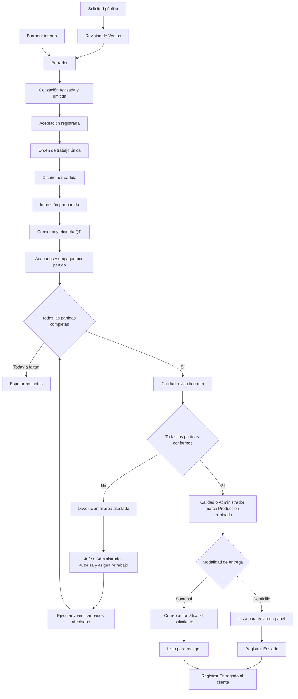

# PrintFlow — Estrategia de implementación de trazabilidad

**Versión:** 1.0
**Fecha:** 10 de octubre de 2026
**Estado:** documento de diseño inicial; las decisiones posteriores registradas en el roadmap y la guía operativa prevalecen cuando lo actualizan.
**Alcance del entregable:** estrategia documental. No implica que todos los módulos, migraciones, escáneres o notificaciones descritos ya estén implementados.

> **Nota de lectura:** las fases numeradas en este documento forman parte de una propuesta técnica inicial. No son el roadmap de producto vigente. Usa [fases e historias](../roadmap/fases-y-historias.md) para el orden actual; las notificaciones automáticas continúan pospuestas.

## 1. Objetivo, referencias y precedencia

Implementar un seguimiento continuo desde la solicitud pública o el borrador comercial hasta la entrega al cliente. La unidad de fabricación y seguimiento será la **partida completa de la orden de trabajo**. Cada área conocerá qué recibió, qué debe hacer, quién es responsable, qué evidencia debe registrar y a qué área entrega el trabajo.

Las cinco etapas de negocio son:

1. **Ventas:** solicitud, revisión, borrador, cotización y aceptación que origina la orden de trabajo.
2. **Diseño:** revisión técnica, preparación o validación del archivo del cliente y captura de referencia por partida.
3. **Impresión:** validación de máquina/material mediante escaneo, impresión, consumo, desperdicio y etiqueta QR.
4. **Acabados:** identificación mediante QR, terminaciones, consumo adicional cuando corresponda y empaque.
5. **Calidad/Entregas:** revisión integral de las partidas, devolución de trabajos incorrectos, liberación de producción y entrega.

El jefe de Producción y el Administrador supervisan las etapas productivas; no constituyen otra etapa de fabricación.

### 1.1. Referencias utilizadas

| Referencia | Uso en esta estrategia |
| --- | --- |
| [FSD de producción y trazabilidad](FSD-produccion-y-trazabilidad.md) | Requisitos funcionales y base para rutas versionadas, planificación, estimaciones, agenda, permisos, snapshots e historial. |
| Decisiones funcionales posteriores al FSD | Reglas vigentes para ejecución, permisos, agenda, entrega y comunicación. El roadmap y la guía operativa resumen las actualizaciones. |
| Código local de `C:\PrintFlow` | Identificar qué reutilizar y dónde extender la arquitectura actual. La inspección es de código, no de datos ni de ejecución en producción. |
| Proyecto local `C:\MetroTickets` | Referencia de presentación por perfil: indicadores, listas con folio y estado, detalle de solicitud, resultados por elemento, responsable y acciones contextuales. |

MetroTickets se toma como referencia de usabilidad y seguimiento. La implementación se diseñará dentro de la arquitectura de PrintFlow; no se trasladan sus archivos ni su código.

### 1.2. Reglas del FSD que se sustituyen o precisan

| Tema | Regla anterior | Regla vigente |
| --- | --- | --- |
| Archivo aportado por el cliente | Podía omitirse Diseño, conservando preprensa. | Todas las partidas pasan por Diseño. Si el archivo original es viable, se autoriza esa misma versión sin volver a subirla. La captura de referencia sigue siendo obligatoria. |
| Cierre de producción | Cierre manual por una persona autorizada, sin una etapa propia de Calidad. | Todas las partidas terminadas en Acabados habilitan automáticamente la revisión de la orden en Calidad/Entregas. Este perfil o el Administrador marca **Producción terminada** después de verificar la totalidad. |
| Avisos de orden lista | Fuera de la primera versión. | El correo automático al cliente permanece pospuesto; el aviso de orden lista es una acción manual o fase posterior. |
| Confirmación de entrega | Ventas confirma la entrega. | Ventas conserva `delivery.confirm` y confirma «Entregado». Calidad/Entregas revisa y libera Producción y registra «Enviado» cuando aplica. |
| Domicilio | Sin un flujo logístico detallado. | Calidad/Entregas o Administrador registra **Enviado**; Ventas registra **Entregado al cliente** con `delivery.confirm`. |
| Consumo real | Registro manual sin obligatoriedad detallada por tarea. | Impresión exige consumo y desperdicio explícitos. Acabados los exige para las tareas que consumen material adicional. No se descuentan existencias. |

El envío a domicilio registra **Enviado**; la recepción por el cliente permite registrar **Entregado**. Son dos hitos distintos: Calidad/Entregas o Administración registra el envío; Ventas confirma la recepción usando `delivery.confirm`.

Las órdenes listas se presentan en la bandeja operativa correspondiente. No se incorpora correo automático nuevo en esta fase; los correos comerciales existentes se conservan como flujos separados.

## 2. Decisiones confirmadas y propuestas complementarias

### 2.1. Decisiones confirmadas

| ID | Decisión |
| --- | --- |
| D01 | Todas las órdenes llegan a Diseño; el trabajo y los archivos se gestionan por partida. |
| D02 | Basta la validación interna de Diseño. No hay aprobación del cliente entre Diseño e Impresión. |
| D03 | Un archivo original correcto puede convertirse en el archivo autorizado para imprimir, sin duplicarlo. Cada partida requiere captura de referencia del resultado esperado. |
| D04 | El jefe de Producción y el Administrador asignan responsables y resuelven incidencias. Los operadores ejecutan únicamente pasos asignados a ellos. |
| D05 | Inicialmente se producen y transfieren partidas completas. No hay avance parcial por lotes dentro de una partida. |
| D06 | El código de material identifica la ficha y las características registradas en el sistema; no un rollo ni un lote físico. |
| D07 | Se registra material utilizado y desperdicio desde esta implementación. No hay descuentos, reservas ni movimientos de inventario. |
| D08 | Una máquina o material distinto requiere sustitución compatible autorizada por jefe/Administrador, con motivo e historial. |
| D09 | Jefe/Administrador autoriza retrabajos. Ventas/Administrador autoriza cambios comerciales. |
| D10 | Calidad/Entregas revisa la orden cuando todas sus partidas han terminado; puede devolver las incorrectas al área correspondiente. |
| D11 | Calidad/Entregas o Administrador libera **Producción terminada**; Ventas confirma la entrega con el permiso `delivery.confirm`. |
| D12 | El correo automático al cliente queda pospuesto. Domicilio conserva los hitos Enviado y Entregado, registrados por los perfiles autorizados. |

### 2.2. Propuestas técnicas y reglas complementarias adoptadas para esta estrategia

Estas decisiones completan el diseño; se distinguen de las respuestas expresas del solicitante y pueden ajustarse antes de implementar el componente correspondiente.

- **Sin entregas parciales en v1:** recolección, envío y entrega abarcan la orden completa. Las partidas pueden avanzar independientemente entre áreas, pero ninguna se fracciona.
- **Material del catálogo:** reutilizar `MaterialVariant.barcode` cuando esté disponible. Representa una presentación técnica del catálogo y sus características, sin identificar existencias físicas. Resolver también su `Material` asociado; no crear un tercer catálogo de insumos.
- **Unidades:** utilizar las unidades de consumo del catálogo. Metros lineales, m², hojas o piezas dependen del insumo; no se impone una unidad global.
- **Desperdicio incluido:** el consumo total incluye el desperdicio, siguiendo la entidad de consumo existente. Se documenta expresamente esta convención en el formulario.
- **Devolución desde Calidad:** Calidad puede registrar la no conformidad y dirigirla al área afectada inmediatamente. El nuevo intento queda pendiente de autorización y asignación por jefe/Administrador antes de ejecutarse.
- **Cancelación de partidas:** propuesta de autorización por Ventas/Administrador, con motivo y evaluación productiva del jefe si existe trabajo iniciado. No se usa una cancelación para ocultar un defecto pendiente de retrabajo.
- **Contacto del correo:** congelar el solicitante al crear la orden. Para origen público se utiliza el contacto solicitante de la petición; para origen interno, el contacto comercial elegido expresamente por Ventas. No elegir automáticamente cualquier correo del cliente.
- **Modalidad de entrega:** `pickup` o `shipping`, compatibles con el formulario público actual. Si la solicitud indica `undefined`, Ventas debe definirla antes de liberar producción. El dato pendiente se muestra como bloqueo de entrega.
- **Etiquetas de varios paquetes:** si una partida completa ocupa varios paquetes, cada uno porta una copia identificada de su etiqueta, con paquete X de Y. Esto no habilita lotes ni avance parcial.
- **Sin cierre técnico ficticio:** si faltan ruta, archivo, material, medidas o rendimiento, mostrar causa y datos pendientes. No inventar consumos, duraciones, aprobaciones ni fechas.

## 3. Base actual de PrintFlow y puntos de extensión

La inspección local muestra una aplicación Symfony con PHP 8.2 como plataforma de Composer, Doctrine, Twig, AssetMapper, Stimulus, Symfony Mailer y permisos granulares. Se mantendrá un **monolito modular**, con reglas en servicios de aplicación y entidades, en lugar de agregar otro sistema de órdenes.

| Capacidad observada | Evidencia local | Estrategia |
| --- | --- | --- |
| Estados comerciales existentes | `src/Enum/Quotations/QuotationStatus.php`: REQUEST, IN_REVIEW, DRAFT, ISSUED, SENT, ACCEPTED y estados de excepción. | Reutilizarlos. La orden de trabajo es otra entidad, no otro estado comercial de la cotización. |
| Solicitud pública y revisión comercial | `PublicQuoteRequestController`, `QuotationManager::createPublic`, `startReview`, `prepareDraft`. | Conservar referencia y datos originales; formalizar la validación de Ventas antes de emitir. |
| Aceptación por distintos medios | `QuotationResponseChannel`, `QuotationManager::accept`, formulario de decisión y evidencias. | Conservar canal, contacto, fecha y evidencia. Verificar la aceptación válida antes de crear la orden. |
| Orden única desde cotización aceptada | `ServiceOrderManager::createFromAcceptedQuotation`, `ServiceOrder`, `ServiceOrderItem`. | Extender ese caso de uso transaccional para inicializar trazabilidad. Conservar bloqueos y restricciones únicas. |
| Planificación manual por partida | `ServiceOrderOperationPlan`, `ServiceOrderManager` y controlador de órdenes. | Ampliar la planificación con rutas versionadas y ejecuciones; no tratar un plan como evidencia de fabricación realizada. |
| Estado de orden limitado a planificación | `ServiceOrderStatus`: PENDING_PLANNING y PLANNED. | Preservar compatibilidad y agregar estados separados para producción y cumplimiento de entrega. |
| Producto utilizado en cotización | FK a `CommercialItem` en `QuotationItem` y `ServiceOrderItem`. | Publicar rutas sobre `CommercialItem`, como establece el FSD. No duplicarlas sobre `Products\Product`. |
| Materiales y presentaciones | `Material`, `MaterialVariant`: código de barras, especificaciones, unidades y estado activo. | Reutilizar identidad y características para requisitos técnicos y escaneo; excluir costo y stock de la proyección del operador. |
| Consumos por partida | `ProductionMaterialUsage`, tabla `production_material_usages`, `ConsumptionQuantityResolver`. | Extender con operación/intento y control de correcciones; hacer obligatoria la captura real al finalizar las tareas indicadas. |
| Capacidad de equipos | `Equipment`: código, operación, estado, ancho y capacidad textual. | Identificar equipos mediante su código y agregar capacidades estructuradas para compatibilidad/estimación. No interpretar capacidad textual como dato numérico fiable. |
| Separación comercial ya incorporada en código | `service_orders.view_commercial`, migración `Version20261010120000`, vistas de órdenes y `ServiceOrderCommercialAccessTest`. | La situación es posterior al diagnóstico del FSD. Conservar controles, verificar permisos aplicados y completar proyecciones operativas explícitas. |
| Entidades completas en vistas actuales | `ServiceOrderController` entrega `serviceOrder` a Twig. | Las nuevas pantallas operativas reciben DTO con campos permitidos. Evitar que el control dependa únicamente de condicionales Twig. |
| Archivo del solicitante por partida | `QuotationItem.attachmentPath`, `attachmentOriginalName`, `requestDetails`; subida actual a `public/uploads/quotations`. | Registrar archivos protegidos, versionados y vinculados a la partida. Migrar adjuntos públicos con comprobación de integridad. |
| Copia actual de partida | `ServiceOrderManager::copyItem` copia especificaciones y datos comerciales, pero no crea un registro propio de archivo operativo. | Agregar referencia estable al archivo, requisitos técnicos y petición original depurada dentro de la creación de la orden. |
| Correo existente | `QuotationMailer`, `PublicQuoteRequestMailer`, configuración de Mailer y `MAILER_SETUP.md`. | Los correos comerciales existentes se conservan; la notificación automática de trazabilidad queda pospuesta. |
| Seguridad y auditoría | `PermissionVoter`, `AuditLogger`, `permissions`, `role_permissions`. | Reutilizar permisos en servidor y auditoría. Validar además asignación y pertenencia de cada partida/paso. |

El correo público actual presenta una cotización calculada incluso cuando el registro queda como REQUEST. Para cumplir la nueva definición de negocio, su pantalla, correo y PDF deben distinguir **solicitud/estimación preliminar** de **cotización revisada y emitida por Ventas**. La existencia de un cálculo automático no reemplaza la revisión comercial.

La presencia de entidades de inventario y migraciones en el repositorio no implica activar el inventario. No se crearán movimientos de stock como efecto de finalizar Impresión o Acabados.

**Límites de esta revisión:** no se consultó la base de ningún entorno, no se verificaron migraciones aplicadas ni se ejecutaron pruebas funcionales, SMTP o dispositivos. La existencia de un archivo de prueba no demuestra que la prueba pase. Estas verificaciones forman parte de la fase 0 y de los criterios de salida.

## 4. Flujo y estados independientes

### 4.1. Flujo general



La disponibilidad para Calidad se calcula automáticamente; **Producción terminada requiere la acción autorizada de Calidad/Entregas o Administrador**. La confirmación de entrega es un evento posterior de Ventas; no depende de notificación automática.

### 4.2. Ciclo comercial

| Concepto visible | Estado existente / comportamiento | Control requerido |
| --- | --- | --- |
| Solicitud | REQUEST, origen público y referencia SOL. | Preservar texto y archivos enviados; no presentarla como cotización final revisada. |
| En revisión | IN_REVIEW, trabajo de Ventas. | Registrar actor y fecha; comprobar correspondencia entre petición y catálogo. |
| Borrador | DRAFT, interno o preparado desde solicitud. | Ajustar producto, características, medidas, cantidades, servicios y condiciones de entrega. |
| Cotización | ISSUED; SENT expresa su envío comercial. | Ventas/Administrador valida antes de emitir; folio y snapshot formal. |
| Aceptada | ACCEPTED con canal, fecha, contacto y evidencia según el flujo vigente. | Aceptación válida y, donde corresponda, revisión de aceptación pública completada. |
| Orden de trabajo | `ServiceOrder` vinculada a la cotización aceptada. | Crear una sola orden por origen y una sola partida por línea aceptada. |

Una solicitud puede emitirse sin que el usuario tenga que recorrer varias pantallas, pero el caso de uso deberá ejecutar la normalización y revisión obligatorias antes de emitir. La implementación actual exige DRAFT para `issue`; se reutiliza esa transición internamente, sin permitir un salto que eluda sus reglas.

Rechazo, expiración, aceptación con cambios, cancelación y reemplazo por revisión conservan los estados existentes. «Aceptada con cambios» no equivale a una autorización para producir especificaciones nuevas no confirmadas.

### 4.3. Planificación, producción y entrega de la orden

Evitar un único campo que intente expresar simultáneamente todos estos conceptos. Propuesta de extensión:

| Eje | Estados propuestos | Regla |
| --- | --- | --- |
| Planificación | PENDING_PLANNING, PLANNED, preservados inicialmente en el enum actual. | Tener un plan no significa haber fabricado. |
| Producción | WAITING_DESIGN, IN_PRODUCTION, WAITING_QUALITY, QUALITY_REWORK, PRODUCTION_COMPLETED, CANCELLED. | Estado resumido calculado desde partidas e incidencias, salvo la liberación humana de calidad y la cancelación autorizada. |
| Entrega | NOT_READY, READY_FOR_PICKUP, READY_FOR_SHIPMENT, SHIPPED, DELIVERED. | READY depende de producción liberada; SHIPPED solo para domicilio; DELIVERED exige confirmación. |

Bloqueos, riesgo de retraso, prioridad y falta de datos son atributos separados; no se pierde esa información al cambiar de estado. Con partidas en áreas distintas, el resumen debe mostrar «En producción — Diseño 1, Impresión 2, Acabados 1», en lugar de atribuir toda la orden a un área única.

### 4.4. Estado de partida, paso e intento

- **Partida:** Pendiente de Diseño → En producción → Acabados terminados → En revisión de calidad → Conforme. Una devolución añade «En retrabajo» y conserva la revisión anterior.
- **Paso:** Pendiente → Listo → En curso → Completado. Pausado y Bloqueado son estados con motivo, actor y fecha. Cancelado/no aplicable exige una resolución autorizada, nunca una omisión silenciosa.
- **Intento:** ejecución concreta de un paso. Un retrabajo crea otro intento enlazado al anterior; no resetea sus fechas ni consumos.
- **Recepción entre áreas:** registra partida, salida vigente, área origen/destino, persona e instante. En Acabados la recepción usa QR.

Los pasos de una partida son secuenciales en v1. Partidas distintas sí pueden estar en etapas diferentes al mismo tiempo. El siguiente paso se habilita únicamente cuando su antecesor y las evidencias de transferencia están completos.

## 5. Reglas de cada etapa

### 5.1. Ventas: convertir la petición en una orden ejecutable

**Entrada:** solicitud pública, borrador interno o revisión comercial existente.

**Acciones: revisar petición original, ajustar borrador, emitir, registrar aceptación y crear orden.**

Por cada partida, Ventas compara la petición original con el Producto/servicio de `CommercialItem`, opciones registradas, cantidad, medidas físicas, material previsto y acabados. Debe identificar cualquier diferencia sin sobrescribir la solicitud original. Un campo libre del cliente no se convierte automáticamente en una opción técnica reconocida.

Antes de emitir, comprobar:

1. Producto/servicio y variantes técnicas válidas.
2. Características y cantidades que respondan a lo solicitado.
3. Archivos recibidos o señalamiento explícito de que Diseño deberá generarlos.
4. Ruta publicada aplicable, o excepción identificada que deberá resolver Producción antes de ejecutar.
5. Contacto solicitante y condiciones comerciales válidas.
6. Modalidad y destino de entrega, permitiendo un pendiente visible cuando aún falte definición.

Al crear la orden se congelan folios, cliente/contacto, modalidad/destino, partidas, petición original depurada, especificaciones revisadas, ruta aplicada y referencias de archivos. La orden existente puede crearse aunque falten datos de planificación; tales partidas entran a Diseño bloqueadas o pendientes de preparación, sin reservas ni fechas inventadas.

**Salida:** orden única; todas las partidas visibles en Diseño y en la vista global de Producción, con responsable pendiente o asignado. La aceptación y la creación permanecen como eventos distintos, aunque se agrupen en una acción de interfaz.

### 5.2. Diseño: archivo autorizado y referencia obligatoria

**Entrada:** partida completa con su petición, especificaciones técnicas, archivos originales y ruta.

**Acciones: iniciar, descargar original, registrar revisión, adjuntar archivo preparado cuando haga falta, adjuntar referencia, agregar instrucciones y liberar a Impresión.**

Existen dos caminos válidos:

| Situación | Archivo autorizado para imprimir | Evidencia obligatoria |
| --- | --- | --- |
| Original correcto | La versión exacta del archivo aportado por el cliente se marca viable para impresión. | Validación interna, referencia al original y captura de cómo debe quedar el trabajo. No se exige otra subida del archivo de impresión. |
| Archivo requiere ajustes o debe crearse | Diseño incorpora una nueva versión preparada para impresión. | Validación interna de esa versión, archivo nuevo, captura e instrucciones pertinentes. |

Revisar dimensiones, orientación, distribución/paneles, resolución o formato aplicable, sangrados y requisitos del equipo/material. Los criterios concretos se parametrizan por Producto y tecnología; no se aplica una única regla técnica a todos los trabajos.

Para finalizar el paso se requiere: archivo autorizado existente, versión/hash fijados, captura obligatoria, validación interna y especificaciones suficientes para el siguiente paso. Las instrucciones adicionales son opcionales; la captura no lo es. Si hay varios archivos necesarios para una partida, la liberación fija el conjunto completo y su orden de uso.

Un cambio de archivo autorizado genera nueva versión y revisión. Si Impresión ya empezó, no se sustituye el archivo que ve el operador sin bloquear el trabajo y tramitar la incidencia/retrabajo. La autorización de una versión no se hereda a otra.

**Salida:** partida lista para Impresión con arte autorizado, captura, indicaciones y requisitos de máquina/material. No se solicita aprobación adicional al cliente.

### 5.3. Impresión: escaneo, ejecución, consumo y etiqueta

**Entrada:** archivo autorizado vigente, captura de Diseño, medidas, cantidad, máquina y material previstos.

Secuencia de ejecución:

1. El operador asignado abre la partida y ve el resultado esperado y los requisitos técnicos.
2. Escanea en la tablet el código de barras de la máquina.
3. Escanea el código del material del catálogo; el servidor recupera y muestra sus características.
4. El servidor compara ambas identidades con la planificación vigente y vuelve a validar compatibilidad, estado de equipo/material y disponibilidad operativa.
5. Si coincide, habilita iniciar la impresión. Si difiere, bloquea e informa por qué.
6. Cuando procede una sustitución, jefe/Administrador elige una alternativa compatible, revisa impacto en agenda, registra motivo y autoriza una revisión del plan. El operador vuelve a validar los códigos contra esa revisión.
7. El operador imprime la partida completa con el archivo aprobado.
8. Antes de completar, registra material total consumido, unidad y desperdicio, incluso cuando el desperdicio es cero.
9. Completar guarda el intento, consumos y evento; crea la identidad de la salida impresa y la etiqueta QR.
10. Se genera la etiqueta imprimible, se imprime y se confirma su colocación. La recepción en Acabados se habilita cuando la identificación física está disponible.

Los escaneos son evidencia de una validación concreta: partida, paso/intento, actor, fecha, archivo autorizado y revisión del plan. Caducan si se cambia responsable, equipo, material, arte o requisitos relevantes antes de iniciar. Al reanudar, exigir nueva validación cuando esas condiciones hayan cambiado.

Una autorización de sustitución no convierte una incompatibilidad en compatible. Si faltan datos para comprobarlo, el jefe debe corregir la ficha o aportar una validación técnica estructurada y justificada antes de aprobar.

**Salida:** partida impresa completa, consumo registrado y material identificado con QR. Si falla la generación o impresión de la etiqueta, se mantiene visible «Pendiente de etiqueta» y se reintenta sin duplicar el intento de impresión ni sus consumos.

### 5.4. Acabados: recepción identificada, tareas y empaque

**Entrada:** material impreso identificado y listo; QR correspondiente a la salida vigente de la partida.

**Acciones: escanear, recibir, iniciar tarea, registrar consumos cuando corresponda, terminar tareas y confirmar empaque.**

El escaneo recupera orden, partida, cantidad, referencia de Diseño, material y lista ordenada de acabados. El servidor valida que la etiqueta esté vigente, la impresión haya concluido y la partida sea ejecutable por ese operador. Escanear no marca ninguna tarea como terminada.

| Tarea | Datos necesarios para completarla |
| --- | --- |
| Corte sin insumos adicionales | Confirmación de trabajo y cantidad completa. No se exige consumo de material. |
| Colocación de ojillos | Insumo, cantidad total utilizada, unidad y desperdicio explícito. |
| Laminado u otro acabado con material adicional | Insumo correcto, cantidad/unidad real y desperdicio; instrucciones y parámetros técnicos aplicables. |
| Empaque | Confirmación de partida completa, identificación conservada y cantidad de paquetes cuando sea necesario. Consumo de empaque solo si la ruta lo configura. |

El requisito de consumo lo determina cada operación de la ruta (`requires_material_usage` o equivalente), no una validación general que pida insumos en todos los acabados.

**Salida:** partida con todos los acabados obligatorios completos y empaque confirmado, conservando la etiqueta. Cada finalización recalcula cuántas partidas faltan en la orden; no libera producción ni envía correo al cliente.

### 5.5. Calidad/Entregas: revisión integral y liberación

**Entrada:** orden cuyas partidas vigentes han completado Diseño, Impresión, Acabados y empaque. Las cancelaciones autorizadas se muestran explícitamente en el alcance de revisión.

La orden aparece automáticamente en la bandeja de Calidad cuando cumple esas condiciones. Si una partida sigue en proceso, no se ofrece como orden lista para liberar.

Calidad abre el detalle integral y verifica por partida:

- Identidad mediante QR, correspondencia con orden y número de partida.
- Producto, dimensiones, material, cantidad completa y acabados solicitados.
- Resultado respecto a la captura de Diseño y a las instrucciones vigentes.
- Empaque e identificación de todos los paquetes.
- Ausencia de incidencias, devoluciones o intentos pendientes que invaliden el resultado.

Se registra Conforme o No conforme, revisor, instante, salida/versión revisada y observaciones. La revisión es interna; no incorpora aprobación del cliente.

**Si todo es conforme:** Calidad/Entregas o Administrador ejecuta «Marcar Producción terminada». El servidor relee y valida toda la orden, guarda revisión y liberación, cambia producción a PRODUCTION_COMPLETED y habilita el flujo de entrega correspondiente.

**Si existe un error:** Calidad selecciona las partidas afectadas, motivo, evidencia opcional y área de retorno. La devolución bloquea su conformidad y la liberación de la orden. Jefe/Administrador autoriza alcance, dependencias e intento de retrabajo y asigna responsable. Las partidas correctas conservan su evidencia y conformidad mientras sus versiones no cambien.

Calidad puede devolver al área correcta sin borrar pasos realizados. La autorización del jefe se aplica a la ejecución del retrabajo, no impide registrar inmediatamente la devolución. Cuando las partidas afectadas vuelven a completar sus pasos, la orden regresa a revisión; Calidad verifica sus resultados nuevos antes de liberar.

**Salida:** producción liberada y orden lista para recolección/envío, o devolución documentada con bloqueo y trabajo pendiente.

## 6. Consumos y desperdicios sin inventario

El registro real es obligatorio al completar Impresión y cualquier operación de Acabados que utilice insumos. Debe existir por partida, operación e intento, permitiendo varios insumos en una tarea.

### 6.1. Convención de cantidades

```text
material_total_consumido = material_aprovechado + desperdicio
material_aprovechado = material_total_consumido - desperdicio
```

Ejemplo: se consumen 12 metros lineales de material; 2 son desperdicio. Se guardan **total = 12**, **desperdicio = 2**, **aprovechado = 10**. No se contabilizan 14 metros. Para 204 ojillos utilizados y 4 desperdiciados, el aprovechamiento es 200 piezas.

El formulario deberá decir «Material total consumido, incluido desperdicio» y «De ese total, desperdicio». Las cantidades pueden ser medidas o reportadas por el operador; su procedencia se conserva y nunca se presentan como estimación del plan.

### 6.2. Datos y validación

| Dato | Regla |
| --- | --- |
| Material/presentación | Referencia al catálogo y snapshot técnico del material utilizado. Registrar previsto y efectivo si hubo sustitución. |
| Unidad | Referencia a `MeasurementUnit`; congruente con el insumo y con la magnitud capturada. |
| Total real | Obligatorio; no negativo. Para completar una impresión ejecutada debe ser mayor que cero, salvo corrección excepcional documentada por jefe/Administrador. |
| Desperdicio | Obligatorio y explícito; cero permitido; no negativo y no mayor que el total. |
| Motivo de desperdicio | Obligatorio cuando es mayor que cero, con clasificación y observación cuando haga falta. |
| Cantidad prevista | Solo si existe una estimación válida. Ausente no significa cero. |
| Autor y momento | Operador, fecha UTC, método/procedencia y paso/intento. |
| Corrección posterior | Nueva revisión del registro, motivo y persona autorizada. Preservar el original y usar una sola revisión efectiva en los totales. |

Usar decimales y unidades explícitas. No convertir metros lineales a m² sin el ancho físico validado, ni hojas a piezas sin una distribución definida. No calcular desperdicio como diferencia con lo presupuestado: es un dato real independiente.

Reutilizar `ProductionMaterialUsage` extendiéndolo con referencia al plan/intento y revisiones de captura. Su campo `actual_quantity` actualmente es opcional; el nuevo caso de uso de cierre exige que esté informado. El comportamiento existente de `ConsumptionQuantityResolver`, que permite usar lo previsto cuando falta lo real, **no cumple** esta regla de cierre y no debe utilizarse para eludirla.

Si no hay BOM o cantidad prevista, adaptar el esquema/contrato de estimación para admitirla ausente y conservar la captura real; no crear una previsión ficticia para satisfacer un campo obligatorio. `posted_quantity`, si se mantiene por compatibilidad, no demuestra un movimiento de inventario. `inventory_movement_id` y lote permanecen sin asignar en este flujo.

Los retrabajos agregan consumos nuevos por intento. Los reportes deben distinguir consumo de primera ejecución, consumo de retrabajo, desperdicio y correcciones vigentes. Registrar el consumo no modifica stock, costos comerciales ni importes de la cotización.

## 7. Archivos, códigos y etiquetas

### 7.1. Archivos como evidencia versionada

Cada archivo conserva ID, partida, propósito, versión, autor, nombre original, MIME validado, tamaño, hash y ruta interna. Propósitos mínimos: original del cliente, arte preparado, captura de referencia y evidencia de incidencia/calidad.

La liberación de Diseño referencia el archivo/conjunto autorizado y la captura exactos. Si usa el original, conserva la misma identidad y registra la autorización; no crea una copia artificial. Reutilizar un mismo binario entre varias partidas requiere vínculos explícitos y autorización independiente por partida.

Almacenar nuevos archivos operativos fuera de `public/`, por ejemplo en `var/storage/production`, mediante un servicio de almacenamiento y controladores de descarga autorizados. Las previsualizaciones también deben protegerse. El conocimiento de una ruta o un ID no concede acceso.

La subida pública existente exige transición: inventariar archivos, copiar a almacenamiento protegido, verificar hash/tamaño, crear referencias, actualizar lectores y bloquear después el acceso HTTP a la ubicación pública. No borrar originales antes de validar las referencias y el respaldo. Preservar descarga pública autorizada cuando un flujo existente la necesite, mediante un acceso acotado, no una carpeta abierta.

Durante implementación se fijan formatos admitidos para impresión y captura, tamaño máximo, política de retención y generación de miniaturas según archivos reales y capacidad del hosting. Se validan MIME/contenido y nombres, sin confiar únicamente en la extensión.

### 7.2. Códigos de máquina y material

- **Máquina:** código único de `Equipment`; la etiqueta física identifica el registro. Si se utiliza Code 128, validar la longitud y legibilidad con el lector real antes de publicar el formato.
- **Material:** código de barras único de la presentación técnica del catálogo. El servidor resuelve material, marca/color/acabado/ancho u otras especificaciones registradas y aplicables. No expone costos, proveedores comerciales o stock al operador.
- **Comparación:** verificar identidad prevista/efectiva y revisión técnica. No basta que el texto de dos nombres se parezca ni se confía en características enviadas por el navegador.
- **Cambio de catálogo:** una edición posterior no modifica el snapshot de la orden. Si altera compatibilidad de trabajo pendiente, exige revisión técnica autorizada antes de ejecutar.
- **Lectura repetida:** descartar lecturas duplicadas accidentales en interfaz y mantener idempotencia en servidor. Escanear dos veces no inicia dos ejecuciones.

Para tablet, integrar lector en Stimulus con cámara y/o lector externo. Detectar soporte, seleccionar cámara trasera y ofrecer mensajes claros sobre códigos incorrectos. `BarcodeDetector` tiene disponibilidad limitada y requiere contexto seguro en los navegadores que lo soportan; no debe ser la única vía de lectura. El lector alternativo debe probarse en las tablets reales. [Referencia técnica: BarcodeDetector](https://developer.mozilla.org/en-US/docs/Web/API/BarcodeDetector).

Si la cámara no funciona, permitir un lector externo. La introducción manual de un código se ofrece, en su caso, como contingencia autorizada y auditada por jefe/Administrador; no se presenta como escaneo físico. Sin conexión no se confirma una transición ni se muestra éxito antes de obtener respuesta del servidor.

### 7.3. Identidad y ciclo de vida de la etiqueta QR

La etiqueta identifica una **salida impresa vigente de una partida**, no una existencia ni un lote de inventario. Contiene QR, folio de orden, número/código de partida, Producto, cantidad/unidad, destino siguiente y versión de salida. Puede incluir miniatura si resulta legible y útil; no contiene precios, costos, correo ni dirección del cliente.

Propuesta de contenido compacto del QR:

```text
PF|1|OT-2026-000123|P003|<identificador-unico-de-etiqueta>
```

El identificador resuelve en servidor la salida, intento de impresión y referencias técnicas. Folio y partida incluidos deben coincidir con esa relación. El QR identifica; no autentica al usuario ni autoriza acciones. Si se utiliza una URL equivalente, se mantienen estas mismas relaciones y controles.

| Situación | Comportamiento |
| --- | --- |
| Finalizar impresión | Crear salida/etiqueta una sola vez por intento y dejar artefacto imprimible disponible. |
| Fallo al generar/imprimir etiqueta | Reintentar sobre la misma identidad; mostrar pendiente y bloquear recepción sin identificación. |
| Etiqueta dañada | Reimprimir la etiqueta vigente; registrar actor, momento y motivo. No generar un trabajo nuevo. |
| Varios paquetes de una partida | Copias identificadas X/Y de la misma salida; conservar el seguimiento de la partida completa. |
| Retrabajo solo de Acabados | Conservar etiqueta de impresión si el material base sigue vigente; asociar los nuevos intentos de Acabados. |
| Nueva impresión por defecto | Crear nueva salida y nueva etiqueta. Marcar anteriores como sustituidas; impedir que un QR viejo complete el trabajo nuevo. |
| Cancelación | Etiqueta invalidada para ejecución, conservada como evidencia histórica. |

Generar PDF/imagen de etiqueta mediante un servicio separado. Puede reutilizarse Dompdf para composición del PDF, con una biblioteca QR compatible con PHP 8.2 seleccionada y fijada en la fase técnica. No asumir instalada una dependencia nueva. El tamaño final, impresora, soporte y margen del código se validan con pruebas físicas.

## 8. Calidad, retrabajos y cambios de alcance

### 8.1. Condiciones de entrada y cierre

```text
Puede entrar a Calidad si:
  existe al menos una partida vigente;
  todas las partidas vigentes completaron pasos de fabricación obligatorios;
  todas tienen empaque e identificación vigentes;
  no hay retrabajos de fabricación pendientes.

Puede marcar Producción terminada si, además:
  todas tienen conformidad de Calidad sobre su versión/salida vigente;
  no hay no conformidades, bloqueos o cambios de alcance pendientes;
  el alcance vigente y las cancelaciones autorizadas están identificados;
  la modalidad de entrega está definida;
  el actor tiene permiso de liberación de Calidad/Entregas.
```

No se utiliza el número de partidas históricas completas como única regla. Se compara el **alcance vigente** y las conformidades de sus versiones actuales. Una orden sin partidas vigentes se cancela o resuelve como excepción; nunca se declara producción terminada por una condición vacía.

El cierre se guarda en una transacción con bloqueo de orden y comprobación de versiones de partidas. Si otra persona devuelve o cambia una partida durante la revisión, rechazar la liberación obsoleta y pedir actualizar el detalle. Preservar registros parciales de la revisión, pero no una liberación inválida.

### 8.2. Devoluciones y dependencias

| Error encontrado | Área de retorno habitual | Consecuencia |
| --- | --- | --- |
| Arte, contenido, dimensiones de archivo o referencia incorrectos | Diseño | Nueva revisión del arte; evaluar nueva impresión y repetición de acabados. |
| Impresión defectuosa o material incorrecto | Impresión | Nuevo intento y consumos; nueva salida/QR; repetir acabados dependientes. |
| Corte, ojillos, laminado o terminación incorrectos | Acabados | Nuevo intento de tareas afectadas; conservar impresión/QR si son válidos. |
| Empaque o identificación incorrectos | Acabados / tarea de empaque | Corregir empaque/etiqueta sin inventar una reimpresión. |
| Desacuerdo entre petición y especificación comercial aceptada | Ventas | Abrir cambio comercial/incidencia; no fabricar otra especificación sin resolver el alcance. |

El jefe confirma el alcance de retrabajo y qué resultados posteriores dejan de ser válidos. Un retorno a Diseño no significa borrar todas las tareas de la orden: se afectan únicamente la partida y las dependencias correspondientes. Las aprobaciones previas de versiones invalidadas permanecen históricas y dejan de contar para el cierre actual.

### 8.3. Cambios comerciales, técnicos y cancelaciones

- **Comerciales:** precio, cantidad pactada, Producto, características contratadas o condiciones de entrega. Ventas/Administrador registra solicitud, motivo, alcance y decisión; jefe evalúa impacto cuando existe producción iniciada.
- **Técnicos compatibles:** máquina alternativa, datos físicos corregidos o preparación de archivo que conserva lo contratado. Jefe/Administrador autoriza revisión técnica y sus efectos; no reescribe la cotización aceptada.
- **De calidad:** no conformidad y devolución registradas por Calidad; ejecución del retrabajo autorizada por jefe/Administrador.
- **Cancelaciones:** conservar partida y ejecuciones históricas, documentar decisión comercial y disposición del trabajo ya fabricado. Excluir del alcance activo solo después de la autorización, mostrando cuántas partidas fueron canceladas.

El enum actual no permite revisar una cotización ACCEPTED mediante el mismo `canBeRevised()` que usa estados anteriores. Para cambios posteriores a la aceptación se requiere un caso de uso explícito de modificación del alcance, enlazado a la cotización y orden originales. No habilitar edición libre del snapshot aceptado ni crear una segunda orden operativa para representar el mismo trabajo. Propuesta: una modificación comercial versionada, con evidencia de nueva aceptación cuando cambie lo pactado y evaluación de impacto productivo.

Si una orden liberada y todavía no entregada recibe una no conformidad autorizada, registrar nueva revisión y retirar disponibilidad para entrega. La coordinación de la corrección con el solicitante es manual; no hay avisos automáticos de trazabilidad pendientes de envío.

Una orden ya enviada requiere resolver la custodia/retorno del material antes de ejecutar retrabajo. Una orden ya entregada conserva su hito de entrega; reclamaciones posteriores se registran como incidencias vinculadas, sin alterar silenciosamente la entrega histórica.

## 9. Entrega y notificaciones

> **Vigencia:** no hay correo automático al cliente en el alcance vigente; el contacto se realiza manualmente o mediante una fase futura. Ventas conserva el permiso `delivery.confirm` para confirmar la recepción. Calidad/Entregas libera Producción y registra el despacho.

### 9.1. Recolección en sucursal

1. Calidad libera producción.
2. El sistema establece READY_FOR_PICKUP y muestra la orden en la bandeja para coordinar la recolección.
3. El equipo coordina manualmente el aviso al cliente por sus canales comerciales; no se genera un correo automático al liberar producción.
4. Ventas confirma la entrega física y registra DELIVERED con actor y fecha. Evidencia adicional puede configurarse según operación.

Ventas puede consultar y confirmar la entrega mediante `delivery.confirm`.

### 9.2. Entrega a domicilio

1. Calidad libera producción y establece READY_FOR_SHIPMENT.
2. La orden aparece en «Listas para envío» de Calidad/Entregas con dirección, contacto, paquetes y datos logísticos necesarios.
3. Al despachar se registra SHIPPED, persona responsable, fecha, modalidad/transportista y referencia de envío cuando corresponda.
4. Cuando se confirma recepción, Ventas registra DELIVERED, fecha y receptor/evidencia disponible mediante `delivery.confirm`.

Sin dirección válida no se habilita Enviado. Enviado no cuenta como Entregado en indicadores. El despacho y la confirmación de recepción mantienen sus eventos y permisos independientes, incluso si ocurren el mismo día.

No hay correo automático al Administrador ni recordatorio de una hora. Las pendientes se consultan en el panel; no se configura una integración de transportista como requisito de v1.

### 9.3. Correo al cliente pospuesto

La integración automática con Symfony Mailer queda para una fase posterior. Si se retoma, primero se deben acordar el evento, destinatario y mecanismo de entrega; esta versión no exige una bandeja ni un procesador de avisos de trazabilidad.

Los estados y el diseño de bandeja descritos en propuestas anteriores quedan fuera de la implementación actual. Si se retoma el correo automático, documentar un diseño actualizado y sus controles antes de iniciar esa fase.

## 10. Información y experiencia por perfil

### 10.1. Referencia concreta de MetroTickets

| Archivo/vista inspeccionada en `C:\MetroTickets` | Patrón de presentación observado | Adaptación para PrintFlow |
| --- | --- | --- |
| `contentIndex.php` | Indicadores y gráficos diferenciados según perfil. | Resumen de carga, pendientes, bloqueos, calidad y entregas según funciones autorizadas. |
| `modules/requests/contentRequests.php` y `js/requests.js` | Lista con folio, tipo, fecha, solicitante, compromiso, responsable, estado, prioridad y acciones. | Lista de órdenes/partidas con identificadores estables, etapa, responsable, compromiso y siguiente acción. |
| `modules/review/contentReview.php` | Detalle con datos generales, especificaciones, elementos, responsable, fechas, estado y resultados. | Detalle único con cabecera de orden, matriz de partidas, archivos, referencia y trazabilidad. |
| `modules/review/modalResultados.php` | Formulario de respuesta con estado, compromiso, prioridad, responsable, observaciones y resultados por pieza. | Formularios enfocados al paso: liberar Diseño, terminar Impresión, registrar consumo, revisar Calidad o entregar. |
| Acciones de consulta, respuesta y finalización por perfil | Cada usuario ve acciones pertinentes al estado y a su función. | Acciones derivadas de permisos, asignación y estado validado en servidor. |

Estos patrones observados sirven para presentar la información. La línea de tiempo por partida, validación de escaneos y detalle de intentos son propuestas propias para cumplir la trazabilidad solicitada, no capacidades atribuidas a MetroTickets sin evidencia.

### 10.2. Paneles de PrintFlow

| Perfil | Información principal | Acciones principales |
| --- | --- | --- |
| Ventas | Solicitudes, borradores, cotizaciones, aceptación, pedidos en producción, compromisos y entrega. Datos comerciales según permiso. | Revisar, ajustar, emitir, registrar aceptación, crear orden y tramitar cambio comercial. |
| Diseño | Partidas pendientes de revisión, petición y especificaciones depuradas, originales, bloqueos y urgencias. | Validar original, preparar arte, subir captura, registrar instrucciones y liberar mediante `production.design.review`; no requiere asignación como operadora. |
| Impresión | Cola asignada, archivo autorizado, referencia grande, máquina/material previstos, cantidad y estado de escaneos. | Escanear, iniciar/pausar, solicitar sustitución, registrar consumo y finalizar con etiqueta. |
| Acabados | Recepción por QR, tareas asignadas, referencia, consumibles requeridos y empaque. | Recibir, ejecutar, registrar consumo cuando corresponde y completar partida. |
| Jefe de Producción | Todas las áreas, carga, agenda, excepciones, incidencias, compromisos y retrabajos. | Asignar, planificar, aprobar sustituciones/retrabajos, reprogramar y resolver bloqueos. |
| Calidad/Entregas | Órdenes completas pendientes de revisión, devoluciones, listas para recoger/enviar y enviadas. Dirección/contacto solo cuando sean necesarios para entrega. | Revisar, devolver partidas, liberar producción, registrar envío y gestionar evidencia. |
| Administrador | Vista global y capacidades según permisos efectivos. | Funciones de supervisión y de Calidad/Entregas autorizadas, además de administración. |

Los operadores conservan consulta de todos los trabajos operativos conforme al FSD, con «Mis tareas» como vista inicial. Consultar otra partida no habilita ejecutarla. No reciben precios, subtotales, descuentos, IVA, total, costos ni márgenes.

### 10.3. Detalle y seguimiento compartidos

Cabecera: folio de orden, referencia comercial visible según permiso, compromiso, prioridad, riesgo, estado productivo y estado de entrega. En producción se muestran únicamente datos del cliente necesarios para identificar el trabajo; Calidad/Entregas recibe datos logísticos adicionales.

Matriz de partidas: Producto, cantidad, etapa actual, responsable, Diseño, Impresión, Acabados, Calidad, bloqueo y siguiente acción. Mostrar contadores separados, por ejemplo **Acabados 3/3**, **Calidad 2/3**, **Producción pendiente de liberación**. Evitar una barra «100 % terminado» que confunda fabricación con entrega.

Línea de tiempo filtrable por orden/partida: solicitud, revisión, aceptación, creación, asignación, liberación de arte, escaneos, sustituciones, ejecución, consumos, QR, empaque, calidad, devolución, retrabajo, liberación, envío y entrega. Cada evento muestra actor, fecha local, resultado y motivo pertinente. Archivos y cantidades apuntan a su versión histórica.

En tablet, usar captura y QR visibles, botones de acción claros, campos grandes y un paso de captura por tarea. Mensajes como «Material diferente al autorizado: solicita sustitución» o «Falta captura de referencia» deben explicar qué falta y quién puede resolverlo. Conservar capturas no enviadas ante errores de validación; confirmar éxito solo tras la respuesta del servidor.

No se agrega un portal público de seguimiento de producción en v1. El solicitante conserva los flujos públicos comerciales existentes y recibe el aviso de recolección. Un portal de órdenes sería otro alcance, con acceso propio.

## 11. Permisos y protección de datos

Los perfiles se implementan mediante los permisos granulares existentes. Código propuesto para el nuevo rol: `ROLE_QUALITY_DELIVERY`; su nombre visible es **Calidad/Entregas**. Los permisos efectivos se verifican en `role_permissions` por entorno; el nombre del rol no concede facultades por sí solo.

| Acción | Ventas | Diseño / Impresión / Acabados | Jefe de Producción | Calidad/Entregas | Administrador |
| --- | --- | --- | --- | --- | --- |
| Consulta comercial e importes | Según permiso comercial | No | No por permiso productivo | No por permiso de calidad | Según permiso comercial |
| Consulta de todos los trabajos operativos | Sí, si se concede | Sí | Sí | Sí | Sí |
| Ejecutar paso productivo | No | Solo asignado y de su área | Si posee permiso operativo y asignación | No por permiso de calidad | Si posee permiso operativo y asignación/reasignación |
| Configurar/publicar ruta y capacidades | No | No | Sí | No | Sí |
| Asignar y reprogramar | No | No | Sí | No | Sí |
| Autorizar sustitución compatible | No | Solicitar | Sí | No | Sí |
| Registrar devolución de calidad | No | Reportar incidencia | Gestionar incidencia | Sí | Sí |
| Autorizar/planificar retrabajo | No | No | Sí | No por permiso de calidad | Sí |
| Cambiar alcance comercial/cancelar partida | Sí | No | Evaluar impacto técnico | No | Sí |
| Revisar y liberar producción | No | No | No por permiso de jefatura | Sí | Sí |
| Registrar Enviado y Entregado | No por permiso comercial | No | No por permiso de jefatura | Sí | Sí |
| Consultar dirección de entrega | Según función comercial | No por permiso operativo | Solo si necesita función logística autorizada | Sí, para entregar | Según permisos |

Familias de permisos nuevas propuestas: `production.view`, `production.route.manage`, `production.plan`, `production.assign`, `production.execute`, `production.substitution.approve`, `production.rework.authorize`, `production.files.upload`, `production.files.download`, `production.labels.print`, `quality.review`, `quality.return`, `quality.release`, `delivery.ship` y `delivery.confirm`. Conservar o mapear permisos existentes para no romper acceso a órdenes. Una futura integración de correo requerirá permisos propios solo cuando se defina ese alcance.

`PermissionVoter` actual comprueba códigos sin un sujeto de entidad; por eso la asignación, el área, la pertenencia orden–partida–paso y la vigencia de un intento se validan adicionalmente en el servicio de aplicación, o mediante un voter de recurso nuevo si se decide incorporarlo.

Las pantallas y endpoints operativos usan DTO/proyecciones con campos expresamente permitidos. No serializar entidades completas ni snapshots comerciales en HTML oculto, `data-*`, JSON, calendario, QR, PDF operativo o bitácora del operador. Los permisos de descarga, miniatura, evidencia de calidad y documentos comerciales se comprueban de forma independiente. Las mutaciones usan POST y CSRF cuando corresponda al flujo autenticado.

## 12. Arquitectura y modelo de datos propuestos

### 12.1. Organización de aplicación

```text
Twig + Stimulus / tablet / lector
    → Controller: permiso, entrada HTTP, CSRF y respuesta
    → DTO + Form/Validator: estructura y validación de entrada
    → Manager/caso de uso: transición, asignación, compatibilidad y transacción
    → Entity + Repository: estado, snapshots, versiones y persistencia
    → Auditoría/eventos + salida de archivos + bandeja de notificaciones
```

Reutilizar `Application\Quotations`, `Application\Orders`, entidades y repositorios actuales. Extensiones propuestas: `Application\Production`, `Application\Quality`, `Application\Delivery`, controladores administrativos y vistas por área. `Entity\Production` ya existe y debe ampliarse en lugar de crear un dominio duplicado.

Casos de uso principales:

| Caso de uso | Responsabilidad |
| --- | --- |
| Crear orden desde aceptación | Extender `ServiceOrderManager`: partidas, ruta, contacto/entrega, archivos y eventos iniciales. |
| Liberar Diseño | Fijar arte/captura aprobados y habilitar siguiente paso. |
| Validar inicio de Impresión | Verificar dos escaneos, arte vigente, responsable, requisitos y plan. |
| Aprobar sustitución | Compatibilidad, revisión del plan, impacto en reservas y trazabilidad. |
| Completar intento | Validar evidencias y consumos, guardar avance y crear salida/etiqueta cuando aplique. |
| Recibir en Acabados | Resolver QR, comprobar vigencia y registrar transferencia. |
| Revisar/devolver Calidad | Conformidad por partida y no conformidad con área de retorno. |
| Autorizar retrabajo | Crear intentos, invalidar resultados dependientes y asignar tareas. |
| Liberar producción | Validar orden completa, registrar liberación y habilitar entrega/aviso. |
| Registrar envío/entrega | Validar modalidad, estado, custodia y permisos; conservar hitos distintos. |
| Procesar notificaciones | Reclamar mensajes pendientes, enviar, guardar resultado y resolver reintentos. |
| Consultar trazabilidad | Componer una lectura comercial u operativa conforme al permiso. |

### 12.2. Datos que se reutilizan o amplían

Todos los nombres nuevos son propuestas. La fase 0 comprobará el esquema realmente aplicado y evitará migraciones o entidades duplicadas.

| Entidad/tabla | Extensión o propósito |
| --- | --- |
| `service_orders` | Producción y entrega separadas de planificación; modalidad/destino/contacto congelados; versión de concurrencia; hitos de liberación/envío/entrega. |
| `service_order_items` | Código estable de partida, snapshot técnico depurado, versión de especificación, estado resumido y conformidad de la salida vigente. Mantener FK de origen. |
| `service_order_operation_plans` | Ruta aplicada, requisitos de equipo/material, responsable, estimaciones, revisión técnica y dependencias. |
| `commercial_item_route_versions` / `commercial_item_route_steps` | Ruta publicada por `CommercialItem`, reglas de inclusión, secuencia, operaciones, evidencias y consumo requerido. |
| `production_operation_executions` | Intentos por plan, número, autorización/asignación, estado, inicio/pausas/fin, salida e intento origen de retrabajo. |
| `production_file_assets` y vínculos de partida | Archivos protegidos, propósito, versión, hash y referencias de la liberación de Diseño. |
| `production_scan_validations` | Máquina/material leídos, esperados/efectivos, revisión de plan/arte, resultado y actor. |
| `production_substitution_authorizations` | Alternativas compatibles, evaluación, motivo, aprobador e impacto aprobado. |
| `production_material_usages` existente | FK de plan/intento, datos reales obligatorios en el cierre aplicable, snapshot de material, unidad y revisión/corrección. Sin movimiento de inventario. |
| `production_output_labels` | Salida impresa e identidad QR, versión, vigencia, reemplazo y registro de impresión/reimpresión. |
| `quality_order_reviews` / `quality_item_reviews` | Revisión integral e inspecciones por partida sobre versión/salida concreta. |
| `production_nonconformities` / vínculos de retrabajo | Defecto, área de retorno, alcance afectado, autorización y resolución. |
| Registro de modificaciones de alcance | Cambios comerciales/técnicos autorizados y su relación con los snapshots originales. |
| Eventos productivos y de entrega | Historial anexado con referencia de orden, partida, paso/intento y correlación. |
| Notificación de entrega | Pospuesta. No se crea `notification_outbox` ni un procesador automático en el alcance actual. |
| Capacidades, calendarios y reservas del FSD | Equipo, jornada/excepciones, rendimiento estructurado, segmentos de reserva y reprogramación. |

La calidad final es un agregado de revisión de la **orden completa**, con detalle por partida. No se duplicará como una operación de máquina reservada en cada ruta para representar la misma inspección integral. Si se necesita inspección interna durante una tarea, será una operación distinta y explícita.

### 12.3. Restricciones y transacciones

- Conservar unicidad de orden por cotización origen y de partida por línea origen.
- Conservar unicidad de operación por partida del plan actual. Varias ejecuciones de la misma operación son intentos hijos, no planes duplicados para eludir la restricción.
- Identificadores de orden/partida permanecen estables; versiones de especificación, arte, plan, intento y salida son independientes.
- Transacción para toda transición que cambie avance, consumo, eventos y habilitación del siguiente paso.
- Bloquear siempre en un orden consistente: orden → partidas por ID → planes/ejecuciones → recursos afectados. Revalidar después de obtener bloqueo.
- Usar versión esperada de recurso e identificador de comando para resolver doble clic, repetición de escaneo y conflictos de dos tablets. No permitir dos intentos activos para el mismo paso sin un caso de retrabajo autorizado.
- Si se incorpora una integración externa o generación de artefactos en una fase futura, procesarla después del commit y evitar que un reintento repita la fabricación.
- Eventos históricos y referencias utilizadas no se borran. Restricciones FK con `RESTRICT`, baja lógica y correcciones explícitas cuando correspondan.
- Añadir índices de colas por área/estado/asignado, orden/partida, trazabilidad por instante y etiqueta vigente.

Doctrine soporta bloqueo pesimista dentro de una transacción explícita. Es congruente con el patrón ya usado por `ServiceOrderManager`; las pruebas de carrera deben ejecutarse en el motor de base de datos objetivo. [Referencia: Doctrine ORM 3.6, transacciones y concurrencia](https://www.doctrine-project.org/projects/doctrine-orm/en/3.6/reference/transactions-and-concurrency.html).

### 12.4. Auditoría operativa

Cada evento conserva: identificador, orden, partida si aplica, plan/intento, tipo, actor o proceso automático, fecha UTC, estado anterior/nuevo, motivo, versión relacionada e ID de correlación. Instantes se presentan en `America/Mexico_City`.

Reutilizar `AuditLogger` para acciones de aplicación y añadir eventos operativos tipados para la línea de tiempo. Ambos se vinculan por correlación para evitar historias contradictorias. La proyección del operador excluye importes y datos personales que no necesita, incluso si la auditoría comercial original los registra.

## 13. Planificación, rutas y calendario conservados del FSD

La trazabilidad solicitada se integra con la planificación del FSD; no reemplaza una ruta publicada por un estado capturado libremente.

- Ruta base reutilizable, publicada por Producto de `CommercialItem`, con snapshot inmutable en la partida. En este alcance todas incluyen entrada a Diseño, aunque la tarea sea únicamente validar el archivo original.
- Ruta inicial operativa: Diseño → Impresión → Acabados/empaque. Acabados puede contener varias operaciones secuenciales. No omitir áreas por decisión libre del operador.
- Si algún Producto no requiere impresión u otra área, su recorrido alternativo y punto de identificación deben definirse expresamente antes de habilitarlo. No inferir una excepción que contradiga el flujo confirmado.
- Proponer máquina compatible cuando existan datos fiables; asignación de operador posterior por jefe/Administrador.
- Si falta archivo requerido, ruta, carga o rendimiento, informar causa y no reservar pasos dependientes. Diseño puede preparar el archivo pendiente antes de completar la estimación.
- Jornada base lunes a viernes, 08:00–18:00, sin pausa fija; feriados, mantenimiento y excepciones extraordinarias autorizadas según FSD.
- Duraciones por unidad física real; ancho, distribución y velocidad validados. No usar m² facturados como área física sin comprobación ni fichas textuales como rendimiento estructurado.
- Segmentar reservas entre jornadas; impedir solapes de máquina en servidor. El tiempo real de intentos permite calibrar estimaciones futuras.
- Prioridad Normal/Alta/Urgente; urgencias y cambios relevantes con motivo. Reprogramación de futuro no iniciado con vista previa y confirmación, sin interrumpir trabajo activo automáticamente.
- Pronóstico de orden por el máximo de sus partidas, agregando tiempo de revisión de Calidad cuando exista una estimación configurada. La falta de capacidad estimada de Calidad se muestra como incertidumbre, no se oculta con duración cero inventada.
- Conservar la sugerencia del FSD de tres días laborales adicionales para compromiso comercial y los ajustes autorizados con motivo/riesgo. Ese margen no demuestra conformidad de calidad ni entrega realizada.

Mantener DayPilot Lite como elección del FSD: vista diaria con máquinas como columnas y vista semanal horizontal para supervisión, sujetas a validación de la versión elegida. Su edición abierta se publica bajo Apache 2.0; conservar la atribución y usar activos locales con AssetMapper/Stimulus. [Referencia oficial: DayPilot Lite](https://javascript.daypilot.org/open-source/).

Los eventos de calendario son segmentos de reserva con información operativa. Calidad y entrega tienen bandejas propias; no se presentan como impresión ocupando una máquina. Arrastrar/redimensionar, si se habilita, solicita simulación y confirmación al servidor.

## 14. Etapas de implementación y criterios de salida

Los hitos se pueden desarrollar y validar de forma incremental en un entorno de pruebas. **La liberación al taller requiere el ciclo completo hasta Calidad/Entregas y sus controles**, aunque una interfaz de área se termine antes. No publicar un cierre automático temporal que eluda la revisión de Calidad.

| Fase | Entrega verificable | Dependencia / criterio de salida |
| --- | --- | --- |
| 0. Línea base y preparación | Esquema real, migraciones aplicadas, permisos efectivos, flujos actuales, adjuntos, catálogo y dispositivos revisados. | Lista de diferencias frente al código y plan de migración documentados; respaldo y entorno de ensayo disponibles. |
| 1. Contratos y núcleo de trazabilidad | Estados separados, rol Calidad/Entregas, DTO operativos, eventos, intentos, invariantes y control de concurrencia. | No hay exposición comercial a operadores; transiciones inválidas y ejecución sin asignación se rechazan. |
| 2. Ventas, rutas y creación de orden | Validación de solicitud/borrador, rutas publicadas por Producto, snapshot técnico/contacto/entrega/archivos, estimación y reservas básicas. | Cotización aceptada genera una sola orden con todas las partidas en Diseño; datos faltantes producen bloqueos identificables. |
| 3. Diseño y archivos protegidos | Cola, versión original o preparada, validación, captura obligatoria e instrucciones. Transición de adjuntos legados. | Ambos caminos de Diseño funcionan; ninguna partida llega a imprimir sin arte vigente y captura. |
| 4. Impresión y escaneos | Lector tablet, máquina/material, sustitución autorizada, intentos, consumo real, desperdicio, salida/QR y reimpresión. | Una discordancia bloquea; alternativa compatible permite continuar con historial; cierre y QR son idempotentes. |
| 5. Acabados y empaque | Recepción QR, ruta de tareas, consumo por insumo requerido y empaque con etiqueta. | Corte no pide insumos innecesarios; ojillos/laminado exigen captura; partidas completas habilitan Calidad. |
| 6. Calidad y retrabajos | Revisión de orden, conformidad por salida vigente, devoluciones, autorización e intentos de retrabajo, liberación manual. | Orden incompleta o no conforme no puede liberarse; retrabajo conserva consumos/archivos/eventos anteriores. |
| 7. Entrega | Bandejas pickup/shipping, liberación, Enviado y Entregado. | Calidad libera producción, registra el envío cuando aplica y Ventas confirma la recepción; el contacto con el cliente es manual. |
| 8. Agenda y supervisión completa | Calendario del FSD, capacidad estructurada, segmentos, prioridades, reprogramación, riesgo y reportes operativos. | Reprogramación concurrente no solapa recursos ni oculta incidencias; vistas respetan permisos. |
| 9. Piloto y liberación | Migración ensayada, prueba con trabajos controlados, capacitación por perfil y observabilidad. | Escenarios de aceptación aprobados; etiquetas y flujo de entrega probados en el entorno objetivo; responsables capacitados. |

### 14.1. Detalle de la fase 0

1. Consultar estado de migraciones y esquema aplicado; contrastar con las entidades de código. Las migraciones de inventario existentes no se ejecutan indiscriminadamente para habilitar esta etapa.
2. Verificar asignación real de `service_orders.view_commercial` y demás permisos; ejecutar y, si hace falta, reparar el soporte de la regresión comercial existente antes de basarse en sus resultados.
3. Identificar órdenes abiertas: solo planificadas, ya fabricadas o entregadas fuera del sistema. Diseñar carga inicial diferenciada.
4. Revisar catálogo de materiales/presentaciones, códigos existentes, unidades, especificaciones y compatibilidad con los cinco equipos del FSD; calibrar rendimientos con el taller.
5. Revisar formatos/tamaños de archivos y adjuntos públicos; definir almacenamiento, respaldo y acceso protegido.
6. Confirmar tablets/navegadores, HTTPS, cámara/lector e impresora de etiquetas; escoger y fijar bibliotecas QR/lectura compatibles.
7. Confirmar que el flujo manual de contacto y los permisos de entrega están claros para cada perfil.
8. Estimar trabajo y orden de despliegue con esas evidencias. No fijar fechas de implementación a partir de velocidades de máquina textuales ni de capacidades del hosting no verificadas.

### 14.2. Migración de órdenes en curso

- Migraciones nuevas y aditivas; no reescribir migraciones históricas. Conservar el FSD original como referencia documental.
- Añadir estados/campos y referencias inicialmente compatibles con datos existentes, aplicar backfill revisado y endurecer restricciones después.
- Órdenes sin ejecución registrada: inicializar ruta/Diseño si corresponde al estado real, sin eventos ficticios de trabajo realizado.
- Órdenes ya fabricadas: responsable verifica su situación y registra incorporación al seguimiento con fecha real conocida o «dato histórico no disponible». No inventar operador, escaneo, consumo ni aprobación retroactivos.
- Órdenes ya entregadas: conservar condición histórica mediante migración explícita; no enviarlas a Diseño ni disparar correos de recolección.
- La migración y la liberación de Calidad no generan avisos automáticos al cliente.
- Migrar adjuntos con verificación de integridad antes de bloquear rutas públicas; conservar respaldo hasta validar usuarios y procesos.
- Reversión operativa: deshabilitar acciones nuevas mediante configuración y detener procesador si hace falta, preservando historia. No eliminar registros productivos para volver atrás.

## 15. Escenarios de aceptación y validación

La verificación futura se centra en reglas de negocio, seguridad, carreras y fallos externos. Para este entregable documental basta revisar coherencia y referencias; no se añade código ni pruebas que simulen una funcionalidad todavía inexistente.

| ID | Escenario | Resultado exigido |
| --- | --- | --- |
| A01 | Solicitud pública con petición distinta de la opción seleccionada. | Ventas ve el original, ajusta antes de emitir y conserva qué cambió. La solicitud calculada no se presenta como revisión final completada. |
| A02 | Dos personas crean orden desde la misma cotización aceptada. | Una sola orden y una sola copia de cada partida. |
| A03 | Orden de tres partidas, dos terminadas y una en impresión. | La orden no está lista para Calidad ni producción terminada; detalle muestra el pendiente. |
| A04 | Original del cliente viable para impresión. | Diseño lo autoriza sin nueva subida; captura sigue obligatoria. |
| A05 | Archivo preparado nuevo sin captura. | Se rechaza la liberación y se conserva la captura del formulario pendiente. |
| A06 | Operador consulta una partida asignada a otra persona. | Consulta operativa permitida; inicio, modificación y finalización rechazados. |
| A07 | Máquina o material escaneado distinto del previsto. | Impresión bloqueada; esperado/efectivo visibles; evento de discordancia. |
| A08 | Jefe autoriza sustitución compatible. | Nueva revisión de plan y motivo; impacto de reserva validado; escaneos nuevos antes de continuar. |
| A09 | Alternativa incompatible o equipo fuera de servicio. | La autorización no permite iniciar; explicar incompatibilidad/falta de datos. |
| A10 | Cierre de impresión sin consumo o desperdicio en blanco. | Rechazo. Cero explícito de desperdicio es válido; no se utiliza consumo estimado como real. |
| A11 | Total 12 m y desperdicio 2 m. | Total acumulado 12 m; aprovechado 10 m. No se suman 14 m ni se descuenta stock. |
| A12 | Acabado de corte y acabado con ojillos. | Corte no exige consumo; ojillos exige insumo/cantidad/desperdicio de su intento. |
| A13 | Fallo de generación de etiqueta después de completar impresión. | Avance/consumo guardados una vez; recepción pendiente de etiqueta; reintento no fabrica otro registro. |
| A14 | QR sustituido por una nueva impresión o QR de otra orden. | No permite completar la partida equivocada ni una salida obsoleta; historial consultable según permiso. |
| A15 | Todas las partidas empaquetadas. | Orden aparece automáticamente en Calidad, pero no en lista de producción liberada. |
| A16 | Calidad devuelve solo una partida a Impresión. | Bloqueo de orden, autorización de jefe, nuevo intento/consumo/QR y revisión; partidas correctas conservan sus resultados vigentes. |
| A17 | Calidad devuelve una partida a Acabados sin defecto de impresión. | Nuevo intento de acabado; archivo y QR de impresión permanecen válidos. |
| A18 | Liberación concurrente con devolución o cambio de versión. | Se rechaza cierre basado en datos obsoletos; no se genera aviso válido de disponibilidad. |
| A19 | Orden pickup liberada; doble clic en Producción terminada. | Una liberación; el contacto al cliente sigue siendo manual y la entrega queda pendiente hasta confirmación de Ventas. |
| A20 | Se confirma dos veces la misma entrega o se reintenta una petición. | El evento de entrega no se duplica y la orden conserva su estado válido. |
| A21 | Orden shipping liberada. | Bandeja de envío; sin correo al Administrador ni recordatorio; registrar Enviado no la marca Entregada. |
| A22 | Dirección no definida para envío. | No permite Enviado; Calidad/Ventas ve el dato faltante y quién lo corrige. |
| A23 | Operador intenta obtener importes o documentos comerciales por URL, JSON, PDF, QR o auditoría. | Acceso denegado o proyección depurada sin datos comerciales; no basta ocultar columnas. |
| A24 | Ruta/material/arte cambia después de un intento ejecutado. | Evidencia histórica inmutable; revisión autorizada y validaciones nuevas para trabajo pendiente. |
| A25 | Partida cancelada o todas canceladas. | Alcance ajustado con autorización y motivo; cero partidas vigentes no libera producción. |
| A26 | Dos reprogramaciones buscan el mismo hueco de máquina. | Reservas finales sin solapes; conflicto visible y recalculable. |
| A27 | Incorporación de órdenes históricas entregadas. | Se preserva historia, no se reinicia producción ni se emite correo de recolección. |
| A28 | Cámara no compatible, etiqueta ilegible o conexión interrumpida. | Contingencia controlada, mensaje útil y ninguna transición confirmada falsamente. |

Pruebas de aplicación para transiciones, consumos, archivos y permisos; pruebas de integración en MySQL/MariaDB objetivo para unicidad, bloqueos y reservas; pruebas funcionales por perfil; prueba física de escaneo/etiqueta y piloto de principio a fin. Una prueba en SQLite no acredita por sí sola la concurrencia del motor de producción.

### 15.1. Ejemplo completo de seguimiento

Orden OT-2026-000123 con dos partidas: una lona y un vinil.

1. Ventas revisa ambas, emite y registra aceptación por WhatsApp; se crea una orden con P001 y P002.
2. Diseño valida el original de P001 y sube su captura; prepara nueva versión de P002 y sube su captura. Ambas liberaciones quedan identificadas.
3. Impresión ejecuta cada partida con escaneos válidos; registra consumos/desperdicio e imprime etiquetas independientes.
4. Acabados recibe mediante QR; P001 registra consumo de ojillos y P002 completa corte sin consumo adicional. Ambas se empaquetan.
5. La orden aparece en Calidad. P001 es conforme; P002 presenta defecto de impresión y se devuelve.
6. El jefe autoriza reimpresión de P002; su consumo anterior permanece. El nuevo intento registra material adicional, genera otra etiqueta y exige repetir sus acabados.
7. Calidad revisa la nueva salida de P002; la conformidad vigente de P001 se mantiene. Libera la orden completa.
8. Si es pickup, el aviso al cliente es manual y Ventas confirma la recolección. Si es shipping, Calidad registra el envío y Ventas confirma posteriormente la recepción.

Este caso debe poder reconstruirse desde el detalle de la orden, desde la partida P002 y desde cualquiera de sus etiquetas, mostrando cuál salida quedó vigente y por qué.

## 16. Operación, indicadores y definición de terminado

Indicadores iniciales por perfil: solicitudes por revisar, partidas listas/en curso/bloqueadas por área, antigüedad de cola, tiempo estimado/real, consumo y desperdicio por unidad/material, retrabajos por causa, órdenes esperando Calidad, listas para recoger/enviar, enviadas pendientes de recepción y entregadas.

No sumar m², metros y piezas en una cifra de consumo; agrupar por material y unidad. No contar una reimpresión como otra partida vendida ni un envío como entrega. La productividad considera intentos y sus tiempos, con retrabajo visible.

El monitoreo cubre errores de transición, archivos faltantes, etiquetas pendientes y reservas en conflicto. El correo automático de trazabilidad no forma parte del alcance vigente.

La implementación se considera terminada cuando:

1. Una solicitud/borrador puede convertirse en cotización revisada, aceptación y orden única, manteniendo su origen y cambios.
2. Cada partida completa recorre Diseño, Impresión y Acabados con las evidencias y consumos requeridos.
3. Escaneos, sustituciones, versiones, etiquetas y retrabajos conservan identidad y trazabilidad verificables.
4. Toda la orden pasa por Calidad/Entregas y solo ese perfil/Administrador autorizado libera producción después de revisar todas las partidas vigentes.
5. Ventas confirma la entrega. En domicilio, Enviado y Entregado quedan como hitos separados; el aviso al cliente se gestiona manualmente.
6. Permisos, archivos y proyecciones protegen datos comerciales y personales conforme a cada función.
7. Rutas, agenda y planificación cumplen las reglas compatibles del FSD; la migración histórica no inventa evidencia.
8. El ciclo completo y sus excepciones se validan con el motor, hosting y dispositivos objetivo, y cada perfil puede consultar su siguiente acción sin perder el seguimiento por partida.
