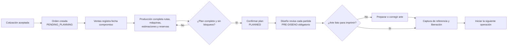
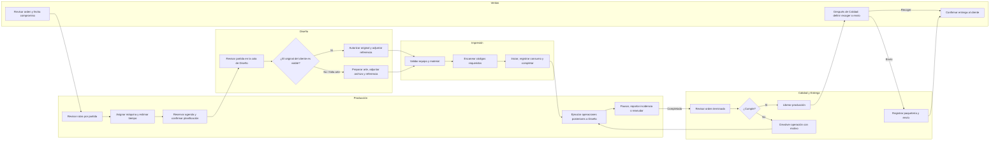
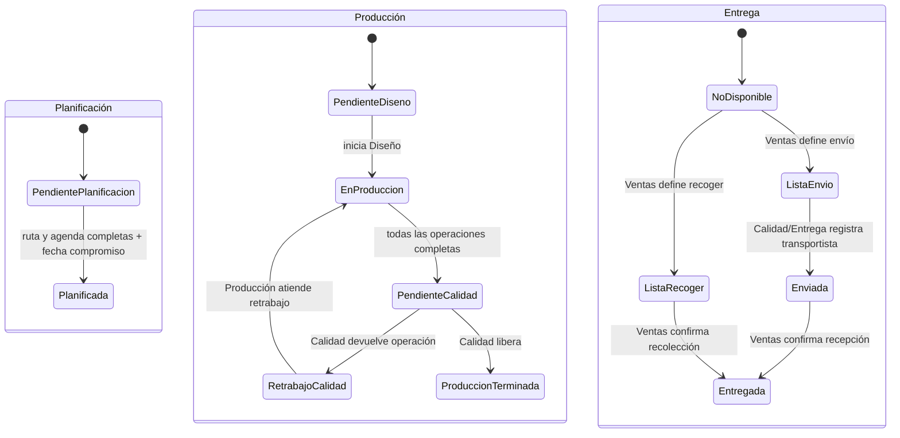

# Guía operativa de producción: de la planificación a la entrega

**PrintFlow · versión 11 de octubre de 2026**

Esta guía describe el flujo disponible en la aplicación para una orden de servicio creada desde una cotización aceptada. Está organizada por rol y por el orden en que debe avanzar el trabajo. Los nombres de los estados entre paréntesis son los que usa el sistema.

## Qué quiere decir «planificar»

La cotización aceptada ya genera la orden y copia la ruta operativa de cada partida. La orden queda en **Pendiente de planificación** (`PENDING_PLANNING`): significa que falta completar el plan del taller, no que falte crear la orden.

**Confirmar planificación** es el paso posterior de Producción. Confirma que cada partida tiene una ruta válida y sin bloqueos, que todas sus operaciones activas tienen una máquina compatible, duración estimada y reserva de agenda, y que Ventas ya registró la fecha compromiso. El sistema guarda quién confirmó y cuándo, cambia la orden a `PLANNED` y permite iniciar Diseño. No confirma el archivo de impresión ni significa que el trabajo ya se fabricó. Ventas confirma por separado la fecha compromiso; Diseño autoriza el arte más adelante.

## Vista rápida

1. **Ventas** revisa la orden creada desde la cotización aceptada y registra la fecha compromiso acordada con el cliente.
2. **Producción** revisa la ruta copiada para cada partida, completa máquinas, estimaciones y reservas; después confirma el plan operativo.
3. **Diseño** revisa todas las partidas, valida el archivo y las dimensiones aunque el cliente haya enviado un original, y libera el archivo correcto para impresión.
4. **Impresión y Producción** ejecutan las operaciones respetando la secuencia, registran pausas e incidencias y completan el trabajo.
5. **Calidad** libera la producción o devuelve una operación para retrabajo.
6. **Ventas** confirma si el cliente recogerá o recibirá un envío.
7. **Calidad/Entrega** registra la salida cuando es envío; **Ventas** confirma la entrega final al cliente.

## Cómo se muestra el progreso y la navegación

El detalle de la orden presenta cinco etapas —**Planificación, Diseño, Producción, Calidad y Entrega**— en una secuencia horizontal. La etapa **Planificación** corresponde al plan operativo posterior a crear la orden: fecha compromiso, ruta, máquinas, estimaciones y agenda. Cada etapa marca si está pendiente, en curso o completa; el encabezado resume el estado actual y el detalle indica qué falta. Durante producción se muestra cuántas operaciones ya terminaron. La vista conserva los datos comerciales detrás de `service_orders.view_commercial`; el progreso operativo no los requiere.

El menú **Operación** se agrupa por intención y solo muestra enlaces que el perfil puede usar:

- **Trabajo diario:** órdenes de servicio, Diseño, Impresión, Ejecución, Calidad y Entregas.
- **Planificación del taller:** rutas, jornada, equipos, operaciones y áreas.
- **Materiales y proveedores:** proveedores, materiales y categorías relacionadas.

La agrupación reduce el bloque de enlaces que ve cada perfil, sin crear permisos nuevos. Administradores con permisos amplios verán más opciones; Diseño u Operador verán principalmente su trabajo diario.

## 1. Ventas: revisar la orden y confirmar la fecha compromiso

**Dónde:** `Órdenes de servicio` → abrir la orden.

1. La aceptación ya creó esta orden. Comprueba que cliente, partidas, cantidades, características y archivos de origen copiados correspondan a la cotización aceptada.
2. Revisa el pronóstico que aparece en la orden. Si todavía no hay tiempos o agenda, el sistema indicará que falta planificar; aún no es una fecha de producción confiable.
3. Registra la fecha compromiso que Ventas acordó con el cliente. La primera fecha no requiere motivo; si cambias o eliminas una fecha ya guardada, escribe el motivo requerido. La recomendación del sistema considera **tres días laborables de margen** después del fin pronosticado, descontando fines de semana y días festivos globales configurados. Ventas confirma la fecha ofrecida al cliente según el compromiso comercial y la prioridad.
4. Guarda la fecha antes de que Producción marque la orden como planificada. Si se modifica después, indica el motivo del cambio para conservar el historial.

**Resultado esperado:** fecha compromiso visible y pronóstico con riesgo calculado cuando exista una agenda completa.

## 2. Producción: completar y confirmar la planificación

**Dónde:** `Órdenes de servicio` → abrir la orden → sección **Planificación operativa**.

1. Revisa cada partida y su ruta copiada desde el Producto. Atiende cualquier aviso de ruta incompleta o bloqueada antes de reservar.
2. Para cada operación, conserva el orden indicado y asigna una máquina compatible. Si solo existe una máquina compatible, la preparación automática puede asignarla; si hay varias, Producción elige una.
3. Verifica la carga y el tiempo estimado:
   - Se calcula automáticamente cuando la capacidad de la máquina está validada y la carga puede obtenerse de los datos de la partida.
   - Para corte, captura la trayectoria real en centímetros; para procesos lineales, captura los metros reales. **No deduzcas longitud de corte o recorrido únicamente a partir del número de piezas.**
   - Si faltan datos fiables o la máquina no tiene capacidad validada, captura minutos manuales y explica el dato que respalda la estimación.
4. Usa **Preparar automáticamente** para completar asignaciones únicas y cálculos posibles; revisa los avisos de lo que quedó pendiente.
5. Usa **Reservar agenda completa**. El sistema coloca las operaciones en secuencia, sin cruces en una misma máquina, dentro de la jornada configurada de **lunes a viernes, 08:00–18:00**. Una operación puede ocupar varios tramos o días.
6. Atiende los bloqueos y vuelve a reservar si hace falta. Usa **Confirmar planificación** solo cuando todas las partidas tengan ruta activa, máquina, tiempo estimado y reserva, y Ventas haya registrado la fecha compromiso.

La confirmación cambia el estado a `PLANNED`, registra actor y fecha, y cierra la preparación inicial de rutas, equipos, estimaciones y reservas para que Diseño pueda comenzar. No significa que la orden ya esté producida ni que el archivo esté aprobado. Si después hace falta cambiar la prioridad, Producción puede revisar el impacto y reprogramar trabajo futuro con el permiso correspondiente. Una operación que ya está activa no se interrumpe para adelantar otra.

**Resultado esperado:** orden planificada; Diseño puede iniciar la primera operación de la ruta.

## 3. Diseño: revisar y liberar cada partida

**Dónde:** menú **Diseño** → cola → abrir la partida pendiente.

1. Comprueba las instrucciones y descarga el archivo de origen del cliente si existe. Diseño debe revisar cada partida y validar que el original corresponda al Producto y a sus dimensiones; recibir un archivo no equivale a aprobarlo.
2. Inicia la revisión. No es necesario asignar la diseñadora como operadora: el acceso para revisar depende del permiso de Diseño.
3. Continúa por una de estas dos opciones:
   - **El archivo del cliente sirve para imprimir:** autoriza el original después de validar medidas y preparación, y adjunta la captura con el Producto de referencia.
   - **Hace falta preparar o corregir el arte:** adjunta el archivo listo para impresión y la captura con el Producto de referencia; agrega instrucciones útiles para Impresión.
4. Autoriza la liberación cuando el archivo adjunto sea exactamente el que debe producirse.

Todas las rutas nuevas comienzan con `PRE-DISENO` obligatorio, aunque el cliente envíe un archivo. Las rutas reutilizables pueden variar en sus operaciones posteriores a Diseño según las necesidades de cada Producto. Si falta el archivo o no cumple dimensiones, Diseño prepara o corrige el arte; si ya está listo, valida y autoriza ese original. En ambos casos la liberación adjunta la captura con el Producto de referencia y habilita la siguiente operación.

**Resultado esperado:** arte liberado y referencia disponible para Impresión.

## 4. Impresión: validar y ejecutar

**Dónde:** menú **Impresión** → cola → abrir la operación asignada.

1. Verifica que la liberación de Diseño corresponda a la partida y versión que vas a imprimir.
2. Revisa los requisitos de impresión y elige el equipo y el material válidos. Si se sustituye un requisito ya definido, puede requerirse autorización de Producción.
3. Escanea el código del equipo y el código del material para validar la configuración antes de comenzar. La captura manual requiere permiso especial de Producción.
4. Inicia la impresión cuando los requisitos estén validados y la operación esté disponible según su secuencia.
5. Al terminar, registra el consumo real y, si corresponde, el desperdicio y su motivo; completa el intento. Sigue la indicación de la pantalla para colocar y confirmar la etiqueta de salida cuando aplique.

**Resultado esperado:** impresión completada con salida, consumo y trazabilidad registrados; la siguiente operación queda disponible según su ruta.

## 5. Producción: ejecutar las demás operaciones

**Dónde:** menú **Ejecución** → cola de operaciones asignadas.

1. Abre la siguiente operación que te corresponde. El sistema respeta el orden de la ruta y restringe el inicio al operador asignado, salvo la revisión especial de Diseño.
2. Inicia el trabajo cuando la máquina y la partida estén listas.
3. Si tienes que detenerte, pausa la operación y escribe el motivo. La máquina queda libre; PrintFlow recalcula el pronóstico y las reservas afectadas para que otros trabajos puedan ocupar el espacio disponible.
4. Si existe una incidencia, registra su causa y resuélvela antes de reanudar. Reanudar depende de que la máquina esté disponible; no se desplaza una operación que ya está activa.
5. Al terminar, registra el tiempo real y completa la operación. Continúa con la siguiente etapa de la partida.

Una incidencia no debe usarse para detener una máquina en marcha: primero pausa la operación y después registra el bloqueo. La actualización de pausa, reanudación, finalización e incidencia recalcula el pronóstico y agenda relacionada. La orden pasa a **Pendiente de Calidad** cuando todas las operaciones activas de todas sus partidas están completas y no tienen incidencias abiertas.

**Materiales:** se pueden registrar previsiones y consumos si el usuario tiene el permiso específico; el módulo de inventario y el descuento automático de existencias siguen pospuestos. El registro operativo no significa que el inventario se haya actualizado.

## 6. Calidad: liberar o devolver para retrabajo

**Dónde:** menú **Calidad** → abrir la orden pendiente.

1. Revisa las partidas, las operaciones y la evidencia de trazabilidad.
2. Si todo cumple, libera la producción. No se libera una orden con operaciones incompletas, intentos abiertos o incidencias pendientes.
3. Si algo no cumple, devuelve la operación correspondiente con el motivo. Producción realiza el retrabajo y vuelve a completar las etapas indicadas; la orden regresa a Calidad para otra revisión.

**Resultado esperado:** estado **Producción terminada**, o una devolución de Calidad trazable que conserva el vínculo con la operación que debe corregirse.

## 7. Ventas y Calidad/Entrega: preparar y confirmar la entrega

**Dónde:** menú **Entregas** → abrir la orden.

1. Después de que Calidad libere Producción, **Ventas** define la modalidad:
   - **Recoger en sucursal**: la orden queda lista para recoger.
   - **Envío a domicilio**: la orden queda lista para envío. La cotización debe tener domicilio válido.
2. Para envío, **Calidad/Entrega** registra transportista y, si existe, código de rastreo. La orden pasa a **Enviada**.
3. **Ventas** confirma que el cliente recibió el pedido. Captura quién recibió si ese dato está disponible.
4. Para recolección, Ventas confirma la entrega cuando el cliente recoge el producto.

La confirmación final deja la entrega en estado **Entregada**. Los correos o avisos externos son acciones manuales por ahora; verifica por el canal acordado con el cliente cuando se requiera.

## Tabla de responsabilidades y accesos

| Rol | Acciones en este recorrido | Permisos principales comprobados en el código |
|---|---|---|
| Ventas (`ROLE_SALES`) | Ver la orden e importes comerciales; confirmar fecha compromiso; definir modalidad; confirmar entrega | `service_orders.view`, `service_orders.view_commercial`, `service_orders.commitment.manage`, `delivery.confirm` |
| Producción (`ROLE_PRODUCTION`) | Planificar rutas, equipos, estimaciones y agenda; ajustar prioridad/reprogramar; supervisar ejecución e incidencias | `service_orders.plan`, `service_orders.commitment.manage`, `production.priority.manage`, `production.schedule.reprogram`, `production.view`, `production.assign`, `production.execute` |
| Diseño (`ROLE_DESIGN`) | Consultar la cola; iniciar revisión; autorizar original o arte preparado; consultar/cargar archivos | `production.view`, `production.design.review`, `production.files.download`, `production.files.upload` |
| Operador (`ROLE_OPERATOR`) | Ver la cola propia; iniciar, pausar, reanudar y completar operaciones asignadas; usar el flujo de Impresión si corresponde | `production.view`, `production.execute`; la ejecución comprueba que el usuario esté asignado a la operación |
| Calidad/Entrega (`ROLE_QUALITY_DELIVERY`) | Revisar y liberar producción; devolver por retrabajo; registrar envíos | `quality.review`, `quality.release`, `quality.return`, `delivery.ship` |
| Administrador (`ROLE_ADMIN`) | Administración y apoyo de acceso | Todos los permisos del sistema |

Los nombres de roles describen perfiles de referencia; los permisos efectivos dependen de la configuración de cada cuenta. Si aparece una pantalla de **403 Sin permisos suficientes**, solicita al Administrador el permiso específico de la acción de la tabla. No compartas una cuenta para continuar el flujo.

## Estados que verás

La orden lleva tres estados relacionados pero distintos: planificación, producción y entrega. Por ejemplo, **Producción terminada** no significa todavía **Entregada**.

## Si el flujo se detiene

| Lo que ves | Qué revisar / quién actúa |
|---|---|
| “Falta estimar y reservar” o no aparece pronóstico | Producción verifica máquina compatible, capacidad, carga, minutos y reserva en agenda. |
| “No hay máquina compatible” | Producción revisa las áreas y equipos del catálogo o solicita el ajuste del catálogo al Administrador. |
| No se puede confirmar planificación | La orden ya fue creada; falta completar el plan operativo. Debe existir fecha compromiso y cada partida requiere ruta activa sin bloqueos; cada operación necesita equipo compatible, estimación y reserva. |
| Diseño no puede iniciar | Confirma que la orden esté planificada y que Diseño sea la primera etapa activa de esa partida; revisa `production.design.review`. |
| Impresión no puede comenzar | Confirma liberación de Diseño, requisitos de equipo/material, escaneos válidos, secuencia disponible y `production.execute`. |
| No se puede reanudar | Resuelve primero la incidencia y revisa si la máquina está libre y si la reserva puede reprogramarse. |
| Calidad no puede liberar | Comprueba operaciones activas completas y que no haya intentos abiertos, bloqueos o incidencias sin resolver. |
| Ventas no puede preparar entrega | Calidad debe haber liberado Producción; para envío, confirma que la orden tenga domicilio. Revisa `delivery.confirm`. |
| No aparece el botón o hay un 403 | Pide al Administrador revisar el permiso concreto que exige esa acción y el rol asignado. |

## Límites actuales del flujo

- El sistema pronostica con base en estimaciones y reservas; la fecha compromiso la confirma Ventas. La recomendación añade tres días laborables de margen, pero el criterio comercial final sigue siendo de Ventas.
- Diseño es una etapa obligatoria para todas las partidas. El archivo del cliente se revisa y autoriza allí; las rutas por Producto pueden cambiar después de `PRE-DISENO`, que debe permanecer como primer paso obligatorio.
- El calendario operativo es lunes a viernes de 08:00 a 18:00, en la zona `America/Mexico_City`; considera también las excepciones y días festivos configurados.
- El ajuste de prioridad y los retrabajos mantienen evidencia de auditoría; el cambio de prioridad desplaza trabajo futuro tras revisar su impacto y no interrumpe una operación activa.
- Los importes comerciales son visibles para Ventas y perfiles autorizados; las cuentas operativas deben trabajar con información de producción sin importes finales.
- Inventario integrado, avisos automáticos por correo y cambios de diseño visual del flujo siguen fuera del alcance de esta guía.

## Referencias de implementación

Controladores que respaldan los pasos descritos:

- `src/Controller/Admin/Orders/ServiceOrderController.php`
- `src/Controller/Admin/Production/DesignController.php`
- `src/Controller/Admin/Production/PrintingController.php`
- `src/Controller/Admin/Production/ProductionExecutionController.php`
- `src/Controller/Admin/Production/QualityDeliveryController.php`
- `src/Application/Orders/ProductionRoutePolicy.php` y `src/Application/Production/CommercialItemRoutePublisher.php` — validan que las rutas publicadas inicien con Diseño obligatorio.
- `src/Application/Production/DesignReviewManager.php` — controla la revisión y liberación del arte después de planificar la orden.

Servicios que validan planificación, pronóstico, ejecución, calidad y reprogramación:

- `src/Application/Orders/ServiceOrderManager.php`
- `src/Application/Production/ProductionPlanManager.php`
- `src/Application/Production/ProductionCommitmentForecaster.php`
- `src/Application/Production/ProductionExecutionManager.php`
- `src/Application/Production/ProductionIncidentManager.php`
- `src/Application/Production/ProductionQualityDeliveryManager.php`
