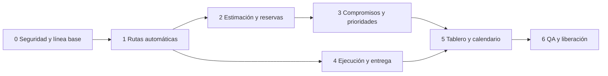

# PrintFlow — historias de usuario y fases de desarrollo de producción

**Versión:** 1.3 · **Fecha:** 11 de octubre de 2026 · **Fuente funcional:** [FSD de producción y trazabilidad](../definicion/FSD-produccion-y-trazabilidad.md).

> **Estado y precedencia:** esta es la secuencia de fases del producto. Los documentos fechados de `implementacion/` son registros históricos y su numeración no corresponde a estas fases. Las decisiones incorporadas después del FSD se reflejan aquí y en la [guía operativa](../operacion/guia-operativa-planificacion-a-entrega.md). El [estado actual](../estado-actual.md) separa código local, evidencia de pruebas y datos de producción.

Este backlog implementa las reglas acordadas sin reconstruir cotizaciones, descuentos u órdenes en otra arquitectura. Cada historia se cierra con evidencia de prueba; la fase anterior es dependencia de la siguiente cuando comparte datos o permisos. Las estimaciones de esfuerzo se asignarán tras verificar esquema, datos y despliegue reales.

## Definiciones de flujo vigentes

- **Crear la orden** ocurre a partir de la cotización aceptada. PrintFlow copia cada partida y la ruta publicada para el Producto. La orden queda en `PENDING_PLANNING`; ya existe, pero su plan operativo aún no está confirmado.
- **Confirmar la fecha compromiso** corresponde a Ventas: guarda la fecha acordada con el cliente. No confirma por sí misma que la agenda del taller esté reservada.
- **Confirmar planificación** corresponde a Producción después de revisar todas las partidas. Exige fecha compromiso, ruta sin incidencias, máquina compatible, duración y reserva para cada operación activa. Registra actor/fecha, cambia la orden a `PLANNED` y habilita el inicio de Diseño. No significa que comenzó la fabricación ni que se aprobó el arte.
- **Diseño siempre revisa cada partida.** Aunque el cliente entregue un archivo, Diseño valida que sea imprimible y corresponda a las dimensiones; lo autoriza y adjunta la captura con el Producto de referencia. Si hace falta corregir o preparar el arte, Diseño deja también la versión final lista para impresión. La ruta publicada de cada Producto debe comenzar con `PRE-DISENO` obligatorio; puede cambiar los pasos posteriores según el producto.
- **Rutas de producción** son configuraciones reutilizables aplicadas por Producto. La ruta y sus operaciones se copian a la partida al crear la orden; actualizar una ruta publicada no cambia órdenes ya creadas.

La interfaz actual puede llamar a esta etapa simplemente «Planificación». Al explicar el flujo, especificar «plan operativo» ayuda a distinguirlo de la creación de la orden y de la fecha comercial acordada.

## Simplificación de operadores y tiempos

> **Estado:** implementada y migrada en la base local (`Version20261011150000`); queda pendiente desplegarla en producción. Los valores concretos de cada Producto quedan por capturar con referencias reales de Producción.

### Asignación de operadores

Producción puede asignar o cambiar el responsable de una operación con máquina reservada mientras no haya iniciado, tanto durante `PENDING_PLANNING` como después de pasar a `PLANNED`. La acción usa `production.assign`, valida cuentas activas con `ROLE_OPERATOR` y conserva auditoría. `PRE-DISENO` sigue administrándose con el permiso de Diseño. La asignación en lote cubre operaciones reservadas sin responsable y sin intentos de ejecución; los cambios de una sola operación permiten corregir la asignación antes de iniciar.

### Estimaciones por secuencia

Cada paso de la ruta publicada por Producto puede guardar minutos base por partida y minutos variables por unidad. Al crear la orden, la regla se copia al snapshot del paso y se calcula `ceil(base + minutos_por_unidad × cantidad)`. Si la regla no está configurada, se mantiene el flujo actual de capacidad física o estimación manual justificada. Al reservar, una capacidad de máquina validada y una carga obtenible sustituyen el estándar por el cálculo físico. Las pausas de ejecución siguen excluidas; en corte no se infieren centímetros de trayectoria a partir de piezas o área. La división de una partida vuelve a calcular los estándares por la cantidad de cada hija.

No se asignaron tiempos iniciales: deben capturarse por Producto cuando Producción tenga referencias confiables. El tiempo real visible se calcula desde `active_seconds` de los intentos; la corrección manual permanece disponible como excepción auditada.

**Resultado:** la orden hereda ruta, tiempo estándar y cálculo sin pedir minutos por secuencia. Producción revisa la máquina y solo captura información cuando no hay estándar ni medición automática confiable.

## Principios de entrega

- Extender `ServiceOrderManager::createFromAcceptedQuotation`, `ServiceOrderItem` y `ServiceOrderOperationPlan` actuales.
- Vincular rutas al Producto del cotizador (`CommercialItem`). Investigar la tabla `products` existente antes de crear una relación adicional.
- Mantener importes comerciales en la orden y crear salidas operativas explícitamente libres de dinero.
- Usar nuevas migraciones; no modificar migraciones ya ejecutadas ni sobrescribir cambios locales fuera del alcance.
- Mantener el cálculo de capacidad, promesa y permisos en Symfony; DayPilot Lite solo muestra datos y solicita cambios.
- No crear movimientos, existencias, reservas o alertas de inventario ni correo automático al cliente en este alcance.

## Fase 0 — seguridad y línea base

**Objetivo:** eliminar la exposición monetaria actual y obtener una base verificable antes de abrir Producción a empleados.

**Estado registrado (10 de octubre de 2026):** el despliegue inicial de las rutas y las funciones probadas se reportó operativo. La evidencia disponible en el repositorio incluye pruebas locales de separación comercial. Esta anotación no certifica por sí sola migraciones, permisos ni esquema productivo posteriores; consulta el [estado actual](../estado-actual.md) y el runbook antes de una liberación.

**Comandos y despliegue:** seguir el [runbook de validación y despliegue en Hostinger](../operacion/validacion-y-despliegue-hostinger.md). Sus consultas de base son de solo lectura; la secuencia de despliegue requiere un commit revisado, confirmar la raíz `public/` y revisar el dry run de migraciones. El procedimiento de liberación no incluye respaldos.

| ID | Historia | Criterio de terminado |
| --- | --- | --- |
| PF-P0-01 | Como responsable técnico, quiero conocer migraciones aplicadas, tablas, permisos efectivos y datos de equipos por entorno para migrar sin perder historia. | Se documentan estado local/Hostinger, `role_permissions`, versión de esquema, registros existentes y diferencias; ninguna migración histórica se reescribe. |
| PF-P0-02 | Como empleado, quiero consultar órdenes/trabajos sin recibir importes comerciales. | **Validación local aprobada:** `ServiceOrderCommercialAccessTest` pasa con 4 pruebas y 195 aserciones. `service_orders.view` no basta para ver importes; la plantilla los condiciona a `service_orders.view_commercial`, que se asigna a Ventas/Administración. `ROLE_OPERATOR` recibe lectura operativa. Al habilitar nuevas exportaciones, adjuntos o bitácoras para empleados, sus proyecciones y permisos también deberán probarse. |
| PF-P0-03 | Como responsable técnico, quiero una regresión de cotización aceptada → orden única y del cálculo comercial vigente. | Pruebas verifican aceptación, POST con CSRF, doble solicitud, partidas/snapshots, PDF comercial bajo permiso y ausencia de cambios en descuentos. La suite de PHP vuelve a ejecutar en entorno de prueba. |
| PF-P0-04 | Como jefe, quiero confirmar las capacidades de las cinco máquinas antes de prometer fechas. | Ficha validada con unidad, ancho útil, tecnología, rendimiento real inicial y preparación; cualquier dato no confirmado permanece no estimable. |

**Puerta de salida:** ningún rol operativo puede obtener importes mediante `service_orders.view` u otra ruta accesible; esquema y permisos aplicados están documentados; la regresión comercial pasa. No cerrar hasta verificar el entorno real y ejecutar las pruebas funcionales.

## Fase 1 — rutas automáticas por Producto y partida

**Objetivo:** crear una orden con trabajo y ruta técnica ya definidos, sin pedir que el jefe capture cada paso.

| ID | Historia | Criterio de terminado |
| --- | --- | --- |
| PF-P1-01 | Como jefe/Administrador, quiero definir rutas base reutilizables y asignarlas a varios Productos. | Se configuran secuencia, operación activa, condición, obligatoriedad y variantes sencillas; cada Producto publica una versión inequívoca. Un Producto puede ajustar su configuración sin alterar otros. |
| PF-P1-02 | Como jefe/Administrador, quiero que cada partida llegue a la revisión de Diseño sin asignar a la diseñadora como operadora. | La ruta inicial pasa por `PRE-DISENO`; el perfil con `production.design.review` valida el archivo aportado o carga arte preparado. En ambos casos adjunta una captura de referencia. La siguiente etapa queda bloqueada hasta liberar Diseño. |
| PF-P1-03 | Como sistema, quiero generar un trabajo y sus pasos por cada `ServiceOrderItem` al crear la orden. | El caso de uso existente genera ruta y snapshot en su transacción; doble clic/concurrencia no duplican orden, trabajo ni planes. Folio y vínculos históricos permanecen. |
| PF-P1-04 | Como jefe, quiero identificar partidas sin ruta o datos completos sin inventar un plan. | La orden se crea y el trabajo muestra causa de «requiere planificación/estimación»; no hay reserva ni pronóstico ficticio. |
| PF-P1-05 | Como jefe, quiero corregir medidas técnicas y dividir una partida cuando producción lo requiera. | Corrección/división solo durante planificación, con permiso, CSRF y motivo; la cotización queda intacta; las hijas sustituyen la fila para Ventas, conservan cantidad/subtotal total y FK original única; revisión de ruta requerida tras corregir medidas. |

**Puerta de salida:** prueba de extremo a extremo desde una cotización aceptada hasta los pasos generados; versiones nuevas no modifican trabajos existentes; la ruta manual actual permanece como excepción autorizada durante la transición.

**Estado de Fase 1 (10 de octubre de 2026):** se reportó en producción el despliegue inicial y el funcionamiento de las funciones probadas. El código conserva rutas publicadas por `CommercialItem`, snapshots y las correcciones/divisiones de partidas. Mantener en regresión los casos integrados de cotización aceptada → orden → ruta y el guardado de ruta desde la interfaz.

## Fase 2 — estimación, máquinas y calendario laboral

**Objetivo:** convertir cargas físicas en tiempo de máquina y reservar huecos sin solapes.

| ID | Historia | Criterio de terminado |
| --- | --- | --- |
| PF-P2-01 | Como jefe/Administrador, quiero registrar capacidad numérica por equipo/operación y máquinas alternativas. | Unidad, valor, ancho, preparación, eficiencia y vigencia son estructurados; la ficha textual histórica se conserva; equipos inactivos o de operación/área inactiva no se proponen. |
| PF-P2-02 | Como sistema, quiero estimar impresión, laminado y corte con su unidad física correcta. | Pruebas de m²/h, metros lineales/h y cm/s incluyen conversiones, preparación y ancho; piezas o área sin longitud de trayectoria no producen tiempo de corte. |
| PF-P2-03 | Como jefe, quiero dar una estimación manual justificada al corte sin vector medible u otra excepción. | Se guardan actor, motivo, datos disponibles, minutos y versión; el valor manual se distingue del calculado y se puede comparar con tiempo real. |
| PF-P2-04 | Como jefe/Administrador, quiero configurar lunes a viernes 08:00–18:00, feriados, mantenimiento, averías y horas extraordinarias autorizadas. | Agenda excluye fuera de jornada por defecto; excepciones por máquina/fecha muestran actor/motivo y recalculan reservas futuras afectadas. |
| PF-P2-05 | Como sistema, quiero elegir una máquina compatible y reservar tramos diarios respetando la secuencia. | Trabajo de varios días se divide en segmentos; no inicia antes del predecesor; prueba concurrente demuestra cero solapes de máquina. |
| PF-P2-06 | Como jefe, quiero asignar operador después de reservar máquina. | Plan inicial puede tener máquina y no responsable; solo jefe/Administrador asignan o reasignan con historia. |

**Puerta de salida:** casos medidos reales validan el estimador; hay prueba de trabajo de 24 horas distribuido en jornadas de diez horas y de colisión concurrente de reservas.

**Estado de Fase 2 (10 de octubre de 2026):** el código incorpora rendimiento numérico validado en la ficha del equipo, tiempos de preparación y limpieza, factor de eficiencia y vigencia; mantiene la capacidad textual anterior sin convertirla. El área de impresión se obtiene de medidas por cantidad. Los metros lineales de laminado y los cm de trayectoria de corte se capturan como cargas físicas explícitas; no se infiere longitud de corte desde área o número de piezas. También hay estimación manual auditada, registro de tiempo real, jornada 08:00–18:00, feriados, mantenimiento, averías, horas extra autorizadas, reservas divididas por día, secuencia, exclusión de solapes mediante bloqueo transaccional de máquina y asignación posterior de operador. La última salida explícita de Hostinger en el registro compartido confirmó `Version20261010150000` y 44 migraciones aplicadas. La suite de unidad de Producción pasó con **13 pruebas y 16 aserciones**; la prueba de reservas concurrentes contra MySQL quedó pendiente. El calendario visual, las prioridades y el riesgo corresponden a fases posteriores.

## Fase 3 — compromisos, prioridades y reprogramación

**Objetivo:** mostrar cuándo se terminará, añadir margen comercial y gestionar urgencias sin interrumpir máquina activa.

| ID | Historia | Criterio de terminado |
| --- | --- | --- |
| PF-P3-01 | Como Ventas, quiero una fecha sugerida de entrega con tres días laborales de margen después del fin previsto. | El cálculo usa calendario del negocio; distingue fin de producción, sugerencia y fecha pactada. La primera fecha puede confirmarse sin motivo; los cambios posteriores requieren motivo y muestran el riesgo. |
| PF-P3-02 | Como jefe/Administrador, quiero prioridades Normal, Alta y Urgente. | Normal es predeterminada; Urgente o cambio posterior exigen motivo; el orden de cola tiene desempate estable. |
| PF-P3-03 | Como jefe/Administrador, quiero previsualizar el efecto de una urgencia y confirmarlo. | Se ven máquina, tramos desplazados, nuevas fechas y riesgos; solo reservas futuras no iniciadas se mueven. Activas, mantenimiento y fijadas permanecen. Confirmación audita la versión del plan. |
| PF-P3-04 | Como jefe, quiero detectar riesgo por partida y orden. | Pronóstico, compromiso, holgura y causa generan alerta en tablero/calendario; prioridad y riesgo tienen indicadores distintos. No hay correo automático de alerta. |
| PF-P3-05 | Como responsable de Producción, quiero completar la planificación viendo solo pendientes y usar una reserva conjunta. | El detalle muestra progreso de máquina/tiempo/agenda/compromiso; muestra disponibilidad y término por máquina compatible respetando secuencia y calendario; sugiere la única máquina seleccionable con horario proyectable y, entre varias, precarga solo la que termina estrictamente antes; deja elegir cuando hay empate; estima cargas derivables y solicita solo la carga física ausente; mantiene ajustes y excepciones plegados; reserva toda la orden de forma atómica, secuencial y sin solapes; permite la primera fecha sin motivo y requiere motivo al cambiarla; no expone importes al personal operativo. |

**Puerta de salida:** simulación con trabajo activo, reserva futura Normal y nueva Urgente muestra que la Urgente toma el próximo hueco válido, la Normal se reubica sin solapes y ambas fechas/alertas se recalculan; cancelar la vista previa no modifica datos.

**Estado de Fase 3 (11 de octubre de 2026):** se implementaron fecha sugerida con margen laboral, indicador de riesgo, compromiso editable con motivo y auditoría, prioridad por partida, vista previa de desplazamientos y riesgos, protección de trabajos iniciados/reservas fijadas y bloqueo de cambios de agenda. El runbook registra validación local posterior: suite de Producción con **17 pruebas y 25 aserciones** y `ServiceOrderCommercialAccessTest` con **9 pruebas y 347 aserciones**. Se reportó un error al convertir fechas al confirmar prioridad en producción; la corrección se incorporó y cubrió en local. El intento productivo demuestra que la ruta se ejecutó, no que la reprogramación corregida o su estado de migraciones estén certificados. La concurrencia MySQL y una nueva comprobación productiva siguen pendientes. La vista diaria/semanal con filtros permanece en Fase 5.

**Actualización UX (11 de octubre de 2026):** se simplifica el detalle de orden según PF-P3-05 antes de avanzar a la siguiente fase. La interfaz agrupa preparación automática y reserva de la orden, pide solo datos faltantes, mantiene excepciones plegadas y exige motivo únicamente al cambiar una fecha compromiso existente. La reserva de toda la orden debe conservar atomicidad MySQL y verificarse en el entorno funcional antes de despliegue.

**Actualización de disponibilidad de equipos (11 de octubre de 2026):** el detalle ahora presenta inicio y término previstos para cada máquina compatible y recomienda solo cuando la agenda y los datos de estimación muestran una ventaja estricta. Un empate se muestra como empate, y la selección sigue requiriendo guardado explícito; la vista previa no reserva ni desplaza trabajos. El registro local, las pruebas y la limitación de validación HTTP están en [disponibilidad y recomendación de equipos](../implementacion/2026-10-11-disponibilidad-y-recomendacion-de-equipos.md). Esta mejora todavía requiere recorrido funcional antes de despliegue.

La interfaz actual también presenta una barra de avance por etapas con el siguiente paso pendiente y agrupa la navegación de Operación en secciones por tarea y permisos. Esto prepara el recorrido diario, pero no sustituye el tablero de calendario de Fase 5.

## Fase 4 — ejecución, calidad y entrega

**Objetivo:** saber qué se hace, quién lo atiende, qué sigue y por qué se detuvo.

| ID | Historia | Criterio de terminado |
| --- | --- | --- |
| PF-P4-01 | Como operador, quiero ver todos los trabajos y ejecutar solo mis pasos asignados. | GET operativo muestra todos sin importes; POST de paso ajeno se deniega. Estado base: Pendiente, Listo, En curso, Pausado, Bloqueado, Completado. |
| PF-P4-02 | Como jefe/Administrador, quiero registrar y resolver bloqueos, pausas e incidencias. | Cada transición valida estado y pertenencia, exige motivo cuando aplica, conserva actor/UTC e historial y actualiza pronóstico y agenda. |
| PF-P4-03 | Como jefe/Administrador, quiero enviar a retrabajo una operación rechazada en calidad. | Se crea nuevo intento ligado al anterior, sin borrar paso/evento ejecutado; causa, autor y resultado son visibles. |
| PF-P4-04 | Como empleado, quiero consultar material previsto y usado. | Se registra nombre, cantidad y unidad manualmente; no consulta ni modifica stock. |
| PF-P4-05 | Como responsable de producción, quiero cerrar la fabricación y que Ventas confirme la entrega aparte. | «Producción terminada» exige pasos requeridos completos y bloqueos resueltos; solo Ventas con permiso confirma «Entregado». Ningún hito envía correo automático. |
| PF-P4-06 | Como empleado, quiero acceder a archivos de producción autorizados. | Previsualización/descarga requiere permiso en servidor; no se expone ruta física ni PDF comercial, y reemplazos relevantes conservan historia. |

**Puerta de salida:** recorrido completo con dos roles desde orden hasta producción terminada y entrega; transiciones inválidas, acceso a pasos ajenos y descargas no autorizadas se rechazan.

**Avance registrado (11 de octubre de 2026):** PF-P4-02 incorpora liberación de huecos por pausa/incidencia, suspensión del pronóstico, recuperación de agenda al resolver/reanudar, cálculo del tiempo restante y protección de trabajo activo y reservas fijadas. PF-P4-05 asigna `delivery.confirm` a Ventas y lo retira de Calidad/Entrega en migración y bootstrap. Las fechas de intentos se leen como UTC. El comando idempotente para Mesa de preprensa y Estación de acabados reutiliza los catálogos existentes y conserva estimación manual. El paso `PRE-DISENO` no requiere operadora asignada; la acción depende del permiso `production.design.review`. Las pruebas locales y el procedimiento están en el [registro técnico de agenda y permisos](../implementacion/2026-10-11-agenda-y-permisos.md). El recorrido completo y la migración en producción no están certificados por ese registro.

## Fase 5 — tablero y calendario DayPilot Lite

**Objetivo:** dar una vista diaria útil al empleado y herramientas de filtrado/reprogramación al jefe.

| ID | Historia | Criterio de terminado |
| --- | --- | --- |
| PF-P5-01 | Como empleado, quiero ver el día seleccionado con todas las máquinas en columnas. | DayPilot Lite Calendar muestra horas 08:00–18:00 y reservas por máquina, navegación por fecha, estado, tarea activa y alerta; funciona en escritorio y ofrece lectura usable en móvil. |
| PF-P5-02 | Como jefe, quiero filtrar por día, máquina, área, operación, estado, prioridad, responsable, orden, Producto y riesgo. | Filtros se aplican en consulta servidor y resumen; no alteran reservas ni exponen datos comerciales. |
| PF-P5-03 | Como jefe, quiero un resumen semanal por máquina. | DayPilot Lite Scheduler muestra máquinas como filas y lunes a viernes en línea temporal horizontal, con carga libre/reservada/ejecutada y alertas. |
| PF-P5-04 | Como usuario autorizado, quiero abrir una reserva y entender trabajo, paso y próximo destino. | Cada segmento enlaza a detalle operativo y lleva folio, operación, horas, prioridad y riesgo sin importes. |
| PF-P5-05 | Como jefe/Administrador, quiero mover una reserva futura desde calendario con seguridad. | La UI pide vista previa y confirmación; el servidor valida permiso, CSRF, jornada, dependencia, compatibilidad, plan vigente y solapes. Ante conflicto revierte la acción visual. |

**Puerta de salida:** integración local con AssetMapper/Stimulus sin CDN de producción; calendario, JSON y DOM se verifican con cuentas de Operador y jefe. No se incorpora ningún plugin Premium de FullCalendar.

**Avance local (18 de octubre de 2026):** se añadió DayPilot Lite como activo local con licencia y atribución, la vista diaria por máquina, el resumen semanal horizontal, filtros y proyección JSON operativa, pendientes sin horario, detalle de tramo y vista previa/confirmación de movimientos con bloqueo de agenda, auditoría y validación de jornada, excepciones, solapes y dependencias. La reubicación entre máquinas se restringe a un tramo futuro sin ejecución ni estimación calculada; Impresión conserva el cambio de equipo en su propio flujo de validación. La puerta de salida sigue abierta hasta recorrer calendario, JSON, DOM y movimientos con cuentas de Operador y jefe y una base de datos configurada.

## Fase 6 — QA, datos existentes y liberación

| ID | Historia | Criterio de terminado |
| --- | --- | --- |
| PF-P6-01 | Como responsable técnico, quiero migraciones seguras y reversibilidad documentada. | Se prueban sobre copia de datos, índices/FK y restricciones, permisos semilla, ruta faltante y órdenes históricas sin ruta; no hay cambio destructivo de snapshots. |
| PF-P6-02 | Como responsable de seguridad, quiero demostrar aislamiento comercial. | Matriz de roles comprueba HTML, `data-*`, JSON/AJAX, calendario, PDF, exportación, adjuntos, bitácora y URLs directas; no hay importes ni valores que permitan deducirlos. |
| PF-P6-03 | Como responsable de operaciones, quiero confiar en fechas y trazabilidad. | Pruebas cubren zona UTC/México, feriados, extraordinarios, varios días, máquina en mantenimiento, concurrencia, urgencia, retrabajo, creación única, snapshots y auditoría. |
| PF-P6-04 | Como responsable de despliegue, quiero liberar sin interrumpir el ciclo comercial. | Estado de migraciones, ejecución revisada, compilación AssetMapper, caché y smoke test en Hostinger; se confirma cotización → aceptación → orden y acceso por roles. |

## Orden de implementación y dependencias

La primera entrega utilizable puede cerrar Fases 0–2: orden con ruta, estimación y reservas. La vista operativa y ejecución completa requieren Fases 4–5 antes de exponerlas a empleados. No declarar terminada una fase solo porque su pantalla exista: sus permisos, transacciones, migraciones y pruebas son parte del criterio de terminado.

## Riesgos concretos que gobiernan la planificación

1. **Exposición de precios detectada:** las vistas locales ya condicionan importes con `service_orders.view_commercial`; aún no se confirma si la nueva migración está aplicada en ningún entorno.
2. **Dos modelos de Producto:** el cotizador usa `CommercialItem`; `Product` existe pero no se encontró en la ruta de cotización/orden. Evitar rutas duplicadas y documentar el vínculo futuro si se necesita.
3. **Capacidad textual:** las cinco velocidades sembradas requieren validación y factores reales; no importarlas automáticamente como rendimiento efectivo.
4. **Restricción única de operación por partida:** ruta inicial v1 no repite operación. Retrabajo se modela como intento, preservando historia. Revisar índice si se acuerdan repeticiones de ruta en el futuro.
5. **Verificación de entorno por fecha:** la última salida explícita de migraciones Hostinger recogida en el runbook fue `Version20261010150000`. Reportes posteriores muestran peticiones a rutas más nuevas, pero no sustituyen el estado de migraciones, la consulta de permisos ni el smoke test. Verificar los tres contra el checkout objetivo antes de liberar.
6. **Licencias y legibilidad:** DayPilot Lite cumple día por máquina y semana horizontal por máquina bajo Apache 2.0. Una semana con día × máquina en columnas necesitaría otra composición y no forma parte de esta entrega; FullCalendar Scheduler v3 o actual no constituye una alternativa gratuita para el uso comercial cerrado.
